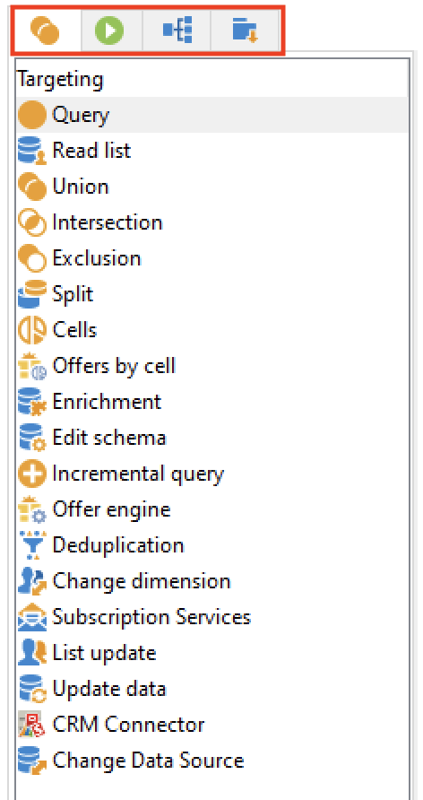

# ワークフローアクティビティ{#wf-activities}

ワークフローアクティビティは、4 つの異なるタブで、カテゴリ別にグループ化されます。

ユーザーの権限、実装環境、ワークフローが設計されたコンテキストに応じて、使用可能なアクティビティは異なる場合があります。

例えば、キャンペーンで作成されたワークフローでは、特定の「**配信**」タブにすべてのチャネルが表示されます。 このタブは、[テクニカルワークフロー](technical-workflows.md)では表示されません。

テクニカルワークフローでは、[キャンペーンワークフロー](campaign-workflows.md)には表示されない特定の「**イベント**」タブが表示されます。

テクニカルワークフローの「

すべてのアクティビティについて、以下の節で詳しく説明します。

* [ターゲティングアクティビティ](targeting-activities.md)
* [フロー制御アクティビティ](flow-control-activities.md)
* [アクションアクティビティ](action-activities.md)
* [イベントアクティビティ](event-activities.md)
* [キャンペーンワークフロー固有のアクティビティ](../campaigns/marketing-campaign-deliveries.md)
