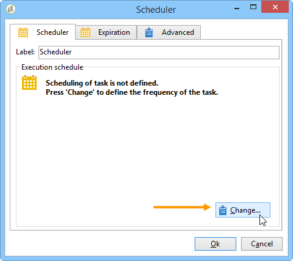
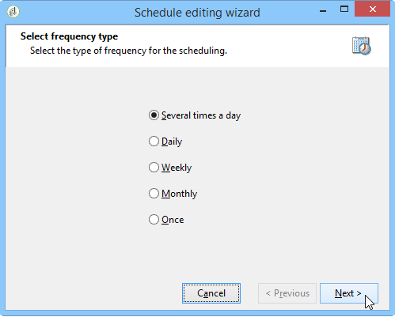
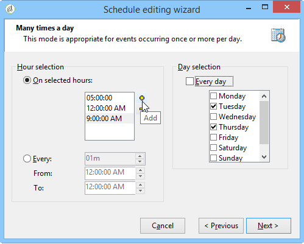
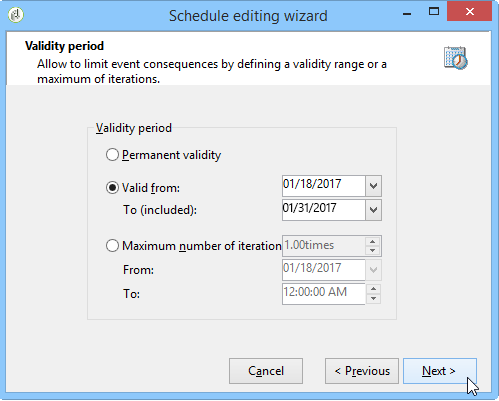
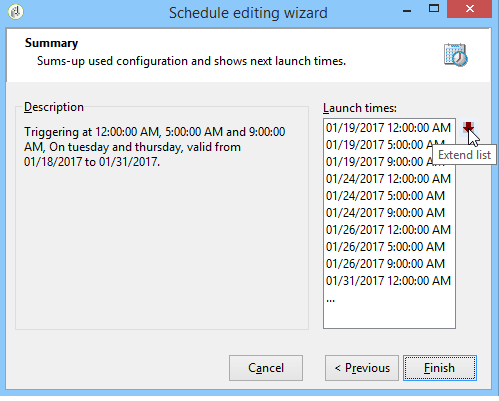

# スケジューラー {#scheduler}

**スケジューラー**&#x200B;は、スケジュールで指定された時間にトランジションを有効化する永続的なタスクです。

「**[!UICONTROL スケジューラー]**」アクティビティは、予約済みの開始とみなされます。 アクティビティのグラフ内の配置ルールは、「**[!UICONTROL 開始]**」アクティビティのルールと同じものです。 このアクティビティはインバウンドトランジションを持つことはできません。

## ベストプラクティス {#best-practices}

**スケジューラーのタイミングを変更した後、ワークフローを再開** - **[!UICONTROL スケジューラー]**&#x200B;アクティビティのスケジュールされた時間を変更する際は、ワークフローを再開することが重要です。 これにより、ワークフローは更新した時間に実行されます。 再開しないと、ワークフローは古いスケジュールに従って引き続き実行されます。

**スケジューラーの頻度を制限** - ワークフローが15 分間隔よりも頻繁に実行するようにスケジュールされないようにします。 実行頻度が増えると、システムのパフォーマンスが低下し、データベースの輻輳が発生する可能性があります。

**分岐ごとに 1 つのスケジューラーを使用** - ワークフローの各分岐には、**[!UICONTROL スケジューラー]**&#x200B;アクティビティを 1 つのみ設定する必要があります。 ワークフローでアクティビティを使用する際のベストプラクティスについて詳しくは、[ワークフローのベストプラクティスページ](workflow-best-practices.md#using-activities)を参照してください。

**ワークフローの同時実行を防止** - ワークフローがスケジューラーによってトリガーされる場合、ワークフローの複数のインスタンスが同時に実行される可能性があります。 例えば、スケジューラーが1時間ごとにワークフローをトリガーするが、ワークフローの実行に1時間以上かかる場合、実行が重複する可能性があります。これを回避するには、複数の同時実行を防ぐためのチェックを設定することを検討してください。 [複数のワークフローの同時実行を防ぐ方法の詳細情報](monitor-workflow-execution.md#preventing-simultaneous-multiple-executions)

**遅延トランジションを考慮** - ワークフローが長時間実行タスク（インポートなど）を実行している場合や、wfserver モジュールが一時的に停止している場合、スケジューラーによってトリガーされるトランジションが遅延する可能性があります。 これを軽減するには、スケジューラーのアクティブ化時間を制限し、定義された時間枠内でタスクが実行されるようにします。

## 「スケジューラー」アクティビティの設定 {#configuring-scheduler-activity}

スケジューラーは、トランジションの有効化スケジュールを定義します。 設定するには、グラフィックオブジェクトをダブルクリックして、「**[!UICONTROL 変更...]**」をクリックします。

ウィザードを使用して、アクティビティの頻度と有効期限を定義できます。 設定手順は、以下のとおりです。

1. 有効化の頻度を選択し、「**[!UICONTROL 次へ]**」をクリックします。

   

1. 有効化する時間と曜日を指定します。 この手順のパラメーターは、前の手順で選択した頻度によって決まります。 アクティビティを 1 日に何度も起動するように選択した場合、設定は以下のようになります。

   

1. スケジュールの有効期限を定義するか、実行回数を指定します。

   

1. 設定を確認して、「**[!UICONTROL 完了]**」をクリックして保存します。

   
