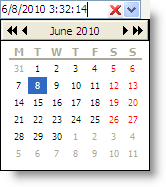

# 日時

日時タイプ コントロールを使用すると、日付と時刻を入力できます。

## プロパティ

**backColor – 文字列**&#x200B;背景色（btnshasow、白）。

**border - string** コントロールの境界線スタイルを変更します（solid、double、inset、outset、none）。

**font-size - integer** フォントサイズを変更します。

**label – 文字列**&#x200B;関連ラベル。

**ノーラベル – ブール値**&#x200B;関連するラベルを非表示にします。

**readOnly - ブール値**&#x200B;は、コントロールを強制的に読み取り専用にします。

**必須 – ブール値** フィールドは必須です。
