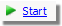

# SubFormLink

サブフォームを開くリンク。



## プロパティ

**backColor – 文字列**&#x200B;背景色（btnshadow、白）。

**border - string** コントロール アウトライン スタイルを変更します（solid、double、inset、outset、none）。

**discardReadOnly - string** サブフォームに「読み取り専用」プロパティを反映しません。

**font-size - integer** フォントサイズを変更します。

**img – 文字列**&#x200B;関連する画像。

**label - string** Button ラベル。

**ノーラベル – 文字列**&#x200B;を使用すると、コントロールをラベル列に合わせることができます。

**prebuildSubForm – 文字列** コントロールの作成時にサブフォームを初期化します。 このオプションはデフォルトで有効になっていますが、最初の表示を高速化するために無効にすることができます。

## 備考

例：

```xml
      <input type="subformlink" label="Advanced parameters...">
  <form label=" Advanced parameters">
    <input xpath="@stopIfTooManyRejects"/>
    <input xpath="@traceMode"/>
  </form>
</input>
```
