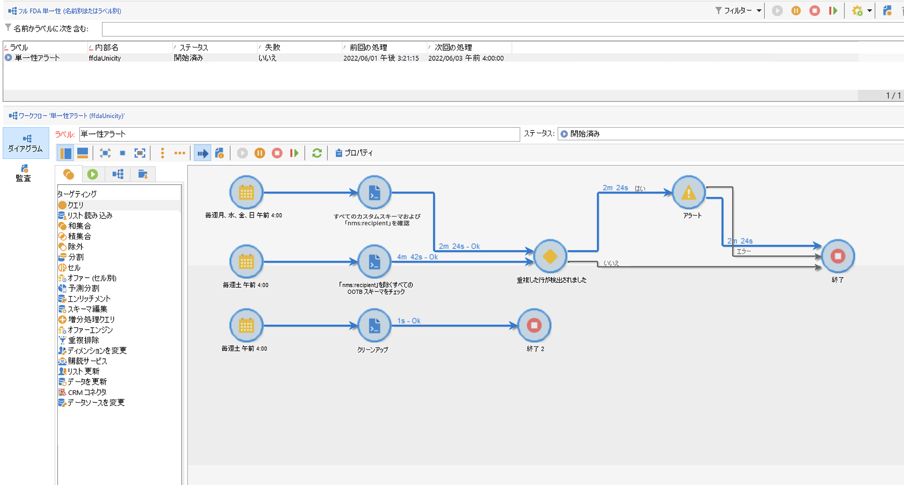
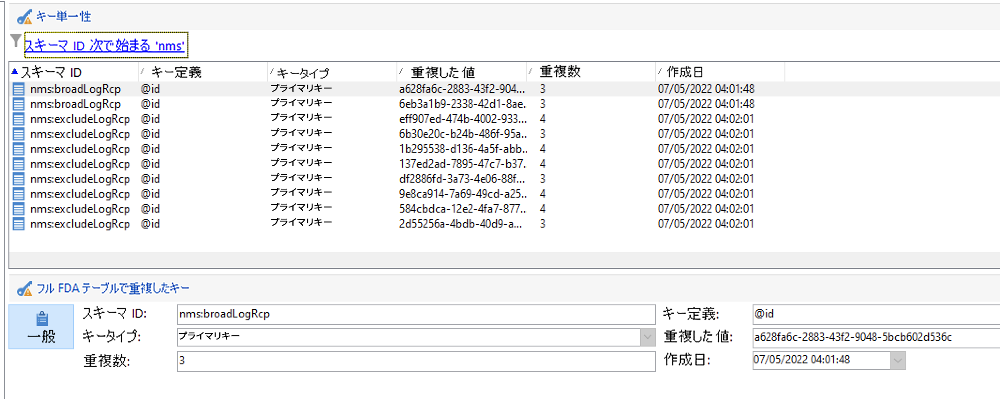
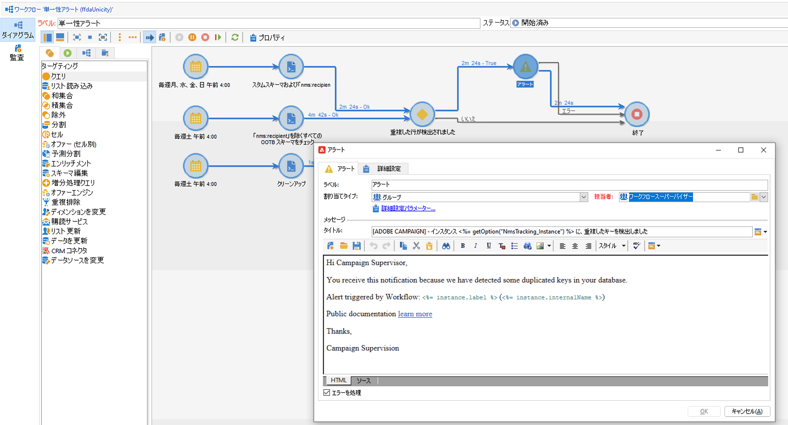
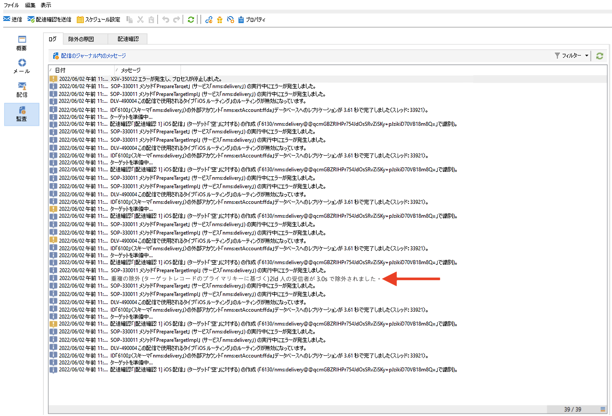
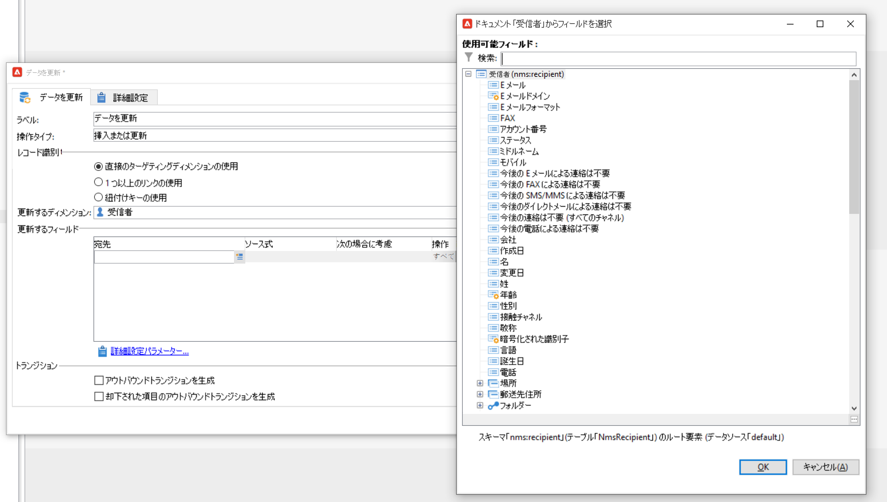
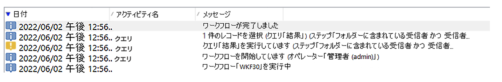

# 鍵の管理と単一性 {#key-management}

[エンタープライズ（FFDA）デプロイメント](enterprise-deployment.md)のコンテキストでは、プライマリキーは文字列であるユニバーサル固有識別子（UUID）です。 UUID を作成するには、スキーマのメイン要素に **autouuid** 属性と **autopk** 属性を含め、**true** に設定する必要があります。

Adobe Campaign v8 は [!DNL Snowflake] をコアデータベースとして使用します。 [!DNL Snowflake] データベースの分散アーキテクチャでは、テーブル内のキーの単一性を確保する仕組みがありません。エンドユーザーは、Adobe Campaign データベース内のキーの一貫性に責任を持ちます。

リレーショナルデータベースの一貫性を維持するには、キー（特にプライマリキー）の重複を避けることが必須です。 プライマリキーが重複すると、**クエリ**、**紐付け**、**データの更新**&#x200B;などのデータ管理ワークフローのアクティビティに問題を引き起こします。 これは、[!DNL Snowflake] テーブルを更新する際に適切な紐付け条件を定義するために重要です。

>[!CAUTION]
>
>重複したキーは、UUIDに制限されません。 カスタムテーブルで作成されたカスタムキーを含むIDで発生する可能性があります。

## Unicity Service{#unicity-service}

Unicity Service は、Cloud Database テーブル内の一意のキー制約の整合性を保持および監視するのに役立つ Cloud Database Manager コンポーネントです。 これにより、重複したキーを挿入するリスクを軽減できます。

Cloud Database は単一性の制約を実施しないので、Unicity Service は Adobe Campaign でデータを管理する際に重複が挿入されるリスクを軽減します。

### 単一性ワークフロー{#unicity-wf}

Unicity Service は専用の&#x200B;**[!UICONTROL 単一性アラート]**&#x200B;ビルトインワークフローを備えており、単一性の制約を監視し、重複が検出された際にアラートします。

これらのテクニカルワークフローは、Campaign エクスプローラー の&#x200B;**[!UICONTROL 管理／本番環境／テクニカルワークフロー／フル FFDA 単一性]**&#x200B;ノードから利用できます。 **これは変更できません**。

このワークフローは、すべてのカスタムおよびビルトインスキーマをチェックし、重複した行を検出します。

**[!UICONTROL 単一性アラート]**（ffdaUnicity）ワークフローが重複キーを検出した場合、スキーマ名、キーのタイプ、影響を受ける行数、日付を含む特定の&#x200B;**単一性監査**&#x200B;テーブルに追加されます。 **[!UICONTROL 管理／監査／キー単一性]**&#x200B;ノードの重複したキーにアクセスすることができます。

スキーマ ID、キー定義、キーの種類、重複した値、重複した数、作成日の キー単一性リスト

データベース管理者は SQL アクティビティを使用して重複を削除するか、アドビカスタマーケアに詳細をお問い合わせください。

### アラート{#unicity-wf-alerting}

重複したキーが検出された場合、特定の通知が&#x200B;**[!UICONTROL ワークフロースーパーバイザー]**&#x200B;オペレーターグループに送信されます。 このアラートのコンテンツとオーディエンスは、**[!UICONTROL 単一性アラート]**&#x200B;ワークフローの&#x200B;**アラート**&#x200B;アクティビティで変更できます。

## 追加のガードレール {#duplicates-guardrails}

Campaignには、[!DNL Snowflake] データベースに重複するキーを挿入しないようにする、一連の新しいガードレールが付属しています。

>[!NOTE]
>
>これらのガードレールは、Campaign v8.3以降で使用できます。 バージョンを確認するには、[Campaign v8互換性マトリックス &#x200B;](../start/compatibility-matrix.md)を参照してください

### 配信準備 {#remove-duplicates-delivery-preparation}

Adobe Campaign は、配信の準備中に重複した UUID をオーディエンスから自動的に削除します。 このメカニズムは、配信の準備中にエラーが発生するのを防ぎます。 エンドユーザーは、配信ログでこの情報を確認できます。一部の受信者は、キーが重複しているため、メインターゲットから除外できます。 その際、次の警告が表示されます。`Exclusion of duplicates (based on the primary key or targeted records)`

### ワークフロー内のデータ更新 {#duplicates-update-data}

[Enterprise （FFDA） デプロイメント &#x200B;](enterprise-deployment.md)のコンテキストでは、ワークフロー内のデータを更新するフィールドとして内部キー（UUID）を選択することはできません。

### 重複を含むスキーマのクエリ {#query-with-duplicates}

ワークフローがスキーマ上でクエリの実行を開始すると、Adobe Campaignは、[監査単一性テーブル &#x200B;](#unicity-wf)に重複したレコードが報告されているかどうかを確認します。 その場合、重複したデータに対するその後の操作がワークフローの結果に影響を与える可能性があるため、ワークフローは警告をログに記録します。

警告の単一性制約を含むで重複データが見つかりました

このチェックは、次のワークフローアクティビティで実行されます。

* クエリ
* 増分クエリ
* リスト読み込み

>[!NOTE]
>
>別のCampaign バージョンから移行する場合は、移行に影響を与えないように、重複を削除し、トラブルシューティングを行い、データを整理することが不可欠です。
