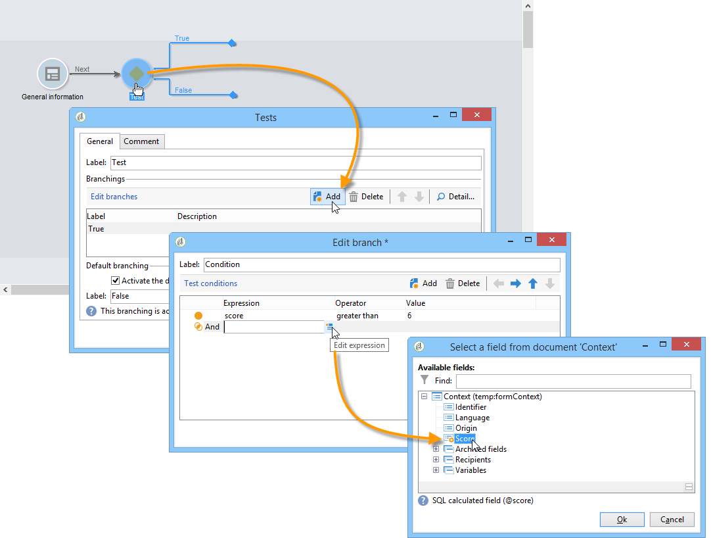
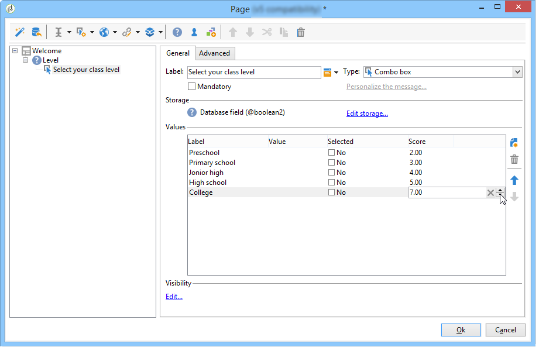
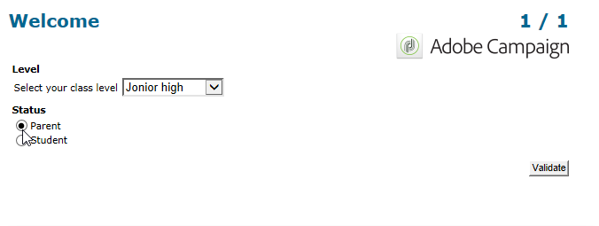

# 回答の管理{#managing-answers}

>[!AVAILABILITY]
>
>調査は、[Campaign FFDA デプロイメント &#x200B;](../../architecture/enterprise-deployment.md)では利用できません。


## 収集した回答の保存 {#storing-collected-answers}

Adobe Campaign のすべての Web フォームで共通の標準ストレージモード（データベースフィールドおよびローカル変数）に加えて、調査では、アーカイブされたフィールドを使用したデータモデルの動的な拡張が可能です。

>[!CAUTION]
>
>このオプションは、**調査**&#x200B;タイプの Web アプリケーションでのみ使用できます。 他のタイプの Web フォームには提供されません。

### アーカイブされたフィールドへの保存 {#storing-in-an-archived-field}

調査で提供された回答を保存するための新しいストレージスペースを追加することで、データテンプレートを簡単に拡張できます。 これをおこなうには、入力フィールドを作成する際に、「**[!UICONTROL 質問に対する回答を保存]**」オプションを選択します。 「**[!UICONTROL 新しいフィールド]**」リンクをクリックして、プロパティを指定します。


フィールドのラベルと名前を入力し、フィールドのタイプ（テキスト、ブール値、整数または 10 進数、日付など）を選択します。

選択したフィールドのタイプは、回答がユーザーによって入力される際の、データの制御に作用します。 **テキスト**&#x200B;フィールドの場合、制約（大文字と小文字の区別、書式）を追加したり、既存の列挙にリンクを追加したりして、強制的に選択させることができます。

制約を追加するには、ドロップダウンリストから選択します。 2 つのタイプの制約があります。

1. 大文字と小文字

   入力された情報は、すべて大文字、すべて小文字、または先頭文字のみ大文字の形式でフィールドに格納できます。 この制約では、ユーザーは選択した形式でデータを入力する必要はありませんが、フィールドに入力されたコンテンツは、保存時に変換されます。

1. データフォーマット

このフィールドがリストで使用されると、列挙の値は、値のリストの上にある&#x200B;**[!UICONTROL データベースからの値のリストを初期化]**&#x200B;リンクを使用して、値のテーブルで自動的に取得できます。

例えば、ユーザーが母国語を選択するためのドロップダウンリストを作成することができます。 対応するアーカイブされたフィールドは、言語のリストを含む&#x200B;**言語**&#x200B;の列挙と関連付けることができます。


フィールドの右側にある&#x200B;**[!UICONTROL リンクを編集]**&#x200B;アイコンを使用すると、この列挙のコンテンツを編集できます。


フィールドの「**[!UICONTROL 一般]**」タブで、「**[!UICONTROL データベースからの値のリストを初期化]**」リンクを使用すると、提供されるラベルのリストを自動的に入力できます。


**例**：受信者の契約を 1 つのフィールドに格納します。

異なるタイプの契約を 1 つのフィールドに格納するには、**[!UICONTROL テキスト]**&#x200B;入力フィールドを作成し「**[!UICONTROL 質問に対する回答を保存]**」オプションを選択します。

「**[!UICONTROL 新しいフィールド]**」リンクをクリックして、フィールドプロパティを入力します。 「**[!UICONTROL 複数値]**」オプションを選択して、複数の値の格納を有効にします。


他の契約用の入力フィールドを作成し、同じアーカイブされたフィールドにデータを格納します。


ユーザーが調査を承認すると、その回答が「**[!UICONTROL 契約]**」フィールドに格納されます。

この例では、次の回答が格納されます。


回答者のプロファイルには、入力された 4 つの契約が含まれます。

それらは、関連する列を表示することで、調査の「**[!UICONTROL 回答]**」タブで表示できます。


また、回答に基づいて受信者をフィルターして、関心のあるユーザーのみを表示できます。 これをおこなうには、ターゲティングワークフローを作成し、「**[!UICONTROL 調査の回答]**」ボックスを使用します。


復元するプロファイルに基づいてクエリを作成します。 次の例では、クエリによって、A タイプの契約を含む、少なくとも 2 つの契約のあるプロファイルを選択できます。


各フォームについて、提供された回答は、フィールドまたはラベルで利用できます。 アーカイブされたフィールドに格納された契約に対して、次の構文を使用します。

```html
<%= ctx.webAppLogRcpData.name of the archived field %
```

>[!NOTE]
>
>別のタイプのフィールドの場合の構文について詳しくは、[この節](https://experienceleague.adobe.com/ja/docs/campaign/campaign-v8/data/query/query-editor){target="_blank"}（Campaign v8 ドキュメント）を参照してください。

### ストレージ設定 {#storage-settings}

調査の回答を XML 形式でアーカイブできます。 これにより、収集した回答の生のコピーを保存でき、項目別リストのデータが過度に標準化される場合に役に立ちます。 [詳細情報](publish-track-and-use-collected-data.md#standardizing-data)

>[!CAUTION]
>
>生の回答をアーカイブすると、必要なストレージスペースに影響します。 このオプションは注意して使用してください。

手順は次のとおりです。

* 「**[!UICONTROL 編集]**」タブの「**[!UICONTROL プロパティ]**」ボタンをクリックして、調査プロパティを編集します。
* 「**[!UICONTROL 詳細設定パラメーター]**」リンクをクリックして、「**[!UICONTROL 生の回答のコピーを保存]**」オプションをチェックします。


すべての調査に対して、デフォルトで有効にできます（このオプションは、調査がパブリッシュされると適用されます）。 これをおこなうには、次に示すように、**[!UICONTROL NmsWebApp_XmlBackup]** オプションを作成して、それに値 &quot;**[!UICONTROL 1]**&quot; を割り当てます。

値1で作成されたNmsWebApp_XmlBackup オプションを持つPlatformの管理の

## スコア管理 {#score-management}

フォームのページで提供されたオプションにスコアを割り当てることができます。 スコアは、非公開の質問（チェックボックス、ドロップダウンリストからの値、購読など）にのみリンクされていることがあります。


スコアは、ページが確認されると（つまり、ユーザーが「**[!UICONTROL 次へ]**」または「**[!UICONTROL 完了]**」ボタンをクリックすると）、サーバー側に蓄積および保存されます。

>[!NOTE]
>
>正または負、整数または非整数の値を使用できます。

スコアは、テストまたはスクリプトで使用できます。

>[!CAUTION]
>
>スコアは、同じページにあるフィールドの表示条件には使用できません。 ただし、後続のページでは使用できます。

* スコアをテストで使用するには、次に示すように、テストの計算式の「**[!UICONTROL スコア]**」フィールドを使用します。

  

* スコアをスクリプトで使用できます。

**例**：スコアを計算して、次のページの表示の条件として使用します。

* 調査で、次のページを使用すると、ドロップダウンリストで選択した値に応じて、異なるスコアをユーザーに割り当てることができます。

  

* 選択したオプションに応じて、このスコアを 2 番目の値と組み合わせることができます。

  

* ユーザーが「**[!UICONTROL 次へ]**」ボタンをクリックすると、2 つの値が加算されます。

  

* 条件は、スコアに応じて、表示されるページに適用できます。 これは、次のように設定します。

  

  
