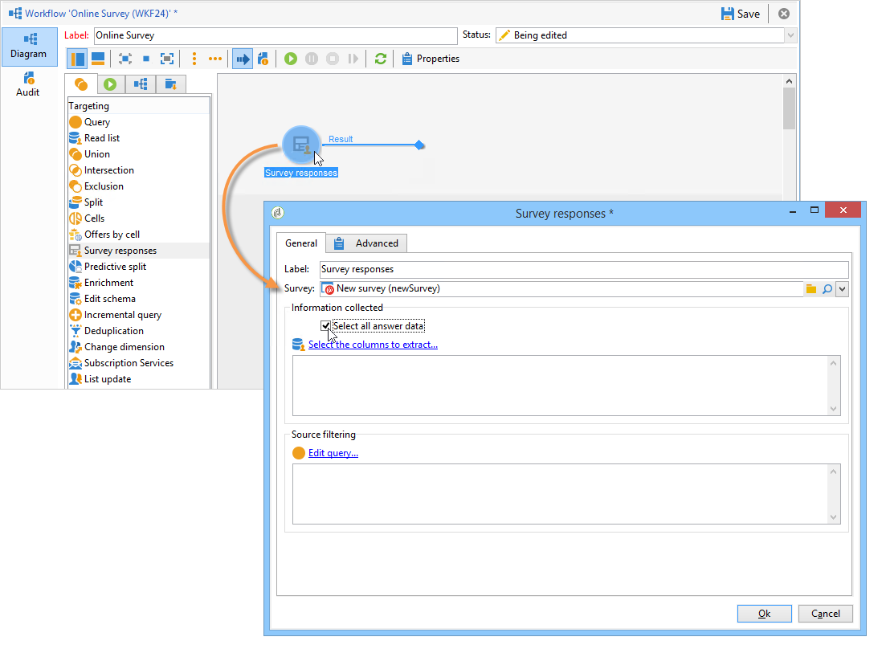
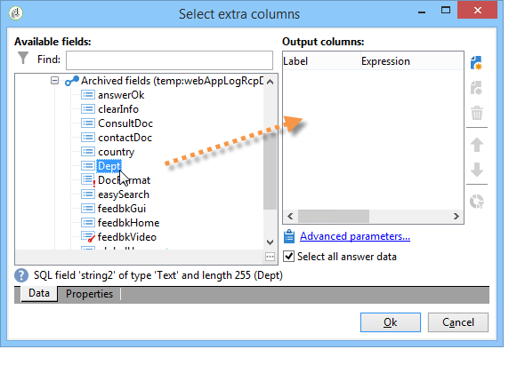
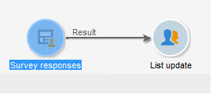
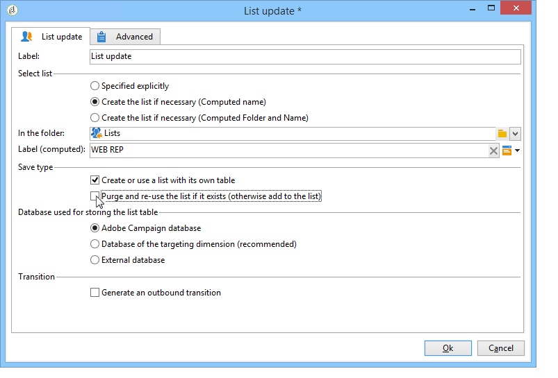
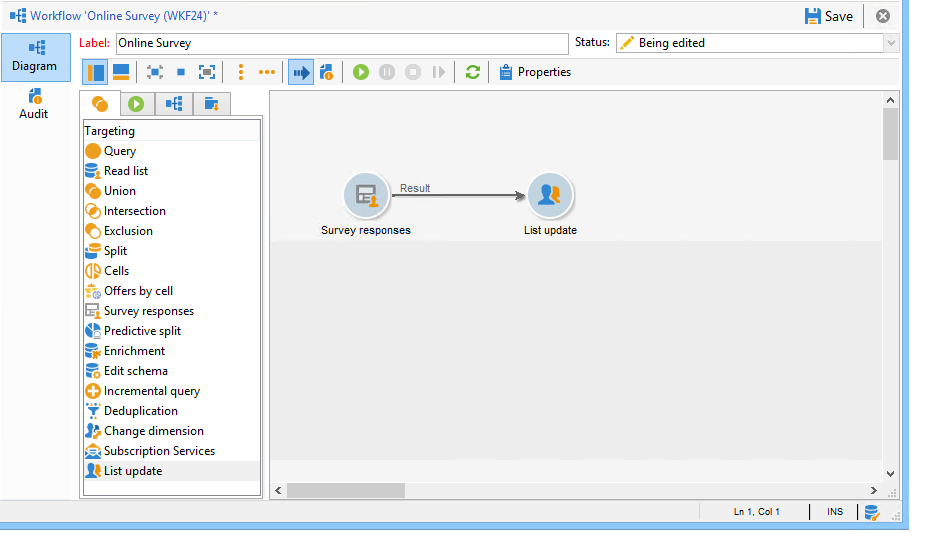
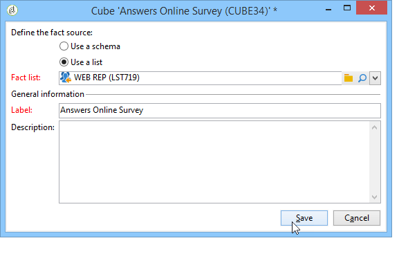
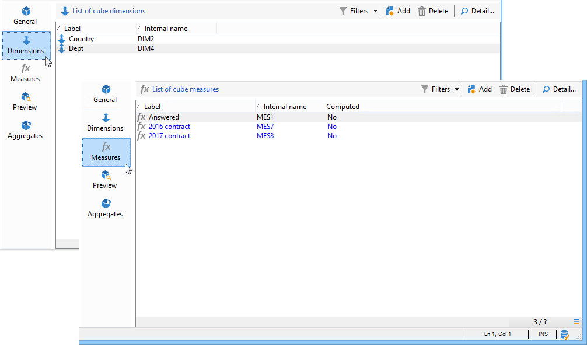
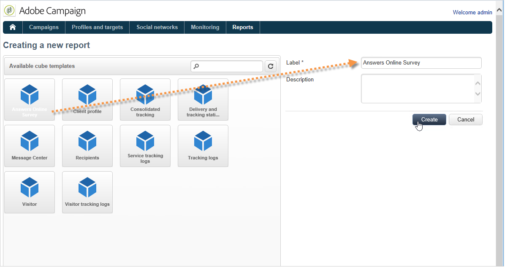
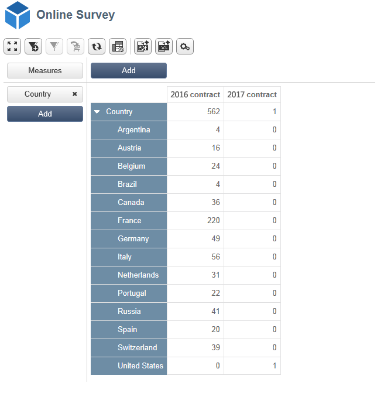

# ユースケース：オンラインサーベイへの回答に関するレポートの表示{#use-case-displaying-report-on-answers-to-an-online-survey}

>[!AVAILABILITY]
>
>調査は、[Campaign FFDA デプロイメント ](../../architecture/enterprise-deployment.md)では利用できません。

専用レポートを使用して、Adobe Campaign の調査に対する回答を収集して分析できます。

次の例では、オンライン調査への回答を収集してピボットテーブルに表示します。

次の手順に従います。

1. 調査への回答を復元するワークフローを作成し、回答をリストに格納します。
1. リスト内のデータを使用してキューブを作成します。
1. ピボットテーブルを含んだレポートを作成し、回答の分類を表示します。

このユースケースに取りかかる前に、調査と分析可能な一連の回答にアクセスできる必要があります。

>[!NOTE]
>
>このユースケースは、**調査マネージャー**&#x200B;オプションを入手した場合にのみ、実行できます。 使用許諾契約書を確認してください。

## 手順 1 - データ収集およびストレージワークフローの作成 {#step-1---creating-the-data-collection-and-storage-workflow}

調査への回答を収集するには、次の手順に従います。

1. ワークフローを作成し、**[!UICONTROL 調査の回答]**&#x200B;アクティビティを追加します。 このアクティビティの使用について詳しくは、[この節](publish-track-and-use-collected-data.md#using-the-collected-data)を参照してください。
1. このアクティビティを編集し、分析対象となる回答が得られた調査を選択します。
1. 「**[!UICONTROL すべての回答データを選択]**」オプションを有効にして、すべての情報を収集します。

   

1. 抽出する列を選択します（この例では、アーカイブされたフィールドをすべて選択します）。 これらが、回答が含まれるフィールドになります。

   

1. 回答収集ボックスを設定したら、データを保存するための&#x200B;**[!UICONTROL リスト更新]**&#x200B;タイプのアクティビティを追加します。

   

   このアクティビティで、更新するリストを指定し、「**[!UICONTROL 存在する場合、リストをパージして再利用 (存在しない場合、リストに追加)]**」オプションのチェックをオフにします。回答は既存のテーブルに追加されます。 このオプションを選択すると、キューブ内のリストを参照できるようになります。 このリストにリンクされたスキーマは、更新のたびに再生成されることはありません。これにより、このリストを使用しているキューブの整合性が保証されます。

   

1. ワークフローを開始して、その設定を確認します。

   

   指定されたリストが作成され、その中に、調査への回答のスキーマが格納されています。

1. スケジューラーを追加して、毎日の回答収集とリストの更新を自動化します。

   **[!UICONTROL リスト更新]**&#x200B;アクティビティと&#x200B;**[!UICONTROL スケジューラー]**&#x200B;アクティビティについて詳しくは、次を参照してください。

## 手順 2 - キューブおよびその測定と指標の作成 {#step-2---creating-the-cube--its-measures-and-its-indicators}

次に、キューブを作成し、その測定を設定できます。これらの測定は、レポートに表示される指標の作成に使用されます。 キューブの作成と設定について詳しくは、[キューブについて](https://experienceleague.adobe.com/en/docs/campaign-classic/using/reporting/ac-cubes){target="_blank"}を参照してください。

この例では、キューブは、先ほど作成したワークフローから提供されるリスト内のデータに基づいています。

ディメンションと、レポートに表示する測定を定義します。 ここでは、回答者の契約日と国名を表示します。

「**[!UICONTROL プレビュー]**」タブでは、レポートのレンダリングを制御できます。

## 手順 3 - レポートの作成とテーブル内のデータレイアウトの設定 {#step-3---creating-the-report-and-configuring-the-data-layout-within-the-table}

次に、このキューブに基づくレポートを作成し、データと情報を処理します。

表示する情報を必要に応じて調整します。

