# web フォームレイアウトの定義{#defining-web-forms-layout}

## コンテナの作成 {#creating-containers}

コンテナを使用すると、ページのフィールドを組み合わせたり、レイアウトを設定したりして、ページの要素を整理できます。

フォームの各ページで、ツールバーの&#x200B;**[!UICONTROL コンテナ]**&#x200B;ボタンを使用してコンテナを作成します。

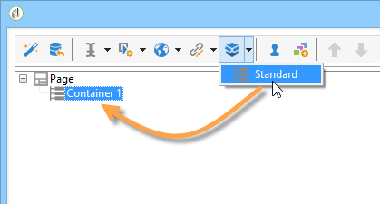

コンテナを使用して、最終レンダリングにラベルを追加せずに、ページの要素をグループ化します。 要素は、コンテナサブツリーにグループ化されます。 標準コンテナを使用すると、レイアウトを管理できます。

次に例を示します。

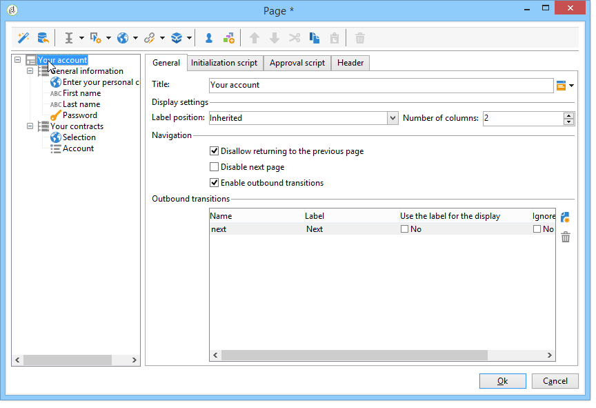

ラベルの位置は、階層のコンテナの下に配置された要素に適用されます。 必要に応じて、各要素についてオーバーロードできます。 列を追加または削除して、レイアウトを変更します。 [ページへのフィールドの配置](#positioning-the-fields-on-the-page)を参照してください。

上記の例では、レンダリングは次のようになります。

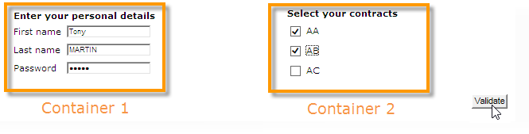

## ページへのフィールドの配置 {#positioning-the-fields-on-the-page}

Web フォームのレイアウトは、各コンテナでページごとに定義され、必要に応じてオーバーロードできます。

ページは列に分類されます。各ページには、一定数の列が含まれます。 ページの各フィールドは、**n** 個のセルを占有します。 また、コンテナは一定数の列を占有し、それに含まれるフィールドは一定数のセルを占有します。

デフォルトでは、ページは単一の列で構築され、各要素が 1 つのセルを占有します。 これは、次に示すように、フィールドが別のフィールドの下に表示され、各フィールドが行全体を占めることを意味します。

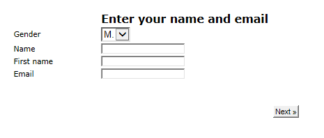

次の例では、デフォルトの設定が維持されています。 ページは、4 つのコンテナを含む単一の列を占有します。

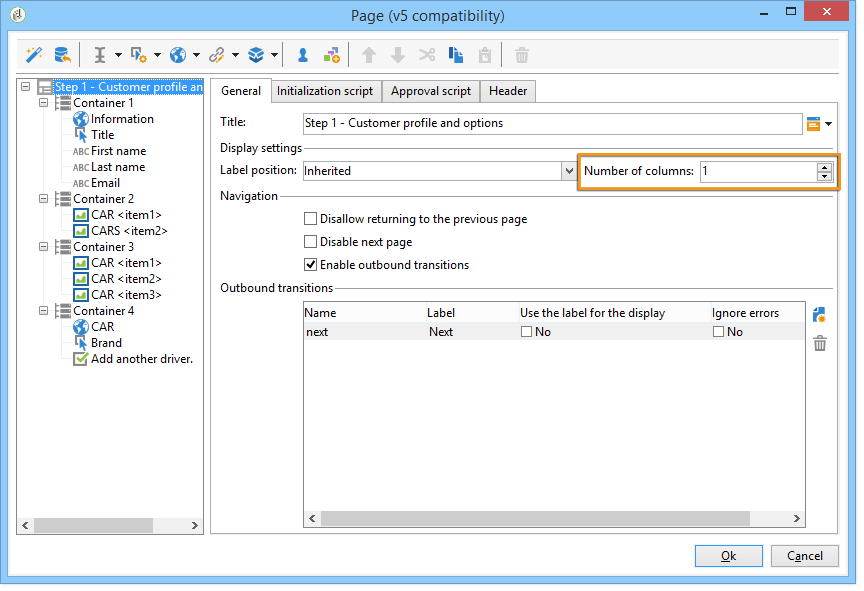

各コンテナは 1 列を占有し、各要素は 1 つのセルを占有します。

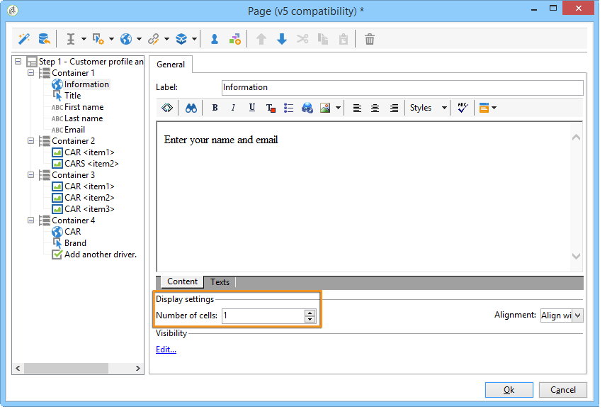

レンダリングは次のようになります。

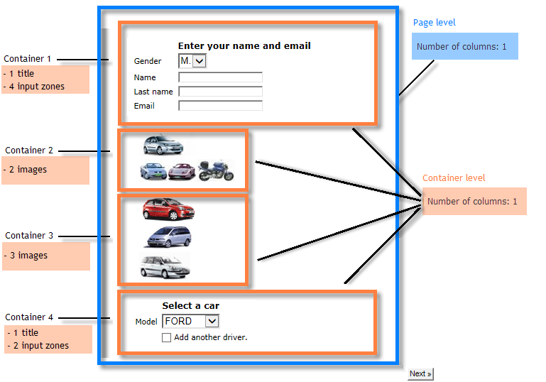

表示パラメーターを適応させて、次のようなレンダリングを取得できます。

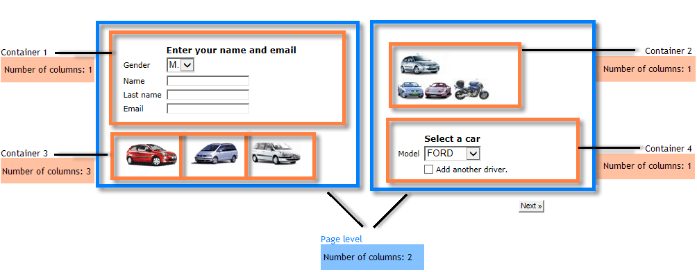

このレンダリングの例では、各入力フィールド、タイトルおよび画像は、コンテナの列の 1 つのセルを占有します。

各コンテナの書式設定を修正できます。 この例では、コンテナ 4 のコンテンツを 2 列に広げて、要素を分配します。

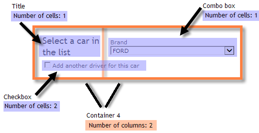

タイトルとリストは、それぞれ 1 つのセル（つまりコンテナの行全体）を占有し、チェックボックスは 2 つのセルをまたがっています。 入力フィールドに属するセルの数は、フィールドのタイプに従って、「**[!UICONTROL 一般]**」タブまたは「**[!UICONTROL 詳細設定]**」タブで定義されます。

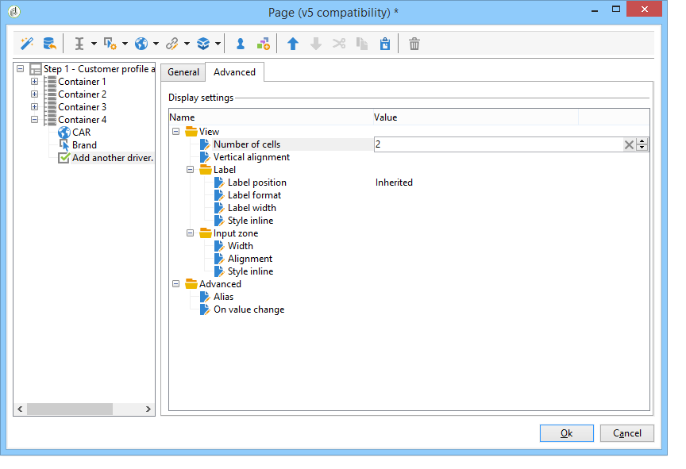

## ラベルの位置の定義 {#defining-the-position-of-labels}

フォームのフィールドおよびラベルの整列を定義できます。

デフォルトでは、ページのフィールドおよびその他のコンテンツの表示パラメーターは、フォームの全般設定、ページの設定、または存在する場合は親コンテナの設定から継承されます。

フォーム全体のグローバルな表示パラメーターは、フォームプロパティボックスで指定されます。 「**[!UICONTROL レンダリング]**」タブを使用すると、ラベルの位置を選択できます。

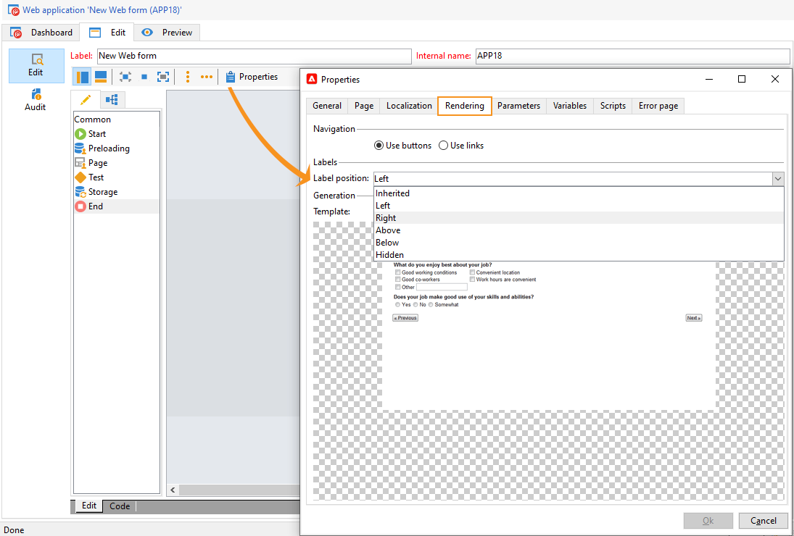

この位置は、「**[!UICONTROL 詳細設定]**」タブで、各ページ、各コンテナおよび各フィールドに対してオーバーロードできます。

次の整列がサポートされます。

* 継承：整列は、親要素（デフォルト値）つまり親コンテナ（ある場合）、またはページのその他から継承されます。
* 左／右：ラベルはフィールドの右または左に配置されます。
* 上／下：ラベルはフィールドの上または下に配置されます。
* 非表示：ラベルは表示されません。
