# コンテンツの編集{#editing-content}

## 表示条件の定義 {#defining-a-visibility-condition}

Web ページ要素の表示条件を指定できます。この要素は、条件が遵守されている場合にのみ、表示されます。

表示条件を追加するには、ブロックを選択して、式エディターを使用して「**[!UICONTROL 表示条件]**」フィールドに入力します。

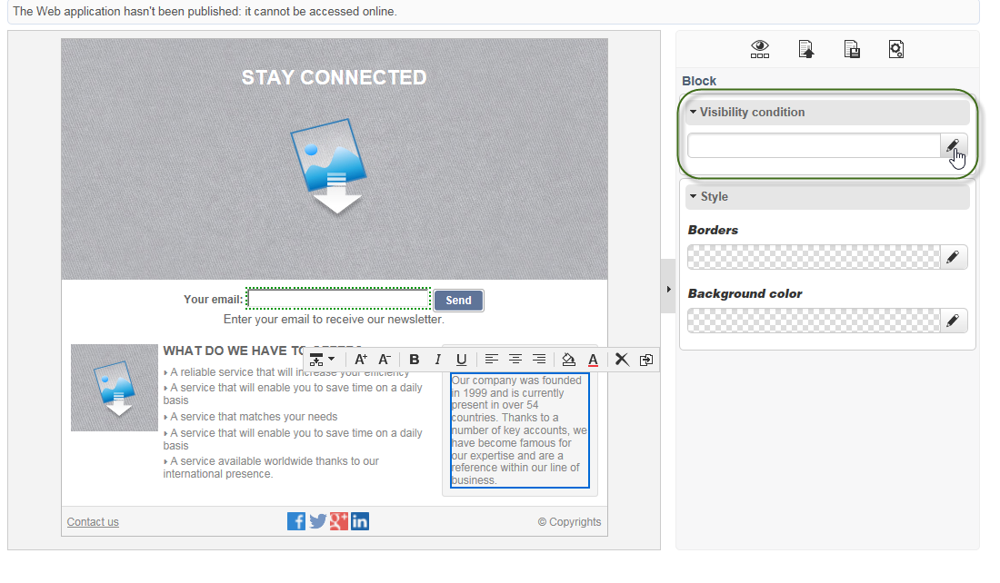

>[!NOTE]
>
>高度な式の編集については、[このページ](https://experienceleague.adobe.com/ja/docs/campaign/campaign-v8/data/query/query-editor){target="_blank"}（Campaign v8 ドキュメント）を参照してください。

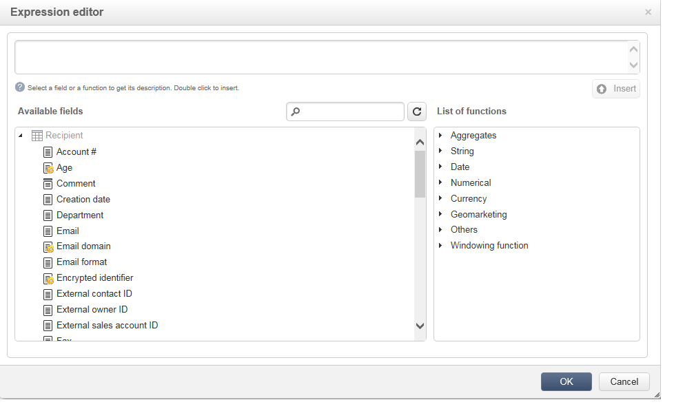

これらの条件は、XTK 式の構文を採用しています（例えば、**ctx.recipient.@email != &quot;&quot;** または **ctx.recipient.@status==&quot;0&quot;**）。 デフォルトでは、すべてのファイルが表示されます。

>[!NOTE]
>
>非表示の動的ブロック（ドロップダウンメニューなど）は、編集できません。

## 境界線と背景の追加 {#adding-a-border-and-background}

選択したブロックに&#x200B;**境界線**&#x200B;を追加できます。 境界線は、スタイル、サイズおよび色の 3 つのオプションを使用して定義されます。

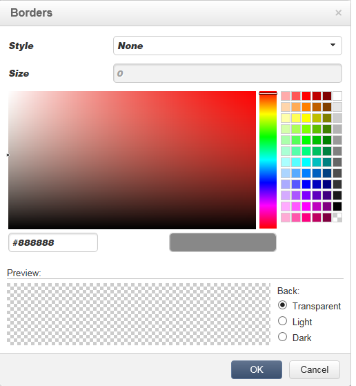

また、カラーチャートから色を選択することで、**背景色**&#x200B;を定義できます。

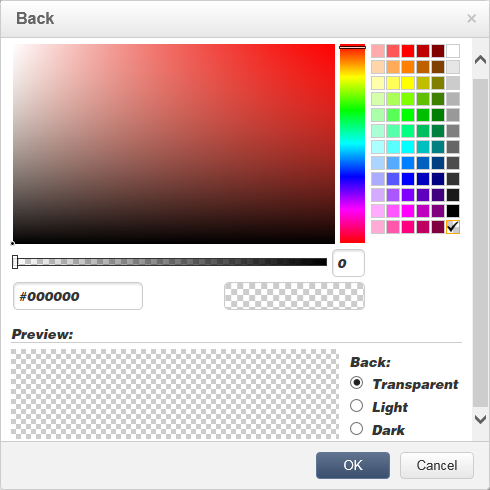

## フォームの編集 {#editing-forms}

### フォームのデータプロパティの変更 {#changing-the-data-properties-for-a-form}

データベースフィールドを入力ゾーン、ラジオボタンまたはチェックボックスタイプのブロックにリンクできます。

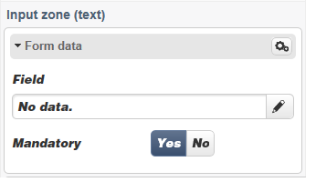

>[!NOTE]
>
>デフォルトのフィールドは、Web アプリケーションストレージスキーマにあります。

**フィールド**&#x200B;入力ゾーンを使用すると、フォームフィールドとリンクするためのデータベースフィールドを選択できます。

デフォルトでは、提供されたフィールドは、**nms:recipient** テーブルにあります。

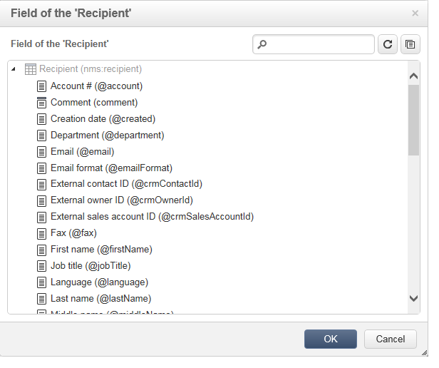

**必須フィールド**&#x200B;オプションを使用すると、ユーザーがフィールドに入力した場合にのみページを承認します。 必須フィールドに入力されていない場合、エラーメッセージが表示されます。

ラジオボタンおよびチェックボックスの場合、**追加の設定が必要です**。

実際、使用されるテンプレートにデフォルトで値が含まれない場合、エディターで完成させる必要があります。

手順は次のとおりです。

* **[!UICONTROL 編集]**&#x200B;アイコンをクリックします。

  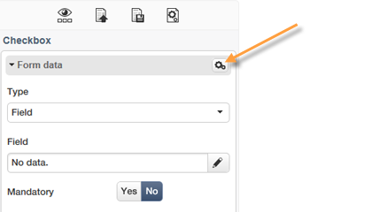

* 定義済みリストの値（選択されたフィールドで定義される）を「**[!UICONTROL 値]**」フィールドに入力します。

  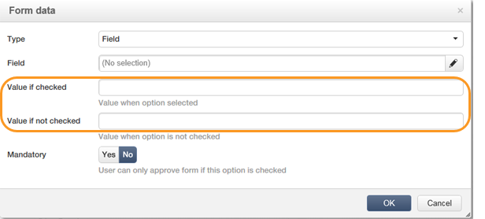

### フォームフィールドの変更 {#modifying-form-fields}

ラジオボタン、入力ゾーン、ドロップダウンリストなどのフォームフィールドは、ツールバーから修正できます。

変更できる設定内容は次のとおりです。

* **[!UICONTROL 削除]**&#x200B;アイコンを使用して、フォームフィールドを含むブロックを削除します。
* **[!UICONTROL 複製]**&#x200B;アイコンを使用して、新しいブロックを作成することで、選択したフィールドを複製します。
* **[!UICONTROL 編集]**&#x200B;アイコンを使用して、**[!UICONTROL フォームデータ]**&#x200B;ウィンドウを編集し、データベースフィールドをフォームゾーンにリンクします。

  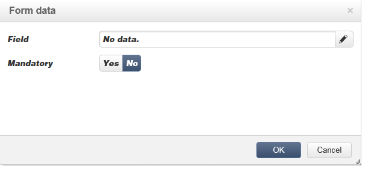

## ボタンへのアクションの追加 {#adding-an-action-to-a-button}

ユーザーがボタンをクリックする際に、関連するアクションを定義できます これをおこなうには、ドロップダウンリストから実行されるアクションを選択します。

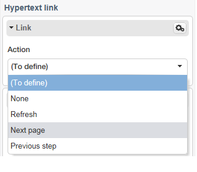

利用可能なアクションを次に示します。

* **[!UICONTROL 更新]**：現在のページを更新します。
* **[!UICONTROL 次のページ]**：Web アプリケーションの次のページへのリンクを作成します。
* **[!UICONTROL 前のページ]**：Web アプリケーションの前のページへのリンクを作成します。

>[!NOTE]
>
>**[!UICONTROL なし]**&#x200B;の値を使用すると、ボタンを非アクティブ化できます。

対応するフィールドのボタンにリンクされたラベルを修正できます。

## リンクの追加 {#adding-a-link}

リンクを任意のページ要素（画像、単語、単語のグループ、テキストのブロックなど）に挿入できます。

これをおこなうには、要素を選択してから、ポップアップメニューの最初のアイコンを使用します。

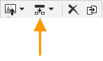

このアイコンを使用すると、利用できるすべてのタイプのリンクにアクセスできます。

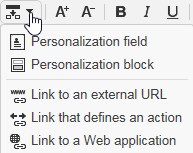

パーソナライゼーションブロックおよびフィールドは、テキストタイプのブロックにのみ挿入されます。

>[!NOTE]
>
>各タイプのリンクについて、開くモードを設定できます。**ターゲット**&#x200B;ドロップダウンリストでターゲットウィンドウを選択します。 この値は、**`<target>`** HTML タグに対応します。
>
>利用可能な&#x200B;**ターゲット**&#x200B;のリストは、次のとおりです。
>
>* その他 (IFrame)
>* 最上位のウィンドウ (_top)
>* 親ウィンドウ (_parent)
>* 新しいウィンドウ (_blank)
>* 現在のウィンドウ (_self)
>* ブラウザーのデフォルト動作
>

### URL へのリンク {#link-to-a-url}

「**外部 URL へのリンク**」オプションを使用すると、ソースコンテンツから任意の URL を開くことができます。

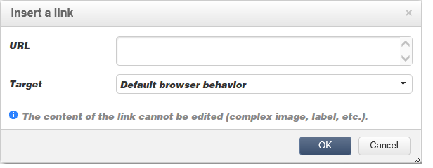

問題になっているリンクアドレスを「**URL**」フィールドに入力します。 URL フィールドは、**https://www.myURL.com** のように入力される必要があります。

### Web アプリケーションへのリンク {#link-to-a-web-application}

「**Web アプリケーションへのリンク**」オプションを使用すると、Adobe Campaign Web アプリケーションにアクセスできます。

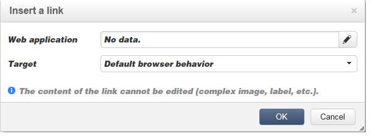

対応するフィールドから Web アプリケーションを選択します。

提案される Web アプリケーションは、**[!UICONTROL リソース／オンライン／Web アプリケーション]**&#x200B;ノードの使用可能なアプリケーションに対応します。

### アクションへのリンク {#link-to-an-action}

「**アクションを定義するリンク**」オプションを使用すると、ソース要素をクリックする際に、アクションを設定できます。

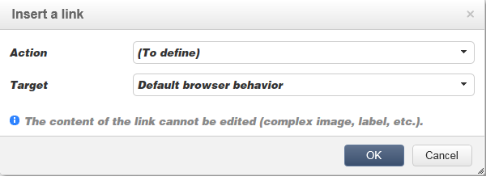

>[!NOTE]
>
>使用可能なアクションについて詳しくは、[ボタンへのアクションの追加](#adding-an-action-to-a-button)の節を参照してください。

### リンクの削除 {#delete-a-link}

リンクが挿入されると、ツールバーに&#x200B;**リンクを編集**&#x200B;と&#x200B;**リンクを解除**&#x200B;の 2 つのアイコンが表示されます。これらを使用すると、作成したリンクを操作できます。

* **[!UICONTROL リンクを編集]**&#x200B;を使用すると、リンクのすべてのパラメーターを備えたウィンドウを表示できます。
* **[!UICONTROL リンクを解除]**&#x200B;を使用すると、確認後、リンクおよび関連するすべてのパラメーターを削除できます。

>[!NOTE]
>
>リンクが削除されても、コンテンツは保持されます。

## フォント属性の変更 {#changing-font-attributes}

テキスト要素を選択する場合、フォント属性（スタイル、書式設定）を修正できます。

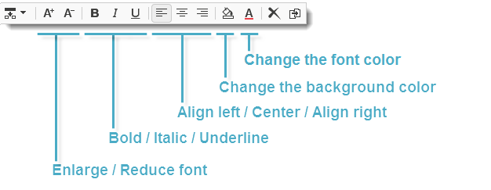

利用可能なオプションを次に示します。

* **フォントを拡大**&#x200B;アイコン：選択されたテキストのサイズを大きくします（`` を追加します）。
* **フォントを縮小**&#x200B;アイコン：選択されたテキストのサイズを小さくします（`` を追加します）。
* **太字**&#x200B;アイコン：選択されたテキストを太字にします（`<strong> </strong>` タグでテキストを囲みます）。
* **斜体**&#x200B;アイコン：選択されたテキストを斜体にします（`<em> </em>` タグでテキストを囲みます）。
* **下線**&#x200B;アイコン：選択されたテキストに下線を設定します（`` タグでテキストを囲みます）。
* **左揃え**&#x200B;アイコン：選択されたブロックの左側にテキストを揃えます（style=&quot;text-align: left;&quot; を追加します）。
* **中央**&#x200B;アイコン：選択されたブロックのテキストを中央に配置します（style=&quot;text-align: center;&quot; を追加します）。
* **右揃え**&#x200B;アイコン：選択されたブロックの右側にテキストを揃えます（style=&quot;text-align: right;&quot; を追加します）。
* **背景色を変更**&#x200B;アイコン：選択されたブロックの背景色を変更できます（style=&quot;background-color: rgba(170, 86, 255, 0.87) を追加します）。
* **テキストの色を変更**&#x200B;アイコン：選択されたブロックのテキストの色、または選択されたテキストの色を変更できます（``）。

>[!NOTE]
>
>* **削除**&#x200B;アイコン：ブロックおよびそのすべてのコンテンツを削除します。
>
>* **複製**&#x200B;アイコン：ブロックおよびブロックに関連するすべてのスタイルを複製します。

## 画像とアニメーションの管理 {#managing-images-and-animations}

デジタルコンテンツエディターを使用すると、ブラウザーと互換性のある&#x200B;**あらゆるタイプの画像**&#x200B;を操作できます。

>[!CAUTION]
>
>HTML ページの **script** タグで外部ファイルを呼び出さないようにする必要があります。 これらのファイルは、Adobe Campaign サーバーにインポートされません。

### 画像の追加／削除／複製 {#adding---deleting---duplicating-an-image}

画像を挿入するには、画像タイプのブロックを選択して、**画像**&#x200B;アイコンをクリックします。

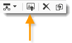

ローカルに保存された画像ファイルを選択します。

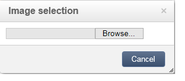

**削除**&#x200B;アイコンは、画像を含む  タグを削除します。

**複製**&#x200B;アイコンは、タグおよびそのコンテンツを複製します。

>[!CAUTION]
>
>画像を複製すると、新しい画像に関連する識別子は削除されます。

### 画像プロパティの編集 {#editing-image-properties}

画像を含むブロックを選択する場合、次のプロパティにアクセスします。

* **キャプション**&#x200B;を使用すると、画像にリンクされたキャプションを定義できます（**alt** HTML 属性に対応）。
* **サイズ**&#x200B;を使用すると、画像サイズをピクセル単位で指定できます。

  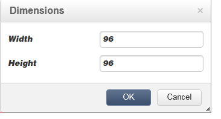

## パーソナライゼーションコンテンツの追加 {#adding-personalization-content}

### パーソナライゼーションフィールドの挿入 {#inserting-a-personalization-field}

挿入アイコン用の「**パーソナライゼーションフィールド**」オプションを使用すると、データベースフィールドをコンテンツに追加できます（受信者の名前など）。 このオプションは、テキストタイプのブロックでのみ使用できます。

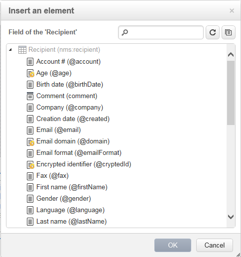

デフォルトでは、提供されたフィールドは、**[!UICONTROL 受信者]**&#x200B;テーブルからのものです。 必要に応じて、Web アプリケーションプロパティを編集して、別のテーブルを選択します。

フィールド名がエディターに表示され、黄色でハイライトされます。 パーソナライゼーションが生成されると（例えば、ランディングページのプレビュー時）、ターゲット化された受信者のプロファイルで置き換えられます。

例については、[パーソナライゼーションフィールドの挿入](creating-a-landing-page.md#inserting-a-personalization-field)の節で説明しています。

### パーソナライゼーションブロックの挿入 {#inserting-a-personalization-block}

「**パーソナライゼーションブロック**」オプションを使用すると、動的でパーソナライズされたブロックをコンテンツに挿入できます。 例えば、ロゴや挨拶メッセージを追加できます。 これは、テキストタイプのブロックでは使用できません。

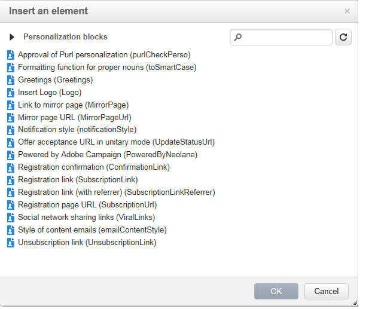

挿入後、パーソナライゼーションブロック名がエディターに表示され、黄色でハイライトされます。 パーソナライゼーションが生成されると、受信者プロファイルに自動的に適応されます。

ビルトインのパーソナライゼーションブロックと、カスタムパーソナライゼーションブロックの定義方法について詳しくは、[Campaign v8 ドキュメント](https://experienceleague.adobe.com/docs/campaign/campaign-v8/send/personalize/personalization-blocks.html?lang=ja){target="_blank"}を参照してください。
