# web フォームの公開{#publishing-a-web-form}


## フォームデータのプリロード {#pre-loading-the-form-data}

Web フォームを使用して、データベースに格納されたプロファイルを更新する場合、プリロードボックスを使用できます。 プリロードボックスを使用すると、データベースで更新されるレコードの検索方法を示すことができます。

次の識別方法が可能です。

* **[!UICONTROL Adobe Campaign の暗号化]**

  この暗号化方法は、暗号化された Adobe Campaign 識別子（ID）を使用します。 この方法は、Adobe Campaign オブジェクトにのみ適用でき、暗号化された ID は、Adobe Campaign プラットフォームでのみ生成できます。

  この方法を使用する場合、パラメーター **`<%=escapeUrl(recipient.cryptedId) %>`** を追加することで、フォームの URL を適応させて、メールアドレスに配信する必要があります。 詳しくは、[メールによるフォームの配信](#delivering-a-form-via-email)を参照してください。

* **[!UICONTROL DES 暗号化]**

  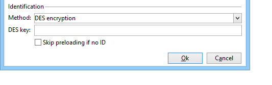

  この暗号化方法は、外部的に提供される識別子（ID）を使用し、Adobe Campaign および外部プロバイダーによって共有されるキーにリンクされます。 **[!UICONTROL DES キー]**&#x200B;フィールドを使用すると、この暗号化キーを入力できます。

* **[!UICONTROL フィールドのリスト]**

  このオプションを使用すると、フォームの現在のコンテキストのフィールドから選択でき、データベースの対応するプロファイルを検索するために使用されます。

  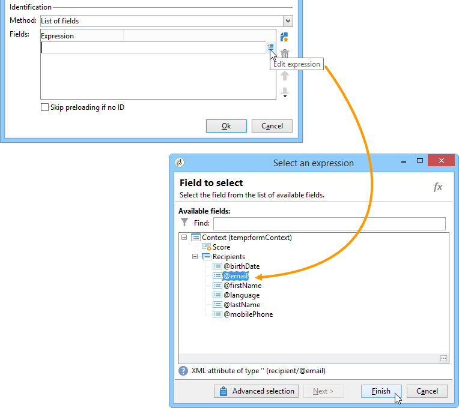

  フィールドは、「**[!UICONTROL パラメーター]**」タブを使用してフォームプロパティに追加できます（[パラメーターの追加](defining-web-forms-properties.md#adding-parameters)を参照）。 フォーム URL または入力ゾーンに配置されます。

  >[!CAUTION]
  >
  >選択されたフィールドのデータは、暗号化されません。 「**[!UICONTROL フィールドリスト]**」オプションが選択されている場合、Adobe Campaign で復号化できないので、暗号化されたフォームで提供しないようにする必要があります。

  次の例では、プリロードされるプロファイルはメールアドレスに基づいています。

  ユーザーが関連するページに直接アクセスできる場合、URL には、暗号化されていないメールアドレスを含めることができます。

  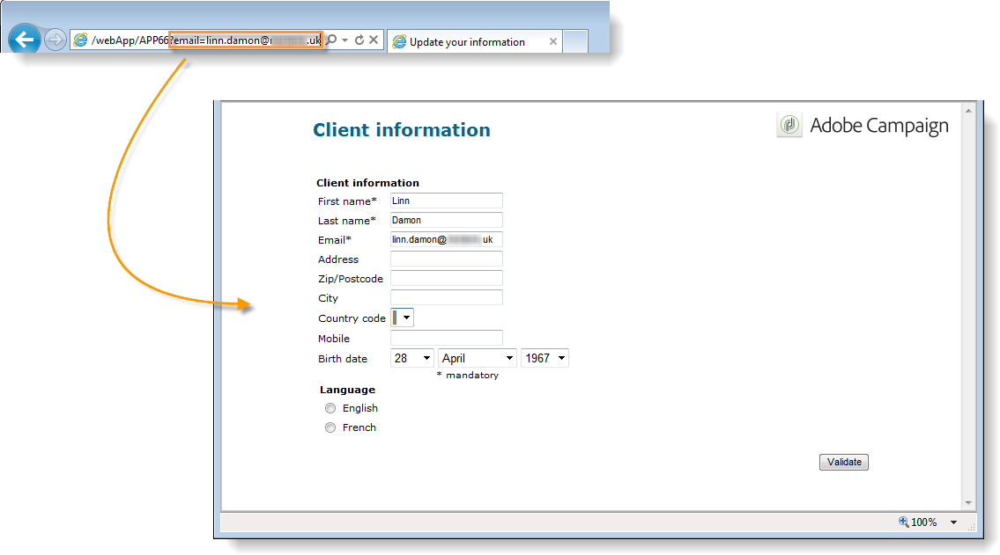

  そうでない場合、パスワードが求められます。

  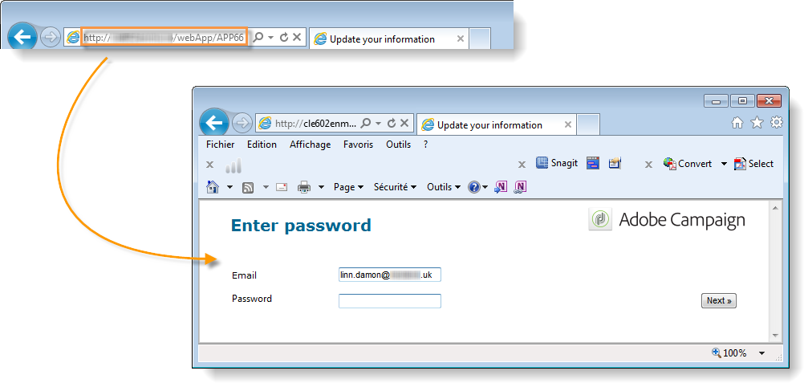

  >[!CAUTION]
  >
  >いくつかのフィールドがリストで指定されている場合、プロファイルをアップロードするために、**すべてのフィールド**&#x200B;のデータがデータベースに格納されたデータと一致する必要があります。 そうでない場合、新しいプロファイルが作成されます。
  > 
  >この機能は、Web アプリケーションで特に便利ですが、パブリックフォームにはお勧めしません。 選択したアクセス制御オプションは、「アクセス制御を有効にする」が選択されている必要があります。

プロファイルを更新しない場合、「**[!UICONTROL ID がない場合にプリロードをスキップ]**」オプションを選択する必要があります。 この場合、入力した各プロファイルは、フォームの承認後にデータベースに追加されます。 例えば、フォームが Web サイトに投稿される際に、このオプションが使用されます。

「**[!UICONTROL フォームで参照されるデータを自動読み込み]**」オプションを使用すると、フォームの入力および結合フィールドに一致するデータを自動的にプリロードします。 ただし、**[!UICONTROL スクリプト]**&#x200B;および&#x200B;**[!UICONTROL テスト]**&#x200B;アクティビティで参照されるデータは、関係ありません。 このオプションが選択されていない場合、「**[!UICONTROL 追加データを読み込み]**」オプションを使用するフィールドを定義する必要があります。

「**[!UICONTROL 追加データを読み込み]**」オプションを使用すると、フォームのページで使用しない情報を追加できますが、それにも関わらずプリロードされます。

例えば、受信者の性別をプリロードして、テストボックスを使用して適切なページに自動的に導くことができます。

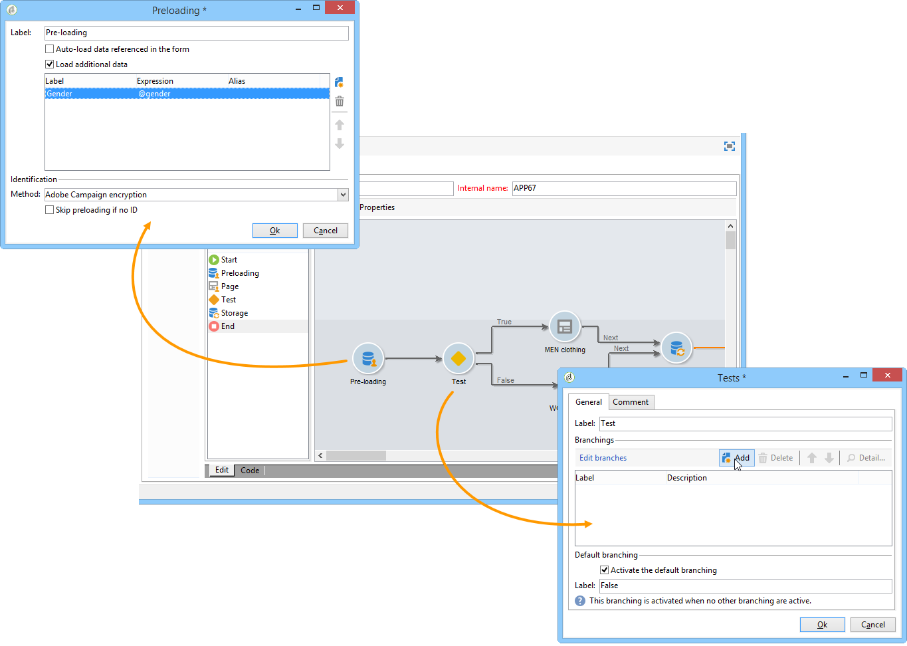

## Web フォームの配信とトラッキングの管理 {#managing-web-forms-delivery-and-tracking}

フォームを作成、設定および公開したら、フォームを配信してユーザーの応答をトラッキングできます。

### フォームのライフサイクル {#life-cycle-of-a-form}

フォームのライフサイクルには、次の 3 つのステージがあります。

1. **編集中**

   これは、最初のデザインフェーズです。 新しいフォームが作成されると、編集フェーズになります。 テスト目的でのみ、フォームにアクセスし、パラメーター **[!UICONTROL __uuid]** をその URL で使用する必要があります。 この URL は、「**[!UICONTROL プレビュー]**」サブタブでアクセスできます。 [フォーム URL パラメーター](defining-web-forms-properties.md#form-url-parameters)を参照してください。

   >[!CAUTION]
   >
   >フォームが編集されている限り、そのアクセス URL は、特別な URL です。

1. **保留中の公開**

   場合によっては（[パッケージを通じてフォームをインポート](#import-web-packages)する場合など）、Web フォームは公開されるまで&#x200B;**[!UICONTROL 保留中の公開]**&#x200B;ステータスになることがあります。

   >[!NOTE]
   >
   >技術的な Web アプリケーション（**[!UICONTROL 管理]**／**[!UICONTROL 設定]**／**[!UICONTROL Web アプリケーション]**&#x200B;メニューから利用可能) の場合、**[!UICONTROL 保留中の公開]**&#x200B;ステータスのフォームは自動的に[公開](#publishing-a-form)され、**[!UICONTROL オンライン]**&#x200B;ステータスになります。

1. **オンライン**

   デザインフェーズが完了すると、フォームは配信できます。

   フォームのステータスが&#x200B;**[!UICONTROL 編集中]**&#x200B;または&#x200B;**[!UICONTROL 保留中の公開]**&#x200B;の場合、オンラインでブラウザーの Web フォーム URL を通じてアクセスするには、フォームを[公開](#publishing-a-form)する必要があります。

   公開すると、フォームは有効期限が切れるまで、ライブになります。

   フォームは、有効期限が切れるまで、**[!UICONTROL ライブ]**&#x200B;になります。

   >[!CAUTION]
   >
   >配信するには、フォームの URL に、**[!UICONTROL __uuid]** パラメーターを含めないようにする必要があります。

1. **閉じる**

   フォームが閉じられると、配信フェーズが終了し、フォームは使用できなくなり、ユーザーはフォームにアクセスできなくなります。

   期日は、フォームプロパティウィンドウで定義できます。 詳しくは、[オンラインでのフォームの公開](#making-a-form-available-online)を参照してください。

フォームのパブリッシュステータスがフォームのリストに表示されます。

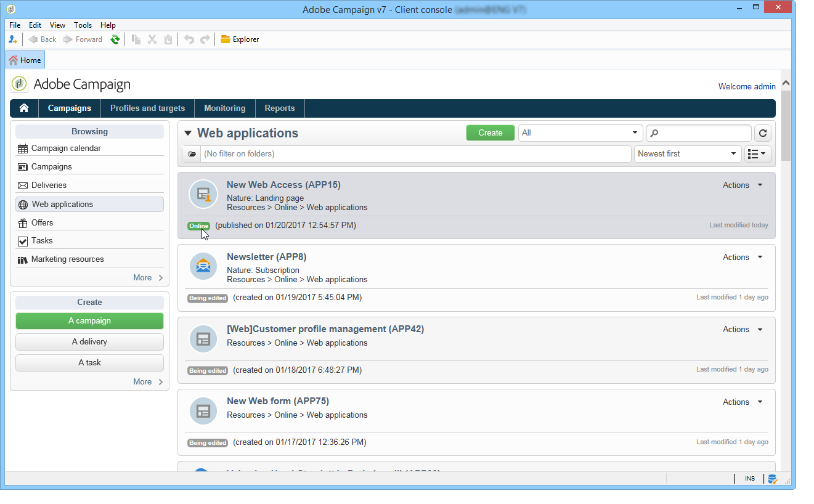

### フォームの公開 {#publishing-a-form}

フォームの状態を変更するには、パブリッシュする必要があります。 これをおこなうには、Web フォームのリストの上にある「**[!UICONTROL パブリケーション]**」ボタンをクリックして、ドロップダウンボックスで状態を選択します。

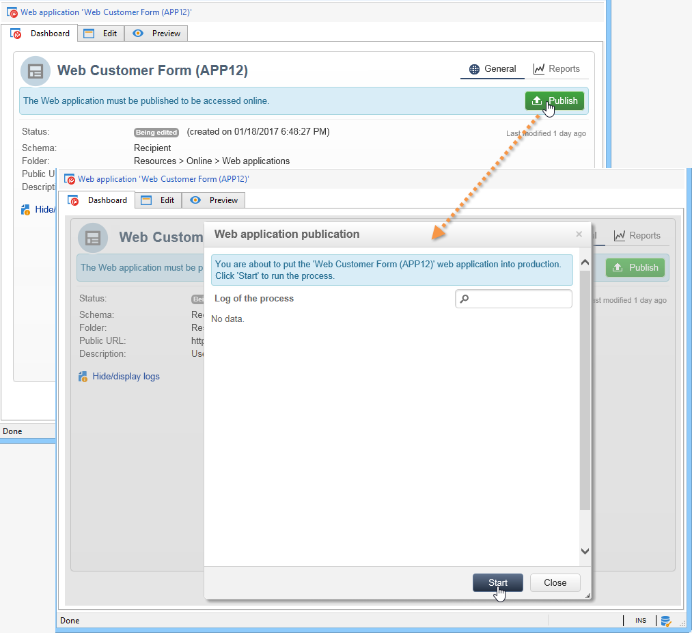

### オンラインでのフォームの公開 {#making-a-form-available-online}

ユーザーがアクセスできるようにするためには、フォームは、本番で開始される必要があります。つまり、有効期間内にある必要があります。 有効な日付は、フォームの「**[!UICONTROL プロパティ]**」リンクを使用して入力します。

* 「**[!UICONTROL プロジェクト]**」セクションのフィールドを使用して、フォームの開始および終了日を入力します。

  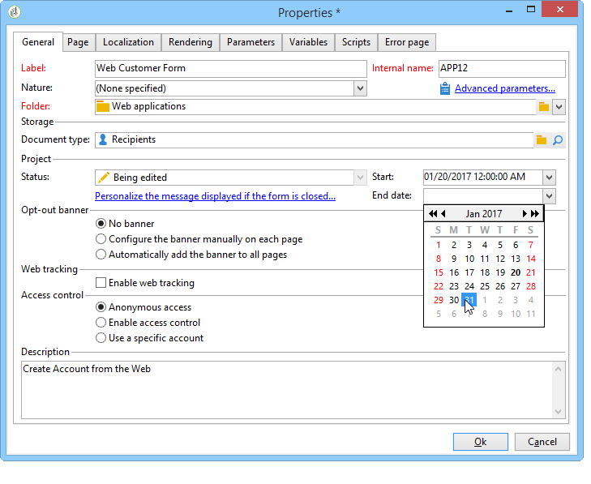

* 「**[!UICONTROL フォームが閉じられた場合に表示するメッセージをパーソナライズ...]**」リンクをクリックし、有効となっていないフォームにユーザーがアクセスしようとした場合に表示するエラーメッセージを定義します。

  [フォームのアクセシビリティ](defining-web-forms-properties.md#accessibility-of-the-form)を参照してください。

### メールによるフォームの配信 {#delivering-a-form-via-email}

メールで招待状を配信する場合、データの紐付けに「**[!UICONTROL Adobe Campaign の暗号化]**」オプションを使用できます。 これを行うには、配信アシスタントに移動し、次のパラメーターを追加することで、リンクをフォームに適応させます。

```
<a href="https://server/webApp/APP264?&id=<%=escapeUrl(recipient.cryptedId) %>">
```

この場合、データストレージの紐付けキーは、受信者の暗号化された識別子である必要があります。 詳しくは、[フォームデータのプリロード](#pre-loading-the-form-data)を参照してください。

この場合、レコードボックスの「**[!UICONTROL プリロードされたレコードを更新]**」オプションをチェックする必要があります。 詳しくは、[Web フォームの回答の保存](web-forms-answers.md#saving-web-forms-answers)を参照してください。

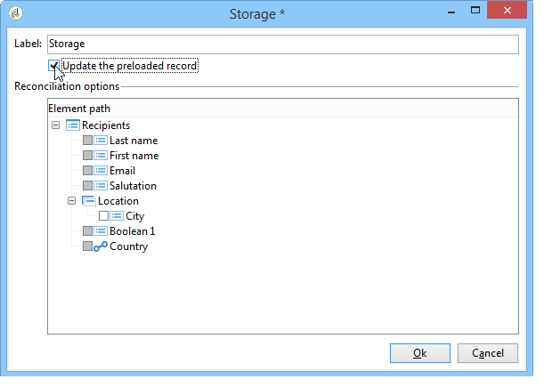

### 応答をログに記録 {#log-responses}

回答のトラッキングを専用のタブで有効化すると、Web フォームの影響を監視することができます。 これをおこなうには、フォームプロパティウィンドウの「**[!UICONTROL 詳細設定パラメーター]**」リンクをクリックして、「**[!UICONTROL 回答をログに記録]**」オプションを選択します。

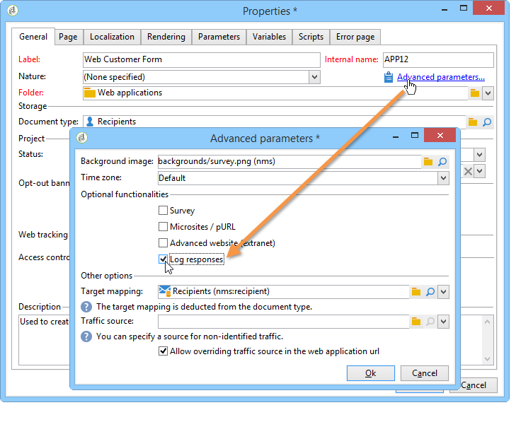

「**[!UICONTROL 回答]**」タブが表示され、回答者の ID を表示できます。

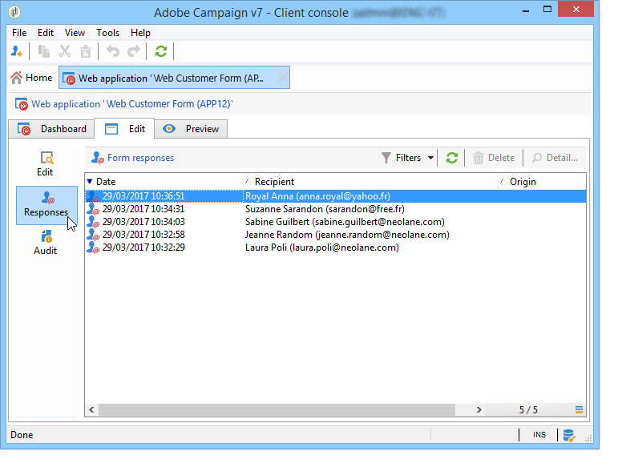

受信者を選択し、「**[!UICONTROL 詳細...]**」ボタンをクリックして提供された回答を表示します。

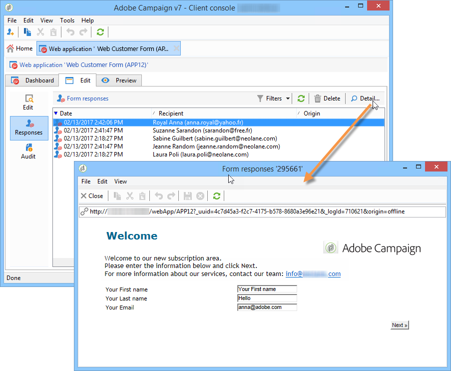

例えば、リマインダーの送信時に非回答者のみをターゲットにしたり、回答者のみに特別なコミュニケーションを提供したりするために、クエリで提供された回答ログを処理できます。

### Web フォームパッケージのインポート {#import-web-packages}

Web フォームを含むパッケージをインスタンスから別のインスタンスへ（例えば、ステージから実稼動へ）エクスポートおよびインポートする際、新しいインスタンス上の Web フォームのステータスは、いくつかの条件に従って変化する場合があります。 様々なケースを次に示します。

Web フォームの様々なステータスについて詳しくは、[この節](#life-cycle-of-a-form)を参照してください。

>[!NOTE]
>
>パッケージを通じて Web フォームをエクスポートすると、フォームのステータスが結果のパッケージのコンテンツに表示されます。

* 最初のインスタンスからエクスポートした際に  Web フォームのステータスが&#x200B;**[!UICONTROL 保留中の公開]**&#x200B;または&#x200B;**[!UICONTROL オンライン]**&#x200B;であった場合：

  * 新しいインスタンスにインポートすると、Web フォームは&#x200B;**[!UICONTROL 保留中の公開]**&#x200B;ステータスを取得します。

  * Web フォームが新しいインスタンスに既に存在する場合は、古いバージョンのフォームが&#x200B;**[!UICONTROL オンライン]**&#x200B;であっても、新しいバージョンのフォームに置き換えられ、**[!UICONTROL 保留中の公開]**&#x200B;ステータスになります。

  * フォームが存在するかどうかに関係なく、新しいインスタンスで&#x200B;**[!UICONTROL オンライン]**&#x200B;になり、ブラウザーの Web フォーム URL を通じてアクセスするには、フォームを[公開](#publishing-a-form)する必要があります。

* エクスポート時に Web フォームのステータスが&#x200B;**[!UICONTROL 編集中]**&#x200B;であった場合：

  * パッケージをインポートするインスタンス上で Web フォームが新しい場合、Web フォームは&#x200B;**[!UICONTROL 編集中]**&#x200B;ステータスを取得します。

  * Web フォームが新しいインスタンスに既に存在する場合、既存のフォームの変更になります。 フォームの古いバージョンが&#x200B;**[!UICONTROL オンライン]**&#x200B;であった場合、フォームの新しいバージョンを新しいインスタンスで再度[公開](#publishing-a-form)するまで、古いバージョンはオンラインのままになります。

  >[!NOTE]
  >
  >「**[!UICONTROL プレビュー]**」タブを使用すると、Web フォームの最新バージョンを確認できます。

<!--
For RN:
* Now, when a web form has the **Pending publication** status, it must be published before it becomes **Online** and accessible through the web form URL in a web browser. [Read more](publishing-a-web-form.md#life-cycle-of-a-form)
-->
