# Web フォームの静的要素{#static-elements-in-a-web-form}


ユーザーインタラクションのない要素をフォームのページに含めることができます。これらは、画像、HTML コンテンツ、横棒グラフまたはハイパーリンクなどの静的要素です。 これらの要素は、ツールバーの最初のボタンで「**[!UICONTROL 静的要素]**」を選択して作成します。

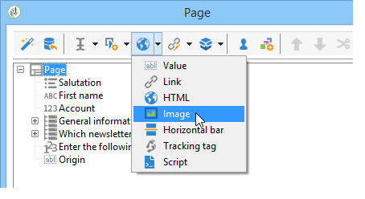

次のフィールドのタイプを使用できます。

* （フォームのコンテキストで）以前提供した回答またはデータベースに基づく値。
* ハイパーリンク、HTML、横棒。 [HTML コンテンツの挿入](#inserting-html-content)を参照してください。
* リソースライブラリまたはユーザーがアクセスできるサーバーに保存された画像。 [画像の挿入](#inserting-images)を参照してください。
* クライアント側またはサーバー側で実行されたスクリプト。 クライアント側で適切に実行するには、JavaScript で記述され、ほとんどのブラウザーとの互換性が必要です。

  >[!NOTE]
  >
  >サーバー側では、スクリプトは、Adobe Campaign が提供する [Campaign JSAPI ドキュメント](https://experienceleague.adobe.com/ja/tools/campaign-api)で定義された関数を使用できます。

## HTML コンテンツの挿入 {#inserting-html-content}

フォームページに、ハイパーテキストリンク、画像、書式設定された段落、ビデオなどの HTML コンテンツを含めることができます。

HTML エディターを使用すると、フォームページに挿入するコンテンツを入力できます。 エディターを開くには、**[!UICONTROL 静的要素]**／**[!UICONTROL HTML]** をクリックします。

コンテンツを直接入力および書式設定したり、ソースコードウィンドウを表示して、一部の外部コンテンツを貼り付けたりできます。 「ソースコード」モードに切り替えるには、ツールバーの最初のアイコンをクリックします。

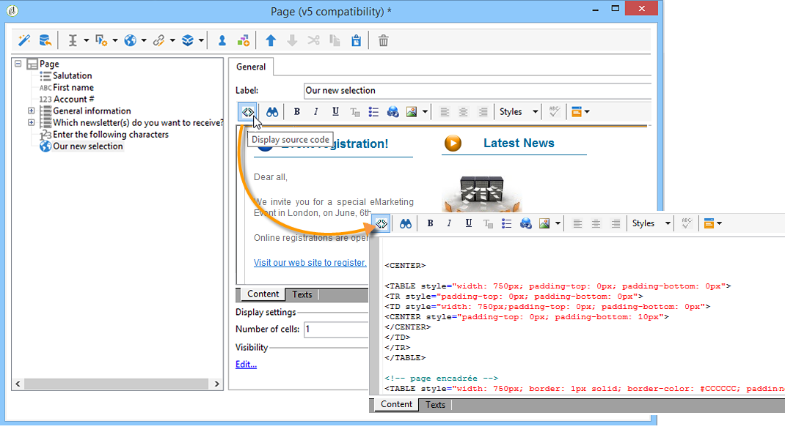

データベースフィールドを挿入するには、パーソナライゼーションボタンを使用します。

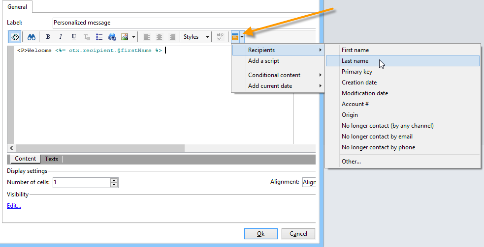

>[!NOTE]
>
>HTML エディターに入力した文字列は、「**[!UICONTROL テキスト]**」サブタブで定義されている場合にのみ、翻訳されます。 そうでない場合、収集されません。 詳しくは、[Web フォームの翻訳](translating-a-web-form.md)を参照してください。

### リンクの挿入 {#inserting-a-link}

次の例のように、編集ウィンドウのフィールドに入力します。

ハイパーリンクを追加するには、**[!UICONTROL 静的要素]**／**[!UICONTROL リンク]**&#x200B;に移動します。

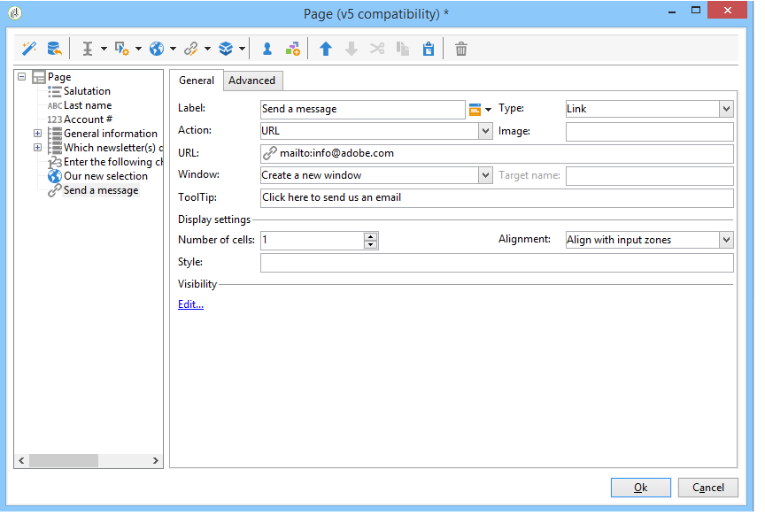

* 「**[!UICONTROL ラベル]**」は、フォームページに表示されるハイパーリンクの内容です。
* 「**[!UICONTROL URL]**」は、目的のアドレス（例：Web サイトの場合は [https://www.adobe.com/jp](https://www.adobe.com/jp)、メッセージを送信したい場合には [info@adobe.com](mailto:info@adobe.com)）です。
* 「**[!UICONTROL ウィンドウ]**」フィールドを使用すると、サイトの場合のリンクの表示モードを選択できます。 リンクを新しいウィンドウで開いたり、現在のウィンドウで開いたり、別のウィンドウで開いたりできます。
* 次に示すように、ツールチップを追加できます。

  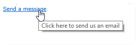

* リンクをボタンとして表示するか、画像として表示するかを選択できます。 これをおこなうには、「**[!UICONTROL タイプ]**」フィールドで表示のタイプを選択します。

### リンクのタイプ {#types-of-links}

デフォルトでは、リンクは、リンク先アドレスが「URL」フィールドに入力できるように、URL タイプのアクションに関連付けられています。

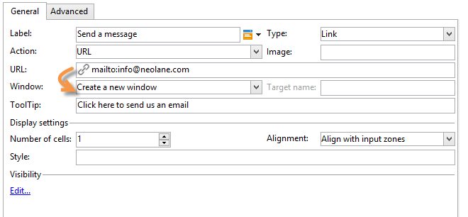

ユーザーがリンクをクリックして次のアクションをおこなえるように、リンクに別のアクションを定義できます。

* ページの更新

  これをおこなうには、「**[!UICONTROL アクション]**」フィールドのドロップダウンボックスで、「**[!UICONTROL ページを更新]**」オプションを選択します。

  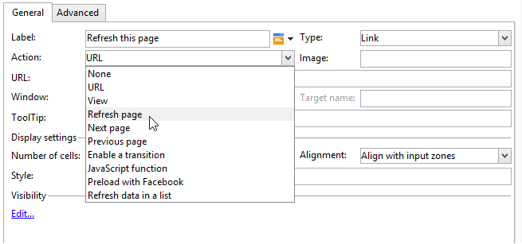

* 次／前のページの表示

  これをおこなうには、「**[!UICONTROL アクション]**」フィールドのドロップダウンボックスで、「**[!UICONTROL 次のページ]**」または「**[!UICONTROL 前のページ]**」オプションを選択します。

  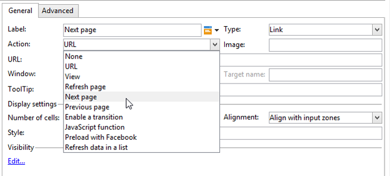

  リンクで置き換える場合は、「**[!UICONTROL 次へ]**」および「**[!UICONTROL 戻る]**」ボタンを非表示することができます。 この[ページ](defining-web-forms-page-sequencing.md)を参照してください。

  リンクは、デフォルトで使用される「**[!UICONTROL 次へ]**」ボタンを置き換えます。

  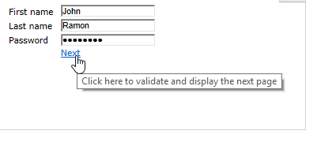

* 別のページの表示

  「**[!UICONTROL トランジションを有効にする]**」オプションを使用すると、「**[!UICONTROL トランジション]**」フィールドで選択されたアウトバウンドトランジションに関連付けられた特定のページを表示できます。

  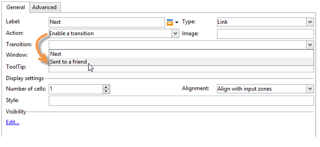

  デフォルトでは、ページには 1 つのアウトバウンドトランジションのみがあります。 新しいトランジションを作成するには、ページを選択して、次に示すように、「**[!UICONTROL アウトバウンドトランジション]**」セクションの&#x200B;**[!UICONTROL 追加]**&#x200B;ボタンをクリックします。

  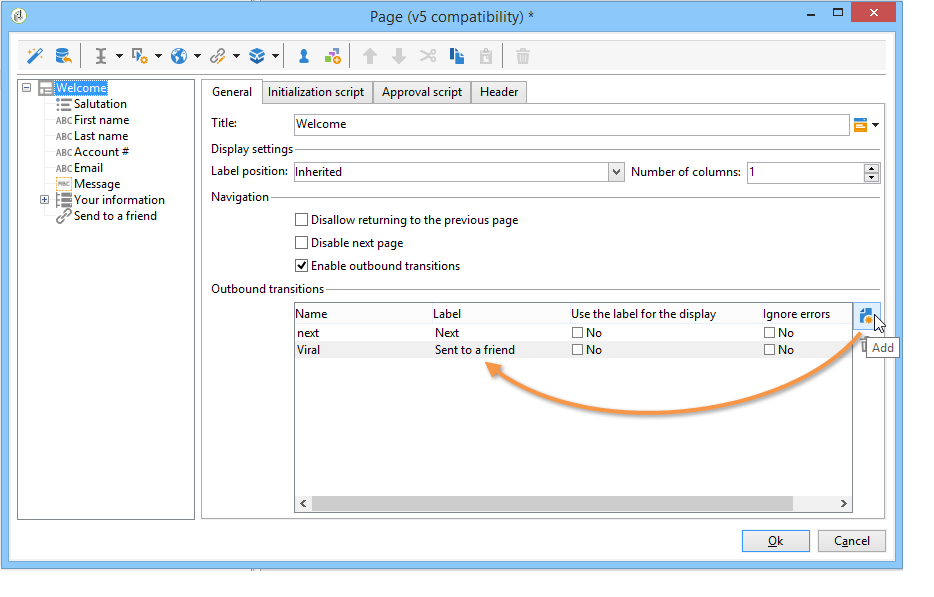

  ダイアグラムでは、この追加は次のように表示されます。

  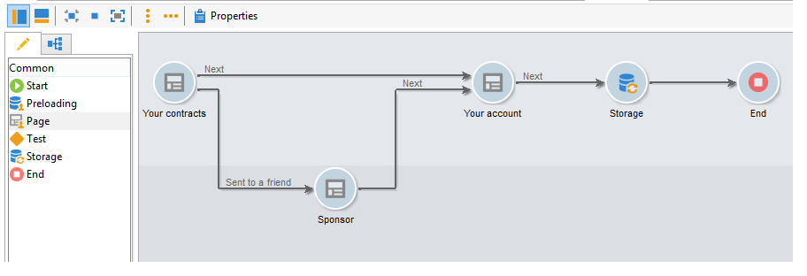

  >[!NOTE]
  >
  >Web フォームのページの順番について詳しくは、[Web フォームページの順番の定義](defining-web-forms-page-sequencing.md)を参照してください。

### HTML コンテンツのパーソナライズ {#personalizing-html-content}

フォームページの HTML コンテンツを前のページで記録したデータでパーソナライズできます。 例えば、自動車保険の Web フォームを作成して、最初のページで連絡先情報および自動車のブランドを提供できます。

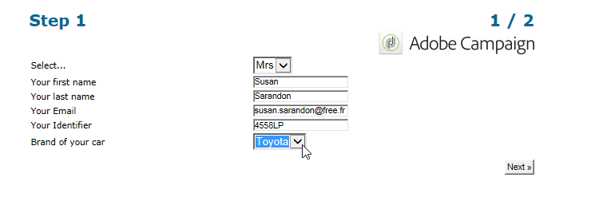

パーソナライゼーションフィールドを使用して、ユーザー名と選択したブランドを次のページに再挿入できます。 使用する構文は、情報ストレージモードによって異なります。 詳しくは、[収集された情報の使用](web-forms-answers.md#using-collected-information)を参照してください。

>[!NOTE]
>
>セキュリティ上の理由により、**`<%=`** 式に入力された値はエスケープ文字に置き換えられます。

この例では、受信者の姓と名がデータベースのフィールドに格納され、自動車のブランドが変数に格納されます。 ページ 2 でパーソナライズされたメッセージの構文は、次のようになります。

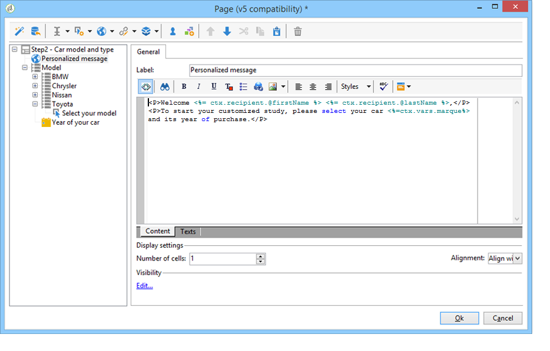

```
<P>Welcome <%= ctx.recipient.@firstName %> <%= ctx.recipient.@lastName %>,</P>
<P>To start your customized study, please select your car <%=ctx.vars.marque%> and its year of purchase.</P>
```

これにより、次のような結果が導かれます。

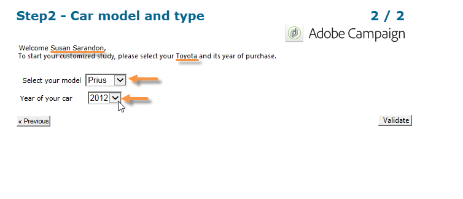

### テキスト変数の使用 {#using-text-variables}

「**[!UICONTROL テキスト]**」タブでは、HTML の &lt;%= 文字と %> 文字の間で使用できる変数フィールドを構文 **$(IDENTIFIER)**.を使用して作成できます。

この方法を使用すると、文字列を容易にローカライズできます。 [Web フォームの翻訳](translating-a-web-form.md)を参照してください。

例えば、「最終コンタクト日：」という文字列を HTML コンテンツに表示できる、**Contact** フィールドを作成できます。 これをおこなうには、以下の手順に従います。

1. HTML テキストの「**[!UICONTROL テキスト]**」タブをクリックします。
1. 「**[!UICONTROL 追加]**」アイコンをクリックします。
1. **[!UICONTROL 識別子]**&#x200B;列に、変数名を入力します。
1. **[!UICONTROL テキスト]**&#x200B;列に、デフォルト値を入力します。

   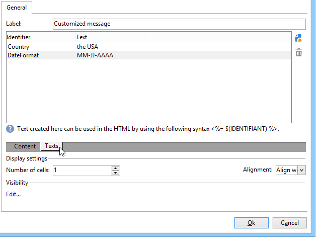

1. HTML コンテンツでは、**&lt;%= $(Contact) %>** 構文を使用してこのテキスト変数を挿入できます。

   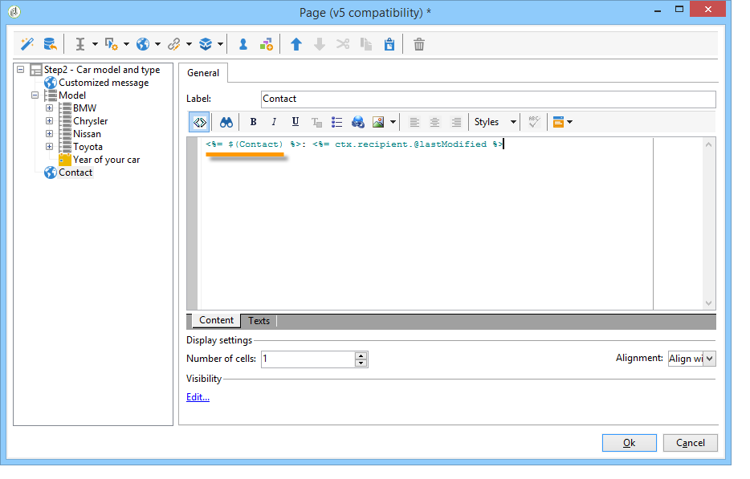

   >[!CAUTION]
   >
   >これらの文字を HTML エディターに入力する場合、**&lt;** および **>** フィールドはエスケープ文字に置き換えられます。 この場合、HTML テキストエディターの&#x200B;**[!UICONTROL ソースコードを表示]**&#x200B;アイコンをクリックして、ソースコードを修正する必要があります。

1. フォームの&#x200B;**[!UICONTROL プレビュー]**&#x200B;ラベルを開いて、HTML に入力した値を表示します。

   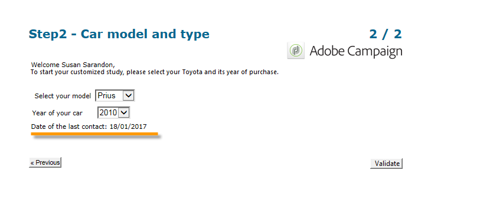

この操作モードでは、Web フォームのテキストを 1 回だけ定義でき、統合翻訳ツールを使用して翻訳を管理できます。 詳しくは、[web フォームの翻訳](translating-a-web-form.md)を参照してください。

## 画像の挿入 {#inserting-images}

画像をフォームに含める場合、外部からアクセス可能なサーバーに保存されている必要があります。

**[!UICONTROL 静的要素]**／**[!UICONTROL 画像]**&#x200B;メニューを選択します。

挿入する画像のソースを選択します。パブリックリソースライブラリから取得したり、外部からアクセス可能なサーバーに保存したりできます。

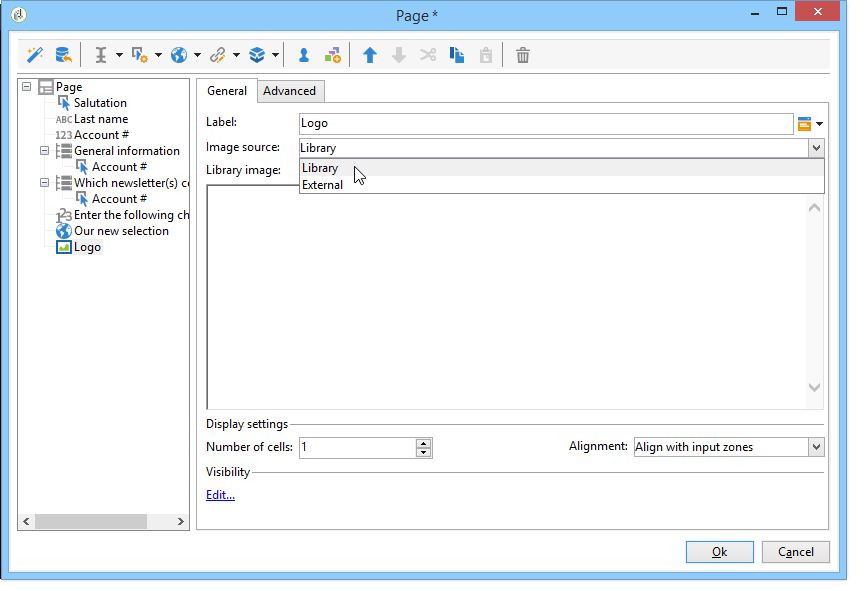

ライブラリからの画像の場合、フィールドのコンボボックスで選択します。外部ファイルにある場合、アクセスパスを入力します。 ラベルは、画像にマウスポインターを重ねるか、画像が表示されない場合に表示されます（HTML の ALT フィールドと同じ）。

画像は、エディター中央のセクションに表示できます。
