# web フォームの翻訳{#translating-a-web-form}


1 つの Web アプリケーションを多言語にローカライズすることができます。

Adobe Campaign コンソールで直接翻訳を実行したり（[エディターでの翻訳の管理 ](#managing-translations-in-the-editor)を参照）、文字列をエクスポートおよびインポートして外部で翻訳したり（[外部での翻訳](#externalizing-translation)を参照）できます。

デフォルトで使用可能な翻訳言語のリストは、[フォームの表示言語の変更](#changing-forms-display-language)を参照してください。

Web アプリケーションは、編集言語で設計されます。これは、翻訳するラベルおよびその他のコンテンツを入力するために使用される基準言語です。

デフォルト言語は、アクセス URL に言語設定が追加されていない場合に Web アプリケーションで表示される言語です。

>[!NOTE]
>
>デフォルトでは、編集言語とデフォルト言語は、コンソールの言語と同じです。

## 言語の選択 {#choosing-languages}

1 つまたは複数の翻訳言語を定義するには、Web アプリケーションの「**[!UICONTROL プロパティ]**」ボタンをクリックし、「**[!UICONTROL ローカライゼーション]**」タブをクリックします。 **[!UICONTROL 追加]**&#x200B;ボタンをクリックして、Web アプリケーションの新しい翻訳言語を定義します。

>[!NOTE]
>
>また、このウィンドウでは、デフォルト言語および編集言語を変更できます。

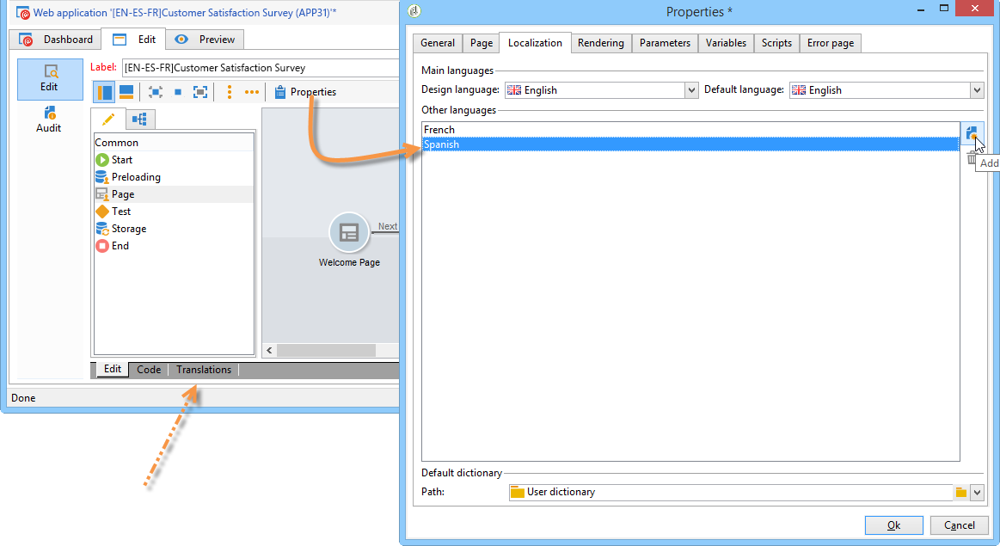

Web アプリケーションの翻訳言語を追加する場合（またはデフォルト言語と編集言語が異なる場合）、翻訳を管理するための「**[!UICONTROL 翻訳]**」サブタブが「**[!UICONTROL 編集]**」タブに追加されます。

Adobe Campaign には、複数言語の翻訳を実行および管理するためのツールが含まれています。 このエディターを使用すると、翻訳または承認する文字列を表示したり、インターフェイスに直接翻訳を入力したり、外部翻訳に対して文字列をインポート／エクスポートしたりできます。

## エディターでの翻訳の管理 {#managing-translations-in-the-editor}

### 文字列の収集 {#collecting-strings}

「**[!UICONTROL 翻訳]**」タブを使用すると、Web アプリケーションを構成する文字列の翻訳を入力できます。

このタブを初めて開いたときは、何のデータも含まれていません。 **[!UICONTROL 翻訳する文字列を収集]**&#x200B;リンクをクリックし、Web アプリケーションの文字列を更新します。

Adobe Campaign はフィールドのラベルとすべての静的要素（HTML ブロック、Javascript など）の「**[!UICONTROL テキスト]**」タブで定義された文字列を収集します。静的要素について詳しくは、[web フォームの静的要素](static-elements-in-a-web-form.md)で説明しています。

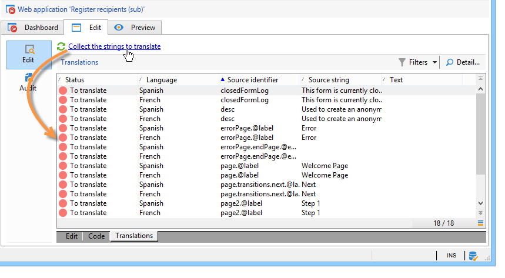

>[!CAUTION]
>
>このプロセスは、処理するデータの量によっては数分間かかることがあります。
> 
>システム辞書に一部の翻訳が見つからないという警告が表示される場合は、[システム文字列の翻訳](#translating-the-system-strings)を参照してください。

文字列が翻訳されるたびに、その翻訳が翻訳辞書に追加されます。

翻訳が既に存在していることを収集プロセスが検出すると、文字列の&#x200B;**[!UICONTROL テキスト]**&#x200B;列に翻訳が表示されます。 文字列のステータスは、「**[!UICONTROL 翻訳済み]**」に変わります。

翻訳されたことのない文字列の場合、「**[!UICONTROL テキスト]**」フィールドは空になり、ステータスは「**[!UICONTROL 翻訳する]**」になります。

### 文字列のフィルタリング {#filtering-strings}

デフォルトでは、Web アプリケーションの各翻訳言語が表示されます。 デフォルトでは、フィルターには、言語とステータスの 2 つがあります。 「**[!UICONTROL フィルター]**」ボタンをクリックし、「**[!UICONTROL 言語別またはステータス別]**」をクリックして、ドロップダウンボックスに一致するものを表示します。 また、詳細フィルターを作成することもできます。 フィルターについて詳しくは、[Campaign v8（コンソール）ドキュメント](https://experienceleague.adobe.com/ja/docs/campaign/campaign-v8/audience/create-filters){target=_blank}を参照してください。

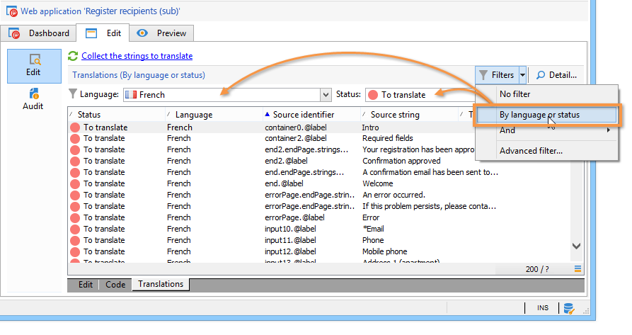

**[!UICONTROL 言語]**&#x200B;ドロップダウンボックスに移動して、翻訳言語を選択します。

未翻訳の文字列のみを表示するには、**[!UICONTROL ステータス]**&#x200B;ドロップダウンボックスで「**[!UICONTROL 翻訳する]**」を選択します。 また、翻訳済みまたは承認済みの文字列のみを表示することもできます。

### 文字列の翻訳 {#translating-strings}

1. 単語を翻訳するには、文字列のリストでその行をダブルクリックします。

   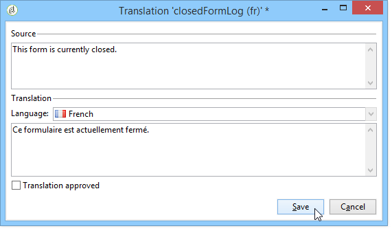

   ソース文字列が、ウィンドウの上のセクションに表示されます。

1. 下のセクションに翻訳を入力します。 承認するには、「**[!UICONTROL 翻訳承認済み]**」オプションをチェックします。

   >[!NOTE]
   >
   >翻訳承認済みはオプションで、処理をブロックしません。

   未承認の翻訳は、「**[!UICONTROL 翻訳済み]**」と表示されます。 承認済みの翻訳は、「**[!UICONTROL 承認済み]**」と表示されます。

## 外部での翻訳 {#externalizing-translation}

文字列をエクスポートおよびインポートして、Adobe Campaign 以外のツールを使用して翻訳できます。

>[!CAUTION]
>
>文字列をエクスポートしたら、統合ツールを使用した翻訳を実行しないでください。 これは、翻訳を再インポートする際に競合を引き起こし、これらの翻訳が失われます。

### ファイルのエクスポート {#exporting-files}

1. 文字列をエクスポートする Web アプリケーションを選択し、右クリックして、**[!UICONTROL アクション／翻訳の文字列をエクスポート...]**&#x200B;を選択します。

   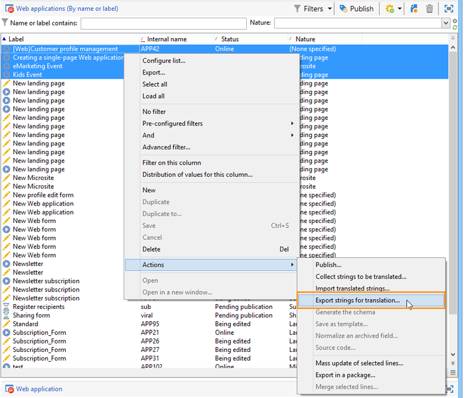

1. 「**[!UICONTROL エクスポート戦略]**」を選択します。

   * **[!UICONTROL 言語ごとに 1 ファイル]**：エクスポートは、翻訳言語ごとに 1 ファイルを生成します。 各ファイルは、選択したすべての Web アプリケーションで共通です。
   * **[!UICONTROL 各 Web アプリケーションにつき 1 ファイル]**：エクスポートは、選択した Web アプリケーションごとに 1 ファイルを生成します。 各ファイルには、すべての翻訳言語が含まれます。

     >[!NOTE]
     >
     >このタイプのエクスポートは、XLIFF エクスポートでは使用できません。

   * **[!UICONTROL 言語および Web アプリケーションごとに 1 ファイル]**：エクスポートは、複数のファイルを生成します。 各ファイルには、Web アプリケーションごとに 1 つの翻訳言語が含まれます。
   * **[!UICONTROL 全部で 1 つのファイル]**：エクスポートは、すべての Web アプリケーションに対して 1 つの複数言語ファイルを生成します。 選択したすべての Web アプリケーションのすべての翻訳言語が含まれます。

     >[!NOTE]
     >
     >このタイプのエクスポートは、XLIFF エクスポートでは使用できません。

1. 次に、ファイルが記録される「**[!UICONTROL ターゲットフォルダー]**」を選択します。
1. ファイル形式（**[!UICONTROL CSV]** または **[!UICONTROL XLIFF]**）を選択して、「**[!UICONTROL 開始]**」をクリックします。

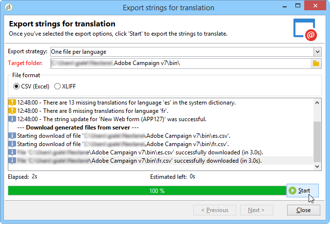

>[!NOTE]
>
>エクスポートファイルの名前は、自動的に生成されます。 同じエクスポートを複数回実行すると、既存のファイルは新しいファイルに置き換えられます。 前のファイルを保持する必要がある場合は、「**[!UICONTROL ターゲットフォルダー]**」を変更してから、「**[!UICONTROL 開始]**」を再びクリックして、エクスポートを実行します。

**CSV 形式**&#x200B;でファイルをエクスポートする場合、各言語はステータスおよび承認ステータスにリンクされます。 **承認しますか？** 列を使用すると、翻訳を承認できます。 この列には、値 **Yes** または **No** が含まれることがあります。 統合エディター（[エディターでの翻訳の管理](#managing-translations-in-the-editor)を参照）については、翻訳の承認はオプションで、処理をブロックしません。

### ファイルのインポート {#importing-files}

外部翻訳が完了したら、翻訳済みファイルをインポートできます。

1. Web アプリケーションのリストに移動して、右クリックし、**[!UICONTROL アクション／翻訳済み文字列をインポート]**&#x200B;を選択します。

   >[!NOTE]
   >
   >翻訳に関係する Web アプリケーションを選択する必要はありません。 Web アプリケーションのリスト上にマウスポインターを置きます。

   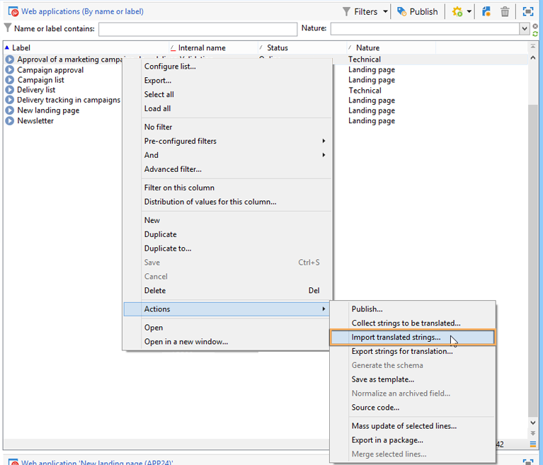

1. インポートするファイルを選択し、「**[!UICONTROL アップロード]**」をクリックします。

   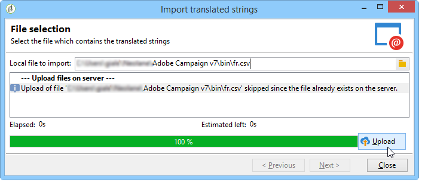

>[!NOTE]
>
>外部翻訳は、常に内部翻訳よりも優先されます。 競合が発生した場合、内部翻訳は、外部翻訳で上書きされます。

## フォームの表示言語の変更 {#changing-forms-display-language}

Web フォームは、Web アプリケーションプロパティの「**[!UICONTROL ローカライゼーション]**」タブで指定されたデフォルト言語で表示されます。 言語を変更するには、URL の末尾に次の文字列を追加する必要があります（**xx** は、言語のシンボルです）。

```
?lang=xx
```

言語が URL の最初または唯一のパラメーターの場合。 例：**https://myserver/webApp/APP34**

```
&lang=xx
```

URL の言語の前に他のパラメーターがある場合。 例：**https://myserver/webApp/APP34?status=1&amp;lang=en**

デフォルトで使用できる翻訳言語と辞書を次に示します。

**デフォルトのシステム辞書**：一部の言語には、システム文字列の翻訳を含むデフォルト辞書が含まれています。 詳しくは、[システム文字列の翻訳](#translating-the-system-strings)を参照してください。

**カレンダーの管理**：Web アプリケーションのページには、日付を入力するためのカレンダーを含めることができます。 デフォルトでは、このカレンダーがいくつかの言語で使用できます（曜日、日付フォーマットの翻訳）。

<table> 
 <tbody> 
  <tr> 
   <td> <strong>言語（シンボル）</strong><br /> </td> 
   <td> <strong>デフォルトのシステム辞書</strong><br /> </td> 
   <td> <strong>カレンダーの管理</strong><br /> </td> 
  </tr> 
  <tr> 
   <td> ドイツ語（de）<br /> </td> 
   <td> ○<br /> </td> 
   <td> ○<br /> </td> 
  </tr> 
  <tr> 
   <td> 英語（en）<br /> </td> 
   <td> ○<br /> </td> 
   <td> ○<br /> </td> 
  </tr> 
  <tr> 
   <td> 英語（米国）（en_US）<br /> </td> 
   <td> </td> 
   <td> </td> 
  </tr> 
  <tr> 
   <td> 英語（英国）（en_GB）<br /> </td> 
   <td> </td> 
   <td> </td> 
  </tr> 
  <tr> 
   <td> アラビア語（ar）<br /> </td> 
   <td> </td> 
   <td> </td> 
  </tr> 
  <tr> 
   <td> 中国語（zh）<br /> </td> 
   <td> </td> 
   <td> </td> 
  </tr> 
  <tr> 
   <td> 韓国語（ko）<br /> </td> 
   <td> </td> 
   <td> </td> 
  </tr> 
  <tr> 
   <td> デンマーク語（da）<br /> </td> 
   <td> ○<br /> </td> 
   <td> ○<br /> </td> 
  </tr> 
  <tr> 
   <td> スペイン語（es）<br /> </td> 
   <td> ○<br /> </td> 
   <td> ○<br /> </td> 
  </tr> 
  <tr> 
   <td> エストニア語（et）<br /> </td> 
   <td> </td> 
   <td> </td> 
  </tr> 
  <tr> 
   <td> フィンランド語（fi）<br /> </td> 
   <td> </td> 
   <td> ○<br /> </td> 
  </tr> 
  <tr> 
   <td> フランス語（fr）<br /> </td> 
   <td> ○<br /> </td> 
   <td> ○<br /> </td> 
  </tr> 
  <tr> 
   <td> フランス語（ベルギー）（fr_BE）<br /> </td> 
   <td> </td> 
   <td> </td> 
  </tr> 
  <tr> 
   <td> フランス語（フランス）（fr_FR）<br /> </td> 
   <td> </td> 
   <td> </td> 
  </tr> 
  <tr> 
   <td> ギリシャ語（el）<br /> </td> 
   <td> </td> 
   <td> ○<br /> </td> 
  </tr> 
  <tr> 
   <td> ヘブライ語（he）<br /> </td> 
   <td> </td> 
   <td> </td> 
  </tr> 
  <tr> 
   <td> ハンガリー語（hu）<br /> </td> 
   <td> </td> 
   <td> ○<br /> </td> 
  </tr> 
  <tr> 
   <td> インドネシア語（id）<br /> </td> 
   <td> </td> 
   <td> </td> 
  </tr> 
  <tr> 
   <td> アイルランド語（ga）<br /> </td> 
   <td> </td> 
   <td> </td> 
  </tr> 
  <tr> 
   <td> イタリア語（it）<br /> </td> 
   <td> ○<br /> </td> 
   <td> ○<br /> </td> 
  </tr> 
  <tr> 
   <td> イタリア語（イタリア）（it_IT）<br /> </td> 
   <td> </td> 
   <td> </td> 
  </tr> 
  <tr> 
   <td> イタリア語（スイス）（it_CH）<br /> </td> 
   <td> </td> 
   <td> </td> 
  </tr> 
  <tr> 
   <td> 日本語（ja）<br /> </td> 
   <td> </td> 
   <td> </td> 
  </tr> 
  <tr> 
   <td> ラトビア語（lv）<br /> </td> 
   <td> </td> 
   <td> ○<br /> </td> 
  </tr> 
  <tr> 
   <td> リトアニア語（lt）<br /> </td> 
   <td> </td> 
   <td> </td> 
  </tr> 
  <tr> 
   <td> マルタ語（mt）<br /> </td> 
   <td> </td> 
   <td> </td> 
  </tr> 
  <tr> 
   <td> オランダ語（nl）<br /> </td> 
   <td> </td> 
   <td> ○<br /> </td> 
  </tr> 
  <tr> 
   <td> オランダ語（ベルギー）（nl_BE）<br /> </td> 
   <td> </td> 
   <td> </td> 
  </tr> 
  <tr> 
   <td> オランダ語（オランダ）（nl_NL）<br /> </td> 
   <td> </td> 
   <td> </td> 
  </tr> 
  <tr> 
   <td> ノルウェー語（ノルウェー）（no_NO）<br /> </td> 
   <td> </td> 
   <td> ○<br /> </td> 
  </tr> 
  <tr> 
   <td> ポーランド語（pl）<br /> </td> 
   <td> </td> 
   <td> ○<br /> </td> 
  </tr> 
  <tr> 
   <td> ポルトガル語（pt）<br /> </td> 
   <td> </td> 
   <td> ○<br /> </td> 
  </tr> 
  <tr> 
   <td> ポルトガル語（ブラジル）（pt_BR）<br /> </td> 
   <td> </td> 
   <td> </td> 
  </tr> 
  <tr> 
   <td> ポルトガル語（ポルトガル）（pt_PT）<br /> </td> 
   <td> </td> 
   <td> </td> 
  </tr> 
  <tr> 
   <td> ロシア語（ru）<br /> </td> 
   <td> </td> 
   <td> ○<br /> </td> 
  </tr> 
  <tr> 
   <td> スロベニア語（sl）<br /> </td> 
   <td> </td> 
   <td> </td> 
  </tr> 
  <tr> 
   <td> スロバキア語（sk）<br /> </td> 
   <td> </td> 
   <td> </td> 
  </tr> 
  <tr> 
   <td> スウェーデン語（sv）<br /> </td> 
   <td> ○<br /> </td> 
   <td> ○<br /> </td> 
  </tr> 
  <tr> 
   <td> スウェーデン語（フィンランド）（sv_FI）<br /> </td> 
   <td> </td> 
   <td> </td> 
  </tr> 
  <tr> 
   <td> スウェーデン語（スウェーデン）（sv_SE）<br /> </td> 
   <td> </td> 
   <td> </td> 
  </tr> 
  <tr> 
   <td> チェコ語（cs）<br /> </td> 
   <td> </td> 
   <td> </td> 
  </tr> 
  <tr> 
   <td> タイ語（th）<br /> </td> 
   <td> </td> 
   <td> </td> 
  </tr> 
  <tr> 
   <td> ベトナム語（vi）<br /> </td> 
   <td> </td> 
   <td> </td> 
  </tr> 
  <tr> 
   <td> ワロン語（wa）<br /> </td> 
   <td> </td> 
   <td> </td> 
  </tr> 
 </tbody> 
</table>

>[!NOTE]
>
>デフォルトで提供されている以外の言語を追加するには、[翻訳言語の追加](#adding-a-translation-language)を参照してください。

## 例：複数の言語での Web アプリケーションの表示 {#example--displaying-a-web-application-in-several-languages}

次の Web フォームは、英語、フランス語、ドイツ語、スペイン語の 4 つの言語で使用できます。 文字列は、すべて Web フォームの「**[!UICONTROL 翻訳]**」タブで翻訳されています。 デフォルト言語が英語なので、調査がパブリッシュされる際には、英語で表示するための標準 URL が使用されます。

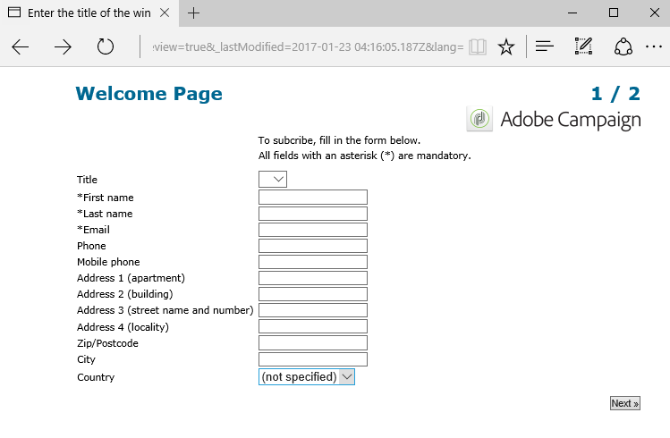

フランス語で表示するには、URL の末尾に **?lang=fr** を追加します。

>[!NOTE]
>
>各言語のシンボルのリストについて詳しくは、[フォームの表示言語の変更](#changing-forms-display-language)を参照してください。

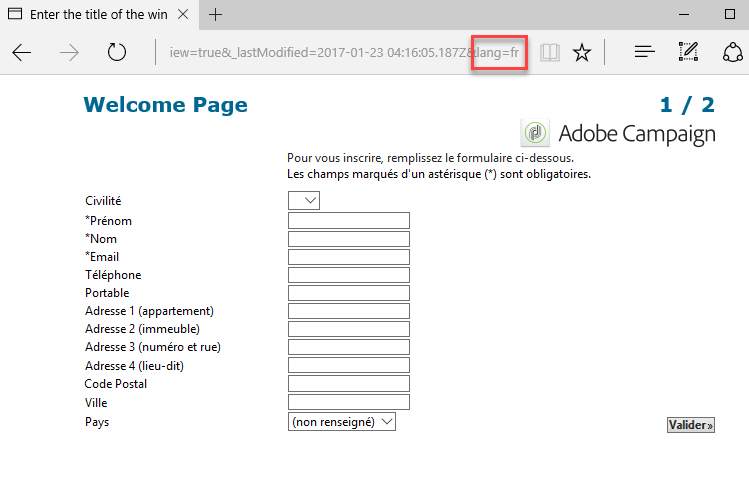

**?lang=es** または **?lang=de** を追加して、スペイン語またはドイツ語で表示することができます。

>[!NOTE]
>
>この Web アプリケーションで他のパラメーターが既に使用されている場合は、**&amp;lang=** を追加します。\
>例：**https://myserver/webApp/APP34?status=1&amp;lang=en**

## 詳細な翻訳設定 {#advanced-translation-configuration}

>[!CAUTION]
>
>このセクションはエキスパートユーザーのみを対象にしています。

### システム文字列の翻訳 {#translating-the-system-strings}

システム文字列は、すべての Web アプリケーションで標準の文字列です。 例：「**[!UICONTROL 次へ]**」、「**[!UICONTROL 前へ]**」、「**[!UICONTROL 承認]**」の各ボタン、**[!UICONTROL 読み込み中]**&#x200B;メッセージなど。デフォルトでは、一部の言語には、これらの文字列の翻訳を含む辞書が含まれています。 言語のリストについて詳しくは、[フォームの表示言語の変更](#changing-forms-display-language)を参照してください。

システム辞書が翻訳されていない言語に Web アプリケーションを翻訳する場合、一部の翻訳が見つからないことを知らせる警告メッセージが表示されます。

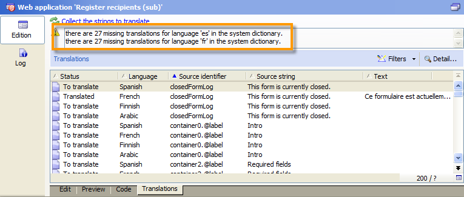

言語を追加するには、次の手順に従います。

1. Adobe Campaign ツリーに移動して、**[!UICONTROL 管理／設定／グローバル辞書／システム辞書]**&#x200B;をクリックします。
1. ウィンドウの上部のセクションで、翻訳するシステム文字列を選択して、下部のセクションの「**[!UICONTROL 追加]**」をクリックします。

   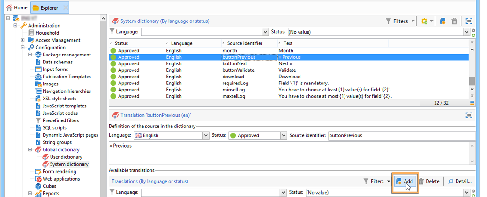

1. 翻訳言語を選択して、その文字列の翻訳を入力します。 翻訳を承認するには、「**[!UICONTROL 翻訳承認済み]**」オプションをオンにします。

   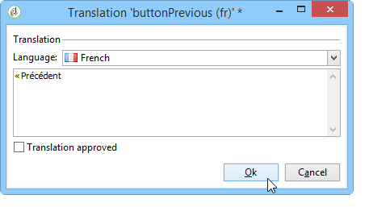

   >[!NOTE]
   >
   >翻訳承認済みはオプションで、処理をブロックしません。

>[!CAUTION]
>
>標準のシステム文字列は削除しないでください。

### 翻訳言語の追加 {#adding-a-translation-language}

Web アプリケーションをデフォルト以外の言語に翻訳するには（[フォームの表示言語の変更](#changing-forms-display-language)を参照）、新しい翻訳言語を追加する必要があります。

1. Adobe Campaign ツリーの&#x200B;**[!UICONTROL 管理／プラットフォーム／列挙]**&#x200B;ノードをクリックし、リストから&#x200B;**[!UICONTROL 翻訳に使用できる言語]**&#x200B;を選択します。 使用できる翻訳のリストが、ウィンドウの下部のセクションに表示されます。

   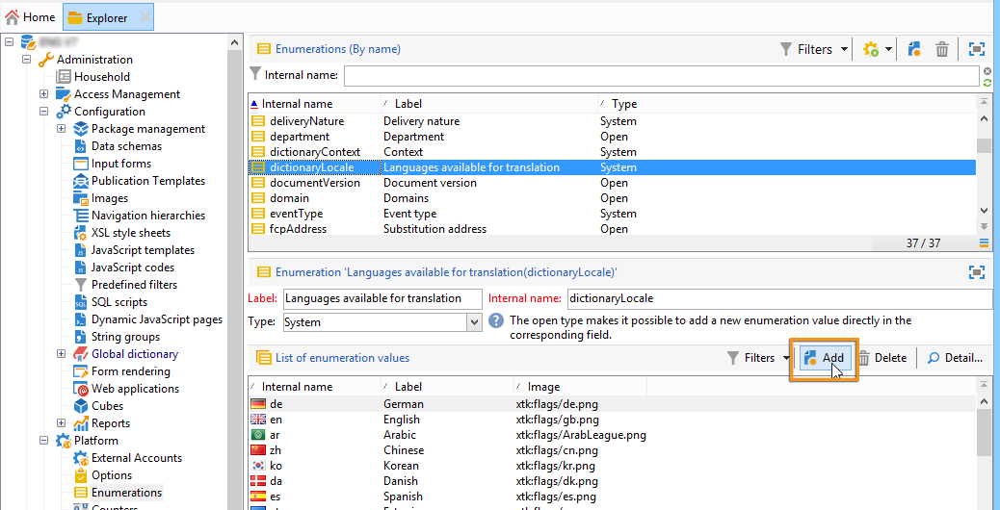

1. 「**[!UICONTROL 追加]**」ボタンをクリックして、「**[!UICONTROL 内部名]**」、「**[!UICONTROL ラベル]**」および画像の識別子（フラグ）を入力します。 新しい画像を追加するには、管理者にお問い合わせください。

   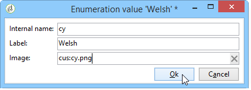
