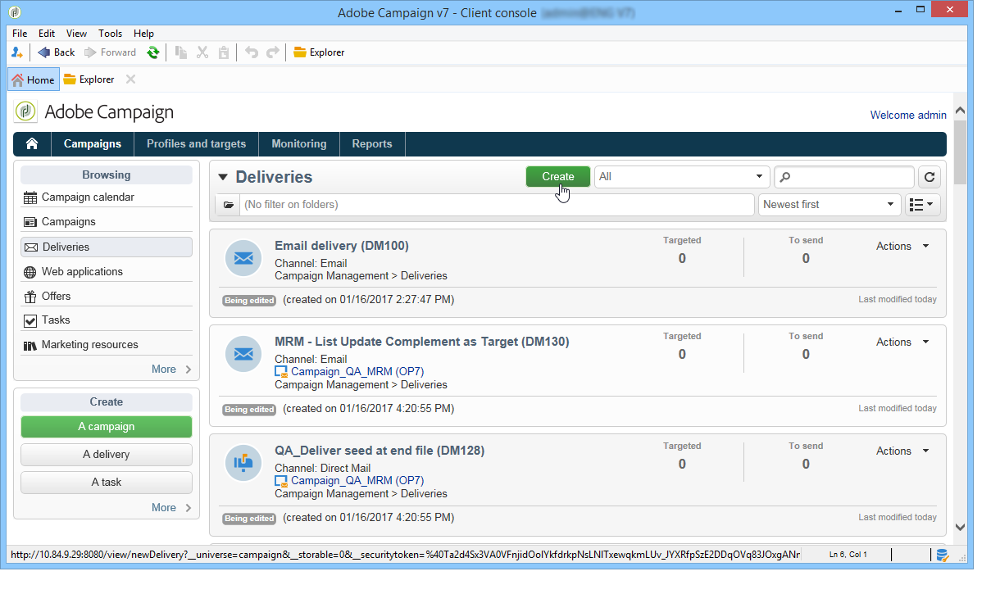
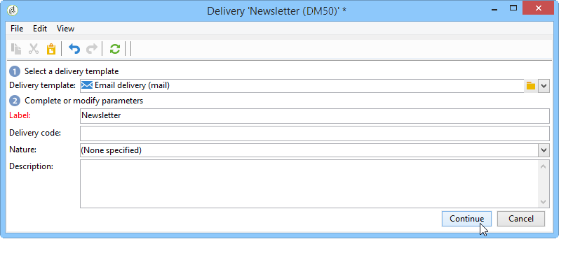
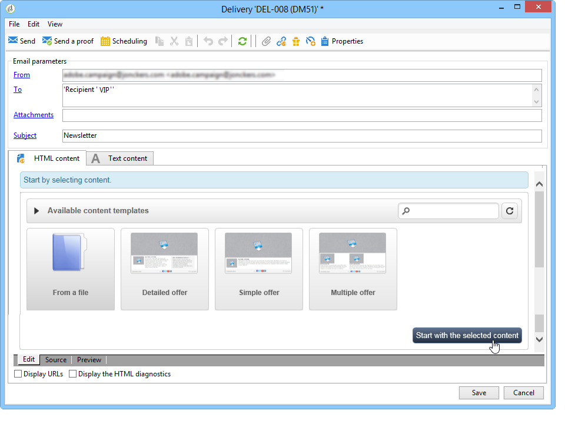
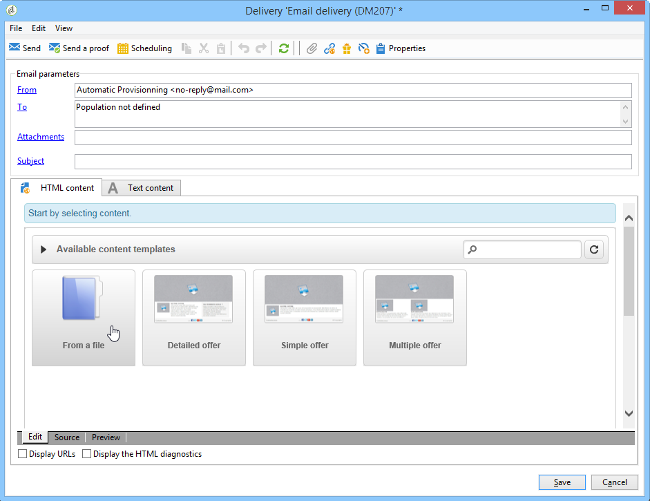
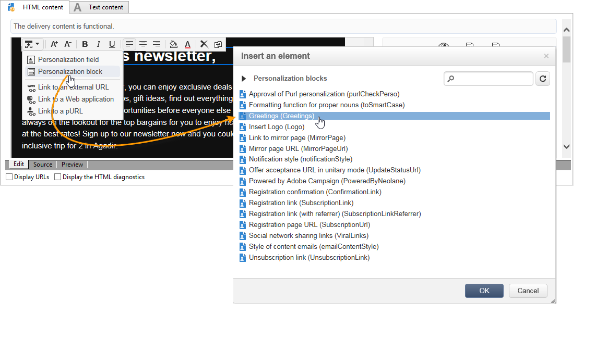
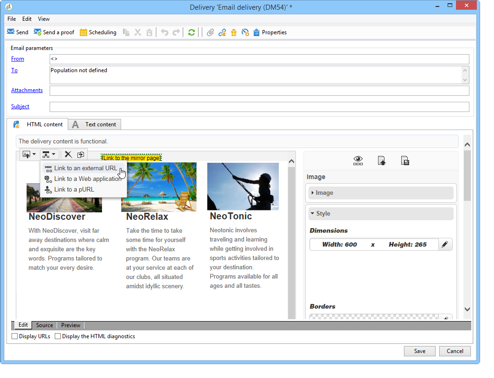
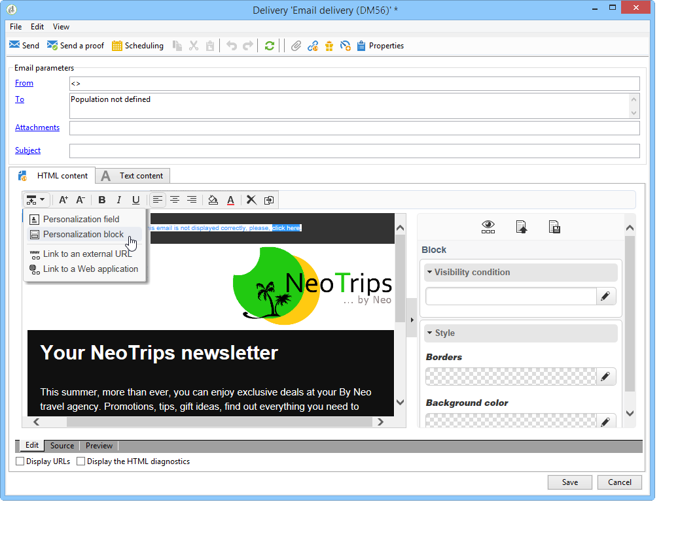
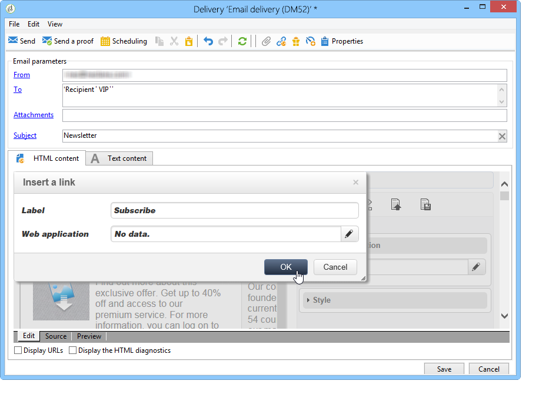

# ユースケース：メール配信の作成{#use-case-creating-an-email-delivery}

この使用例では、Adobe Campaign デジタルコンテンツエディター（DCE）を使用したメール配信をデザインするための手順を説明します。

最終目標は、次の要素を含むパーソナライズされたテンプレートを使用して配信を作成することです。

* 受信者へ直接の挨拶（姓と名を使用）
* 外部 URL へのリンク 2 種類
* ミラーページ
* Web アプリケーションへのリンク

>[!NOTE]
>
>将来の配信のコンテンツをホストするために、開始する前に少なくとも 1 つの **HTML テンプレート**&#x200B;が設定されている必要があります。
>
>配信&#x200B;**[!UICONTROL プロパティ]**&#x200B;で、「**[!UICONTROL コンテンツ編集モード]**」（「**[!UICONTROL 詳細]**」タブ）が「**[!UICONTROL DCE]**」に設定されていることを確認します。 エディターの最適な操作を確保するには、[コンテンツ編集のベストプラクティス](content-editing-best-practices.md)を参照してください。

## 手順 1 - 配信の作成 {#step-1---creating-a-delivery}

新しい配信を作成するには、カーソルを「**キャンペーン**」タブに置いて、「**配信**」をクリックします。 次に、既存の配信のリストの上にある「**作成**」ボタンをクリックします。 配信の作成について詳しくは、[このページ](https://experienceleague.adobe.com/en/docs/campaign-classic/using/sending-messages/about-email-channel){target="_blank"}を参照してください。

## 手順 2 - テンプレートの選択 {#step-2---selecting-a-template}

配信テンプレートを選択して、配信に名前を付けます。 この名前は、Adobe Campaign コンソールのユーザーにのみ表示され、受信者には表示されません。ただし、この見出しは、配信のリストに表示されます。 「**[!UICONTROL 続行]**」をクリックします。

## 手順 3 - コンテンツの選択 {#step-3---selecting-a-content}

デジタルコンテンツエディターには、すぐに使用できる様々なテンプレートが付属しています。これらのテンプレートは、多様な要素（列、テキスト領域など）で構成されています

使用するコンテンツテンプレートを選択したら、「**[!UICONTROL 選択したコンテンツで開始]**」ボタンをクリックして、作成した配信にテンプレートを表示します。

また、「**[!UICONTROL ファイルから]**」を選択すると、Adobe Campaign 以外で作成した HTML コンテンツをインポートすることもできます。

このコンテンツをテンプレートとして保存し、後で利用することもできます。 パーソナライズされたコンテンツテンプレートを作成すると、テンプレートのリストからプレビューできるようになります。 詳しくは、[テンプレート管理](template-management.md)を参照してください。

>[!CAUTION]
>
>**Adobe Campaign Web インターフェイス**&#x200B;を使用している場合は、HTML コンテンツと関連する画像を含む .zip ファイルをインポートする必要があります。

## 手順 4 - メッセージの設計 {#step-4---designing-the-message}

* 受信者の氏名の表示

  受信者の氏名を配信のテキストフィールドに挿入するには、選択したテキストフィールドをクリックして、表示する場所にマウスポインターを置きます。 ポップアップツールバーの最初のアイコンをクリックし、**[!UICONTROL パーソナライゼーションブロック]**&#x200B;をクリックします。 「**[!UICONTROL 挨拶]**」を選択し、「**[!UICONTROL OK]**」をクリックします。

  

* リンクを画像に挿入します。

  画像を使用して配信の受信者を外部アドレスに導くには、関連する画像をクリックしてポップアップツールバーを表示し、最初のアイコン上にマウスポインターを置いて、**[!UICONTROL 外部 URL へのリンク]**&#x200B;をクリックします。 詳しくは、[リンクの追加](editing-content.md#adding-a-link)を参照してください。

  

  **https://www.myURL.com** という形式で「**URL**」フィールドにリンクの URL を入力して、確認します。

  リンクは、ウィンドウの右側のセクションを使用して、いつでも変更できます。

* リンクをテキストに挿入します。

  外部リンクを配信のテキストに統合するには、テキストの一部またはテキストのブロックを選択して、ポップアップツールバーの最初のアイコンをクリックします。 **[!UICONTROL 外部 URL へのリンク]**&#x200B;をクリックして、「**[!UICONTROL URL]**」フィールドにリンクアドレスを入力します。 詳しくは、[リンクの追加](editing-content.md#adding-a-link)を参照してください。

  リンクは、ウィンドウの右側のセクションを使用して、いつでも変更できます。

  >[!CAUTION]
  >
  >「**[!UICONTROL ラベル]**」フィールドに入力したテキストは、元のテキストを置き換えます。

* ミラーページの追加

  受信者に Web ブラウザーで配信コンテンツを表示するのを許可するには、ミラーページへのリンクを配信に統合します。

  投稿したリンクを表示するテキストフィールドをクリックします。 ポップアップツールバーの最初のアイコンをクリックして、**[!UICONTROL パーソナライゼーションブロック]**&#x200B;を選択し、**[!UICONTROL ミラーページへのリンク（MirrorPage）]**&#x200B;を選択します。 「**[!UICONTROL 保存]**」をクリックして確定します。

  

  >[!CAUTION]
  >
  >パーソナライゼーションブロックラベルは、配信の元のテキストを自動的に置き換えます。

* Web アプリケーションへのリンクの統合

  デジタルコンテンツエディターを使用すると、Adobe Campaign コンソールから Web アプリケーションへのリンクを統合できます（ランディングページやフォームページなど）。 詳しくは、[Web アプリケーションへのリンク](editing-content.md#link-to-a-web-application)を参照してください。

  Web アプリケーションへのリンクのテキストフィールドを選択して、最初のアイコンをクリックします。 **[!UICONTROL Web アプリケーションへのリンク]**&#x200B;を選択し、「**Web アプリケーション**」フィールドの末尾にあるアイコンをクリックして、目的のアプリケーションを選択します。

  

  「**保存**」をクリックして確定します。

  >[!NOTE]
  >
  >この手順では、事前に少なくとも 1 つの Web アプリケーションを保存しておく必要があります。 それらがコンソールの&#x200B;**[!UICONTROL キャンペーン／「Web アプリケーション」]**&#x200B;タブに表示されます。

## 手順 5 - 配信の保存 {#step-5---saving-the-delivery}

コンテンツを統合したら、「**保存**」をクリックして配信を保存します。 これで、**[!UICONTROL キャンペーン／「配信」]**&#x200B;タブにある配信のリストに表示されます。
