# Web フォームの回答{#web-forms-answers}


## 回答ストレージフィールド {#response-storage-fields}

フォームへの回答は、データベースのフィールドか、一時的にローカル変数に保存できます。 回答のストレージモードは、フィールド作成時に選択されます。 これは、「**[!UICONTROL ストレージを編集]**」リンクを使用して編集できます。

フォームの各入力フィールドについて、次のストレージオプションを使用できます。

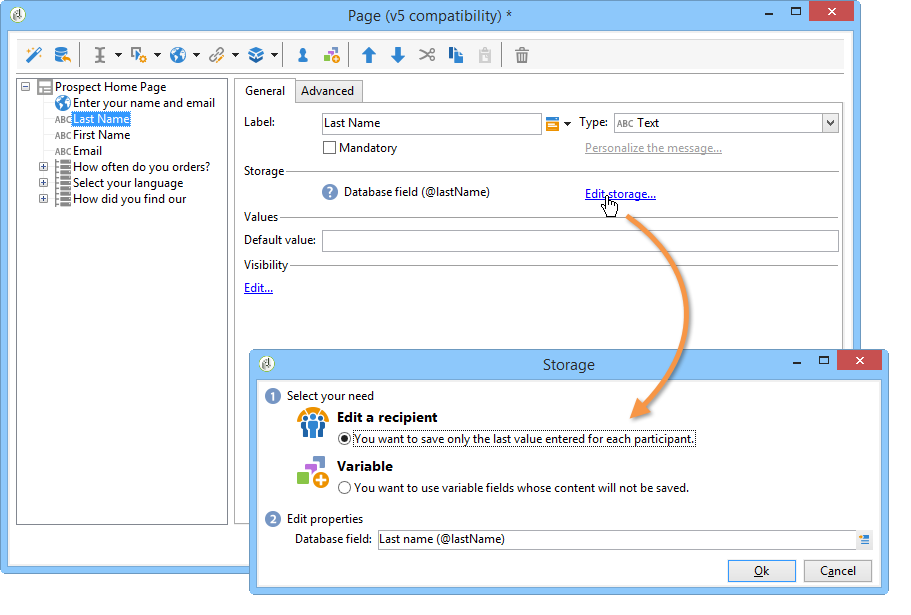

* **[!UICONTROL 受信者を編集]**

  データベースのフィールドを選択できます。ユーザーの回答はこのフィールドに格納されます。 各ユーザーごとに、最後に入力した値のみが保存され、プロファイルに追加されます。[データベースへのデータの格納](#storing-data-in-the-database)を参照してください。

* **[!UICONTROL 変数]**

  情報をデータベースに格納したくない場合、変数を使用できます。 ローカル変数はアップストリームを宣言できます。 [ローカル変数へのデータの格納](#storing-data-in-a-local-variable)を参照してください。

### データベースへのデータの格納 {#storing-data-in-the-database}

データベースの既存のフィールドにデータを保存するには、**[!UICONTROL 式を編集]**&#x200B;アイコンをクリックして、利用可能なフィールドのリストから選択します。

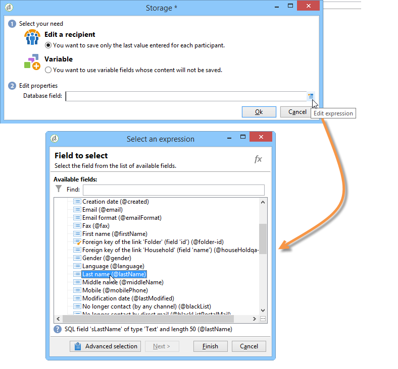

>[!NOTE]
>
>デフォルトの参照ドキュメントは、**nms:recipient** スキーマです。 それを表示するか新しく選択するには、リストからフォームを選択して、**[!UICONTROL プロパティ]**&#x200B;ボタンをクリックします。

### ローカル変数へのデータの格納 {#storing-data-in-a-local-variable}

ローカル変数を使用すると、データがデータベースに格納されなくても、そのページまたは別のページで再利用して、例えば、フィールドの表示に関する条件を配置したり、メッセージをパーソナライズしたりできます。

これは、未保存のフィールドの値を使用して、ページ上のオプションのグループの表示を承認できることを意味します。 次のページでは、車両のタイプはデータベースに格納されていません。

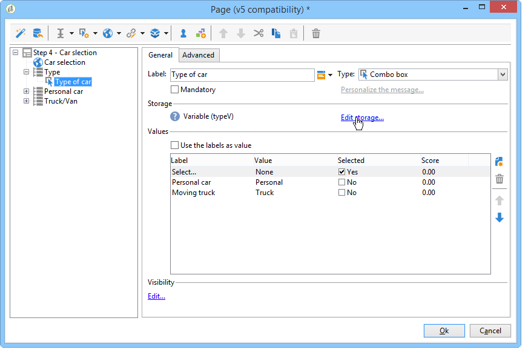

ドロップダウンボックスが作成される際に選択される必要がある変数か、「**[!UICONTROL ストレージを編集]**」リンクを使用して格納されます。

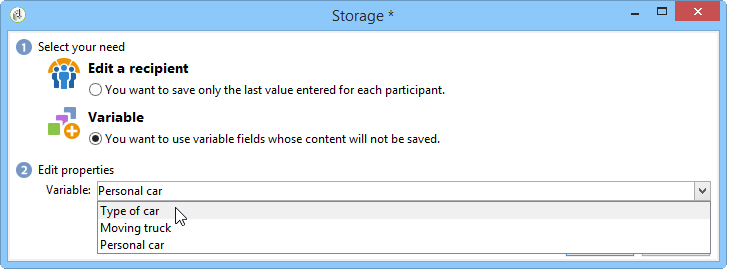

既存の変数を表示して、「**[!UICONTROL 変数を編集]**」リンクから新しい変数を作成できます。 「**[!UICONTROL 追加]**」ボタンをクリックして、新しい変数を作成します。

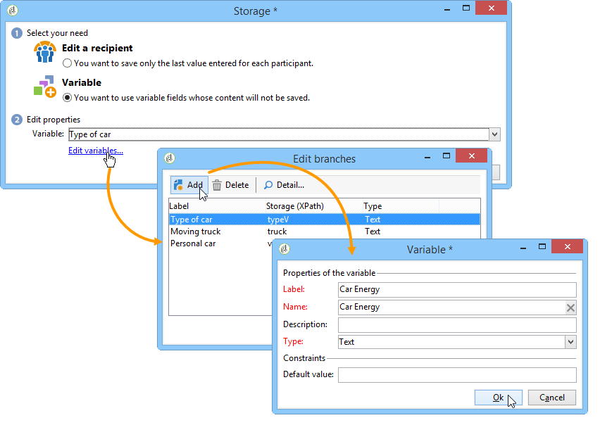

追加された変数は、ページの入力フィールドが作成される際に、ローカル変数のリストで使用できます。

>[!NOTE]
>
>各フォームについて、変数のアップストリームを作成できます。 これをおこなうには、フォームを選択して、**[!UICONTROL プロパティ]**&#x200B;ボタンをクリックします。 「**[!UICONTROL 変数]**」タブには、フォームのローカル変数が含まれます。

**条件が設定されたローカルストレージの例**

上記の例では、自家用車の関するデータを含むコンテナは、表示条件で示されたように、ドロップダウンリストから **[!UICONTROL Private]** オプションが選択されている場合にのみ表示されます。

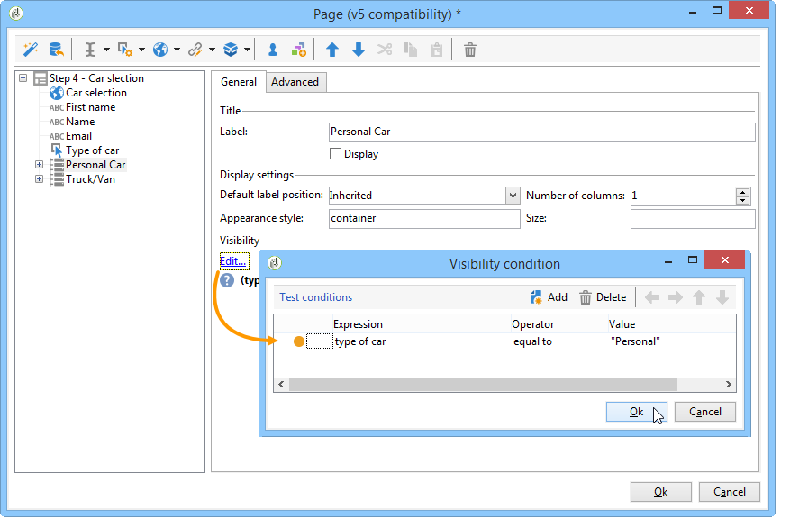

ユーザーが自家用車を選択すると、Web フォームは次のオプションを提供します。

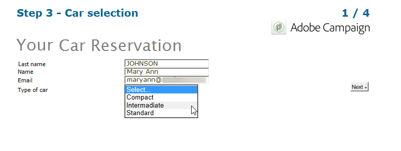

商用車に関するデータを保持するコンテナは、表示条件に表されるように、Professional オプションが選択された場合に表示されます。

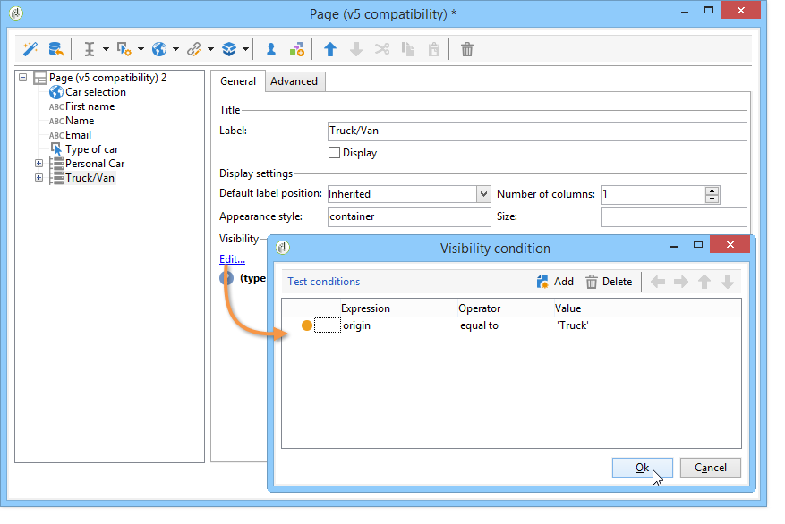

つまり、ユーザーが商用車を選択すると、フォームは次のオプションを提供します。

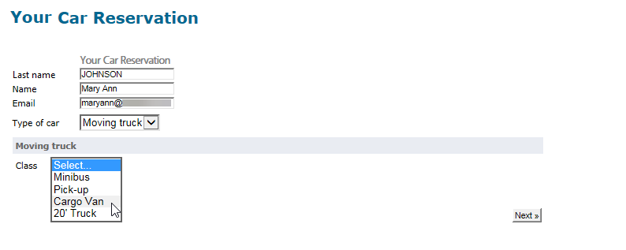

## 収集された情報の使用 {#using-collected-information}

各フォームについて、提供された回答は、フィールドまたはラベルで再利用できます。 次の構文を使用する必要があります。

* データベースのフィールドに格納されたコンテンツの場合：

  ```
  <%=ctx.recipient.@field name%
  ```

* ローカル変数に格納されたコンテンツの場合：

  ```
  <%= ctx.vars.variable name %
  ```

* HTML テキストフィールドに格納されたコンテンツの場合：

  ```
  <%== HTML field name %
  ```

  >[!NOTE]
  >
  >`<%=` 文字がエスケープ文字に置き換わるその他のフィールドと異なり、HTML コンテンツは、`<%==` 構文を使用することで、そのまま保存されます。

## Web フォームの回答の保存 {#saving-web-forms-answers}

フォームのページで収集した情報を保存するには、ダイアグラムにストレージボックスを配置する必要があります。

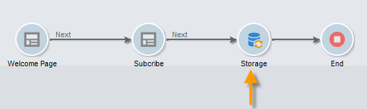

このボックスを使用するには、次の 2 つの方法があります。

* Web フォームがメールで送信したリンクでアクセスできる場合で、アプリケーションにアクセスするユーザーが既にデータベースにある場合、「**[!UICONTROL プリロードされたレコードを更新]**」オプションをチェックできます。 詳しくは、[メールによるフォームの配信](publishing-a-web-form.md#delivering-a-form-via-email)を参照してください。

  この場合、Adobe Campaign は、ユーザープロファイルの暗号化されたプライマリキー（Adobe Campaign が各プロファイルに割り当てた一意の識別子）を使用します。 プリロードボックスを使用して情報をプリロードするように設定する必要があります。 詳しくは、[フォームデータのプリロード](publishing-a-web-form.md#pre-loading-the-form-data)を参照してください。

  >[!CAUTION]
  >
  >このオプションは、メールアドレス（入力するフィールドがある場合）を含むユーザーデータを上書きします。 新しいプロファイルを作成するためには使用できず、フォームのプリロードボックスの使用が必要です。

* データベースの受信者のデータをエンリッチメントするには、ストレージボックスを編集して、紐付けキーを選択します。 内部使用の場合（通常、イントラネットシステム）、または、例えば新しいプロファイルを作成するために使用されるフォームの場合、紐付けフィールドを選択できます。 このボックスは、Web アプリケーションの様々なページで使用されるデータベースのすべてのフィールドを提供します。

  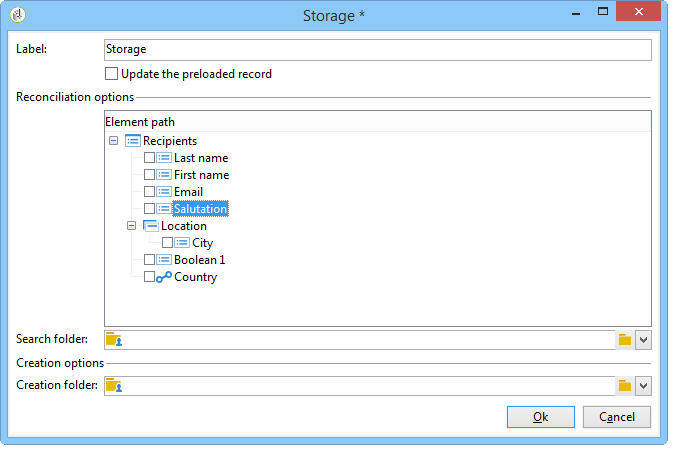

デフォルトでは、データは&#x200B;**[!UICONTROL 更新または挿入]**&#x200B;操作によってデータベースにインポートされます。データがデータベースに存在する場合、その要素は更新されます（例えば、選択したニュースレターや入力したメールアドレスなど）。 存在しない場合、情報は追加されます。

ただし、この動作を変更できます。 これをおこなうには、要素のルートを選択して、ドロップダウンリストから実行する操作を選択します。

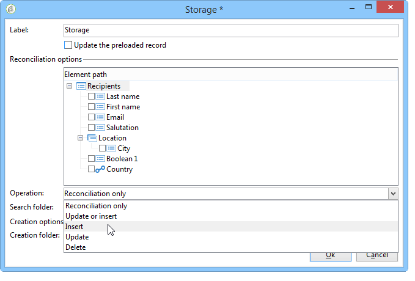

紐付けについて検索フォルダーを選択したり、新しいプロファイルについて作成フォルダーを選択したりできます。 これらのフィールドが空の場合、プロファイルについてオペレーターのデフォルトフォルダーを検索したり、そこにプロファイルを作成したりします。

>[!NOTE]
>
>実行できる操作は、**[!UICONTROL シンプルな紐付け]**、**[!UICONTROL 更新または挿入]**、**[!UICONTROL 挿入]**、**[!UICONTROL 更新]**、**[!UICONTROL 削除]**&#x200B;です。\
>オペレーターのデフォルトのフォルダーは、オペレーターが書き込み権限を持つ最初のフォルダーです。\
>[この節](https://experienceleague.adobe.com/en/docs/campaign-classic/using/getting-started/permissions/access-management){target="_blank"}を参照してください。
