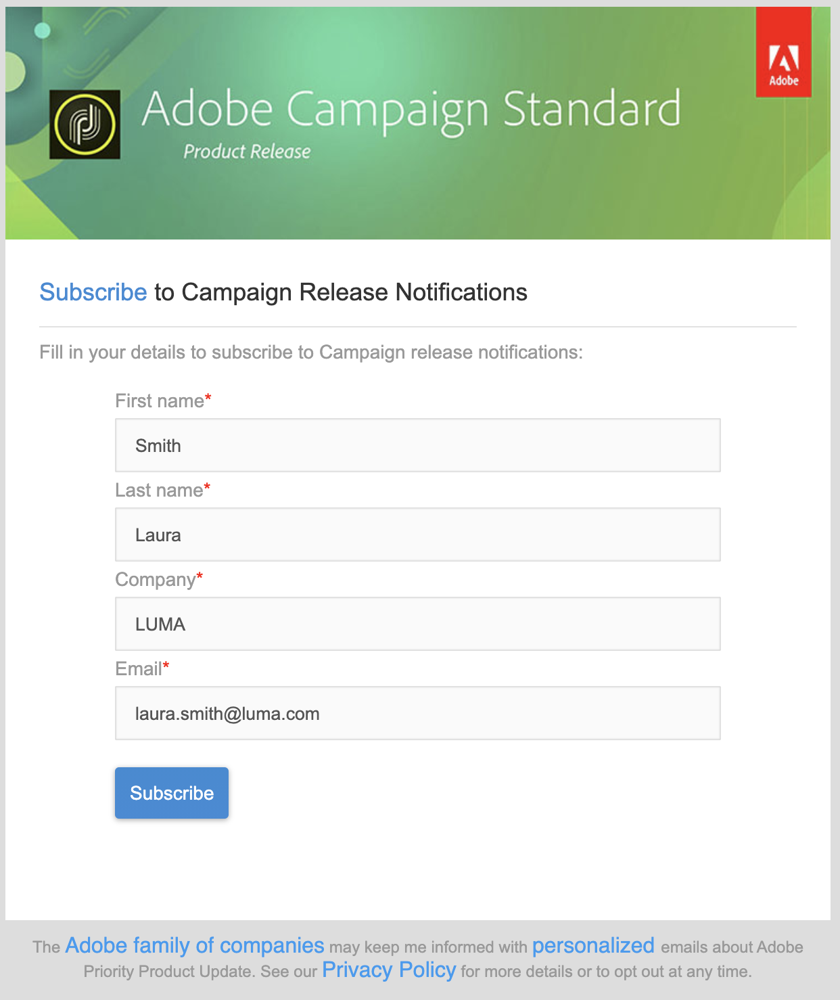

# Web アプリケーションと web フォームの概要{#gs-ac-web}

>[!NOTE]
>
>最も一般的なユースケースでは、Campaign Web ユーザーインターフェイスでランディングページを作成し、簡単にデザインして公開できます。 この節の説明に従って、クライアントコンソールで作成されたランディングページでは、より多くの設定を提供し、より高度なユースケースをカバーします。
>
>[Campaign Web ユーザーインターフェイスのランディングページについて詳しく見る](https://experienceleague.adobe.com/ja/docs/campaign-web/v8/landing-pages/get-started-lp){target="_blank"}

Adobe Campaign では、**web フォーム**&#x200B;を定義して公開するためのグラフィカルなモジュールを統合します。このモジュールでは、入力フィールドと選択フィールドを含むページを作成して、データベースのデータを含めることができます。 これにより、お客様はユーザーが閲覧または情報を入力できるよう、web ページをデザインおよび投稿できます。

[このセクション ](web/about-web-forms.md)でweb フォームを作成および公開する方法について説明します

Adobe Campaign では、データベースのデータと接続ユーザーの権限に応じたコンテンツを使用して、動的でインタラクティブな **Web アプリケーション**&#x200B;を作成して公開することができます。

作成できるページには、エクストラネット上の編集フォームのほか、データベースからのデータを含み、テーブル、グラフ、入力フォームなどを備えた通知フォームなどがあります。この機能を使用すると、ユーザーが情報を検索したり入力したりできる Web ページをデザインして投稿できます。

[このセクション ](web/about-web-applications.md)でweb アプリケーションを作成および公開する方法について説明します
