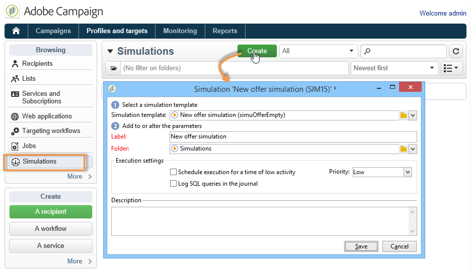
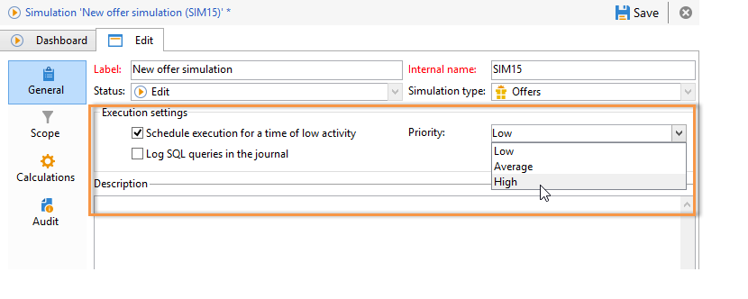
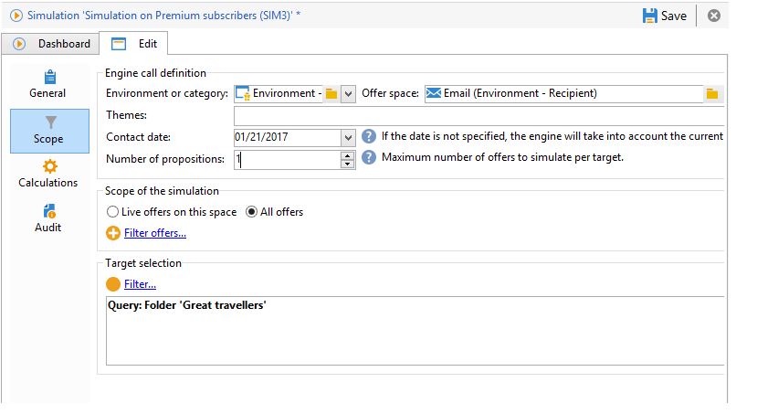
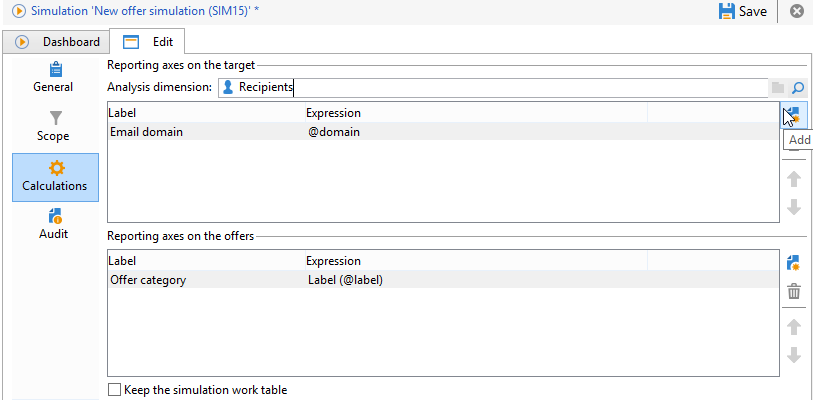
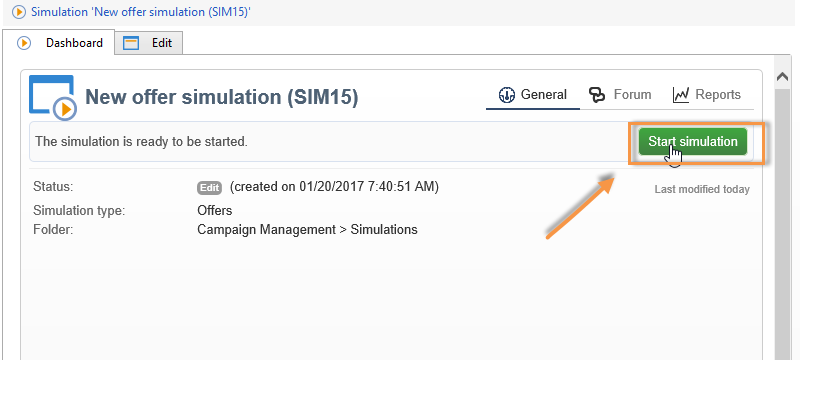
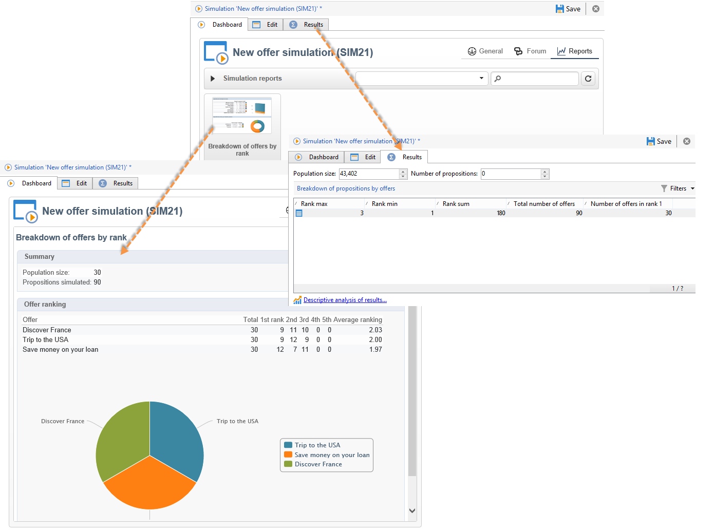

# オファーのシミュレーションについて{#about-offers-simulation}

**シミュレーション**&#x200B;モジュールを使用すると、提案を受信者に送信する前に、1 つのカテゴリまたは環境に属するオファーの配分をテストできます。

シミュレーションには、オファーにあらかじめ適用されているコンテキストおよび実施要件ルール（[オファーカタログの概要](https://experienceleague.adobe.com/ja/docs/campaign/campaign-v8/offers/interaction-offer-catalog){target="_blank"}（キャンペーン v8 ドキュメント）を参照）と、オファーのプレゼンテーションルール（[オファー表示域の管理](managing-offer-presentation.md)を参照）が考慮されます。 ターゲットの受信者はシミュレーションの影響を受けないので、これにより、実際にオファーを使用したり、ターゲットを拡大または縮小したりしなくても、オファーの提案の様々なバージョンをテストして調整できます。

オファーをシミュレートする方法については、以下の手順を参照してください。

 [このビデオ](https://helpx.adobe.com/jp/campaign/classic/how-to/simulate-offer-in-acv6.html?playlist=/ccx/v1/collection/product/campaign/classic/segment/digital-marketers/explevel/intermediate/applaunch/introduction/collection.ccx.js&ref=helpx.adobe.com)もご覧ください。

## シミュレーション作成の主な手順 {#main-steps-for-creating-a-simulation}

オファーのシミュレーションを実行するには、次の手順に従います。

1. 「**[!UICONTROL プロファイルとターゲット]**」タブで、「**[!UICONTROL シミュレーション]**」リンクをクリックしたあと、「**[!UICONTROL 作成]**」ボタンをクリックします。

   

1. 作成したシミュレーションを保存し、編集します。
1. 「**[!UICONTROL 編集]**」タブに移動し、実行設定を指定します。

   詳しくは、[実行設定](execution-settings.md)を参照してください。

   

   >[!NOTE]
   >
   >実行設定は、Campaign でインタラクションを使用する場合にのみ使用できます。

1. シミュレーションのスコープを指定します。

   詳しくは、[スコープの定義](simulation-scope.md#definition-of-the-scope)を参照してください。

   

1. レポートの軸を追加して、**[!UICONTROL オファーの配分（ランキング別）]**&#x200B;レポートの内容をより充実させます（オプション）。

   詳しくは、[レポートの軸の追加](simulation-scope.md#adding-reporting-axes)を参照してください。

   

1. 「**[!UICONTROL 保存]**」をクリックして、シミュレーションの設定を保存します。
1. ダッシュボードからシミュレーションを開始します。

   

1. シミュレーション結果をチェックし、分析レポートを表示します。

   詳しくは、[シミュレーションのトラッキング](simulation-tracking.md)を参照してください。

   
