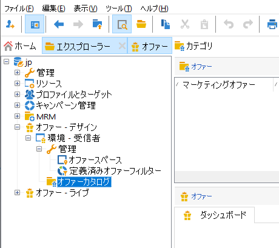
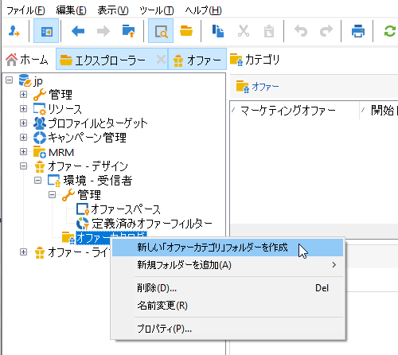
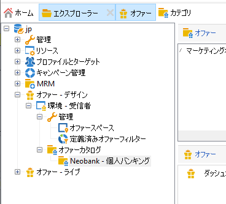
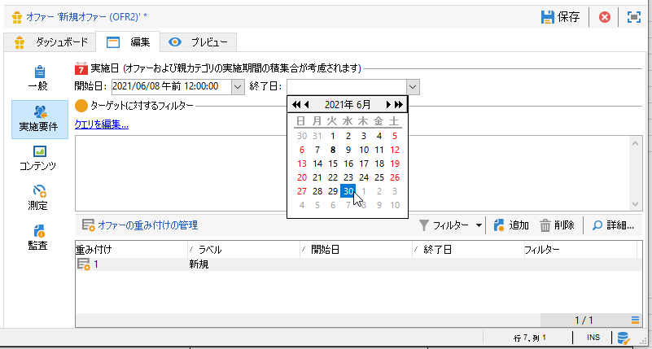
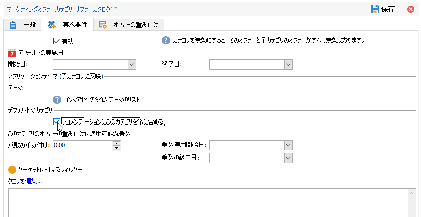

# オファーカタログの作成

**オファーマネージャー**&#x200B;は、オファーカタログの作成を担当します。

1 つのオファーカタログは、1 つの既存環境に関連付けられます。 カタログに含まれるオファーは、その環境で指定されたスペースにのみ関連付けられます。

オファーを作成する前に、まず[環境](interaction-env.md)を指定する必要があります。この環境には、一連のオファーのすべての特性（実施要件、ターゲットに対する制約、プレゼンテーションルール）をカテゴリに分類したものや、スペースのリストが含まれます。

## オファーカテゴリの作成{#creating-offer-categories}

オファーは、カテゴリ/サブカテゴリに整理されます。 カテゴリーは&#x200B;**[!UICONTROL Design]**&#x200B;環境で作成され、そのカテゴリーに含まれるオファーが承認されると、**[!UICONTROL Live]**&#x200B;環境に自動的にデプロイされます（つまり、使用可能になります）。 **[!UICONTROL デザイン]**&#x200B;環境には、すべてのオファーを受信するデフォルトのカテゴリが含まれています。 サブカテゴリを作成すると、カタログオファーに階層を追加できます。

各カテゴリには、**実施日**&#x200B;を定義できます。この日程は、カテゴリに含まれるオファーをターゲットに提示できる期間です。 カテゴリの重み付けを調整して、オファーの提示に優先度を付けることもできます。

新しいカテゴリを作成するには、次の手順に従います。

1. **[!UICONTROL オファーカタログ]** フォルダーを参照します。

   オファー – デザインと環境 – 受信者の下でオファーカタログフォルダーが選択された エクスプローラーツリー

1. 右クリックし、ドロップダウンリストから「**[!UICONTROL 新しい「オファーカテゴリ」フォルダーを作成]**」を選択します。

   オファーカタログの

1. カテゴリの名前を変更します。 「**[!UICONTROL 一般]**」タブを使用して、後でラベルを編集することもできます。

   

   >[!NOTE]
   >
   >これらの手順を、作成するカテゴリの数だけ繰り返します。

   その後、必要に応じて次の操作を実行します。

   * 「**[!UICONTROL 実施要件]**」タブで、実施日を割り当てます。

     

   * **[!UICONTROL クエリを編集]**&#x200B;して、オファーのターゲットにフィルターを適用します。

   * 実施要件ルールの概要。 表示するには、オファーの「**[!UICONTROL スケジュールおよび実施要件ルール]**」リンクをクリックします。

## フォールバックカテゴリの追加

すべての受信者にオファーの提案が届くよう、体系的に 1 つまたは様々なオファーカテゴリをレコメンデーションに追加できます。

これらのフォールバックオファーは低い（null以外の）ウェイトを持つ必要があり、より高いウェイトのオファーが適格でない場合にのみ考慮されます。

また、レコメンデーションに常に含まれるようにするため、これらのオファーには提示ルールを適用しないでおく必要があります。 これにより、提案中に重みの大きいオファーがない場合でも、受信者には、このカテゴリのオファーが少なくとも 1 つ届きます。

レコメンデーションにフォールバックカテゴリを含めるには、次の手順を行います。

1. オファーカタログを参照します。
1. 「**[!UICONTROL 実地要件]**」タブをクリックし、「**[!UICONTROL レコメンデーションにこのカテゴリを常に含める]**」チェックボックスをオンにします。
1. 「**[!UICONTROL 保存]**」をクリックします。

   
