# オファー表示域の管理{#managing-offer-presentation}

## プレゼンテーションルールの概要 {#presentation-rules-overview}

インタラクションでは、プレゼンテーションルールを使用してオファーの提案のフローを制御できます。 インタラクションに特化したそれらのルールをタイポロジルールと呼びます。 タイポロジルールを利用すると、既に受信者に送信された提案の履歴に基づいてオファーを除外できます。 ルールは環境内で参照されます。

## オファープレゼンテーションルールの作成と参照 {#creating-and-referencing-an-offer-presentation-rule}

1. **[!UICONTROL 管理]**／**[!UICONTROL キャンペーン管理]**／**[!UICONTROL タイポロジ管理]**／**[!UICONTROL タイポロジルール]**&#x200B;ノードに移動します。
1. タイポロジルールを作成し、「**[!UICONTROL オファーのプレゼンテーション]**」タイプを選択します。

   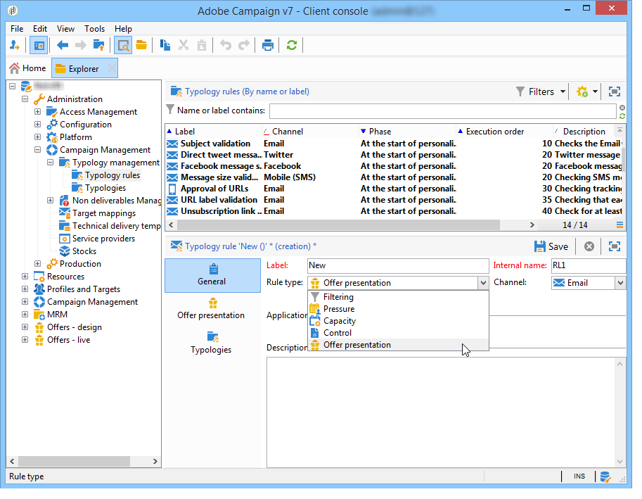

1. ルールを適用するチャネルを指定します。

   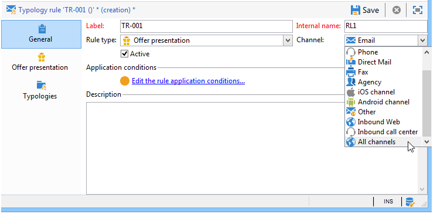

1. ルールの適用条件を設定します。 詳しくは、[プレゼンテーションルールの設定](#presentation-rule-settings)を参照してください。
1. **[!UICONTROL 管理]**／**[!UICONTROL キャンペーンの実行]**／**[!UICONTROL タイポロジ管理]**／**[!UICONTROL タイポロジ]**&#x200B;ノードに移動し、**[!UICONTROL オファーのプレゼンテーション]**&#x200B;タイプのルールをすべてグループ化するタイポロジを作成します。

   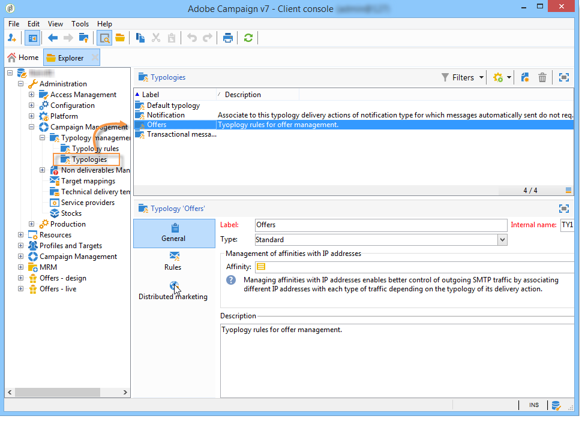

1. タイポロジを作成したら、タイポロジルールにマウスカーソルを置いて、いま作成したタイポロジにグループ化します。

   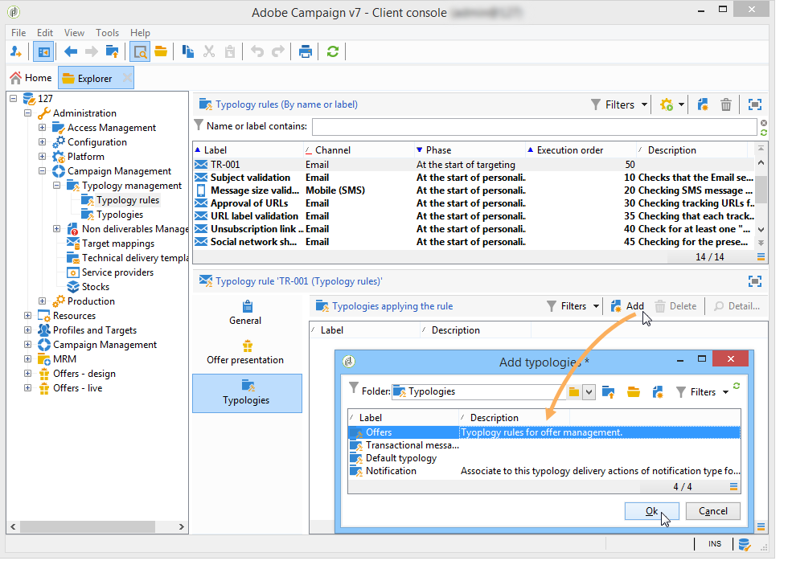

1. オファー環境で、ドロップダウンリストを使用してタイポロジを参照します。

   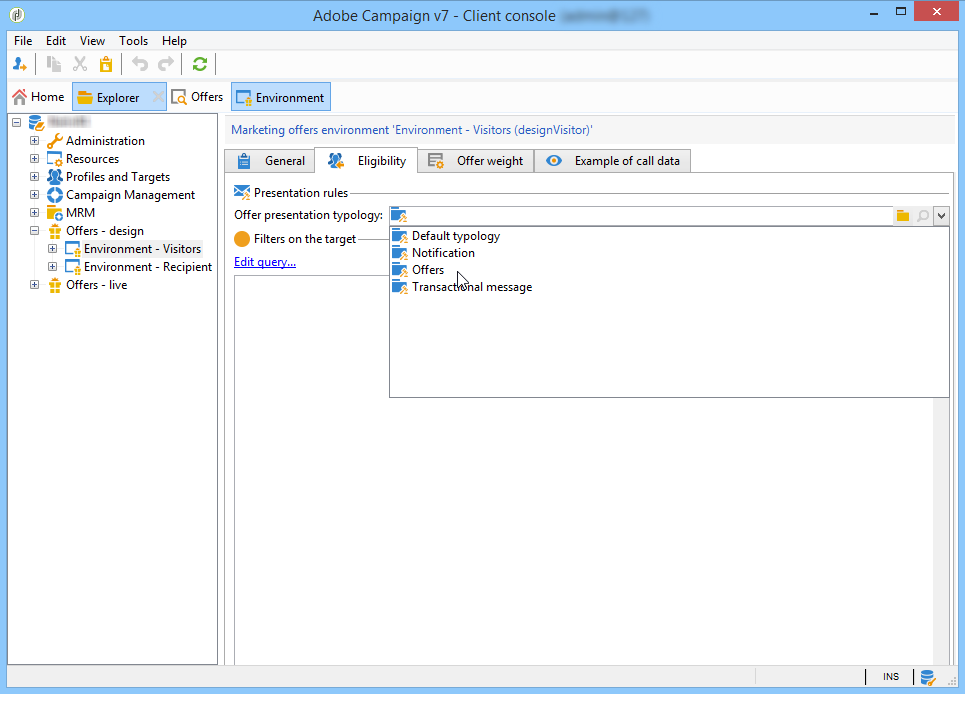

## プレゼンテーションルールの設定 {#presentation-rule-settings}

### 適用条件 {#application-criteria-}

「**[!UICONTROL 一般]**」タブの適用条件を使用すると、プレゼンテーションルールを適用するオファーを指定できます。 それには、次に説明するように、クエリを作成して、該当するオファーを選択する必要があります。

1. タイポロジルール内で、「**[!UICONTROL ルール適用条件を編集]**」リンクをクリックし、クエリを作成します。

   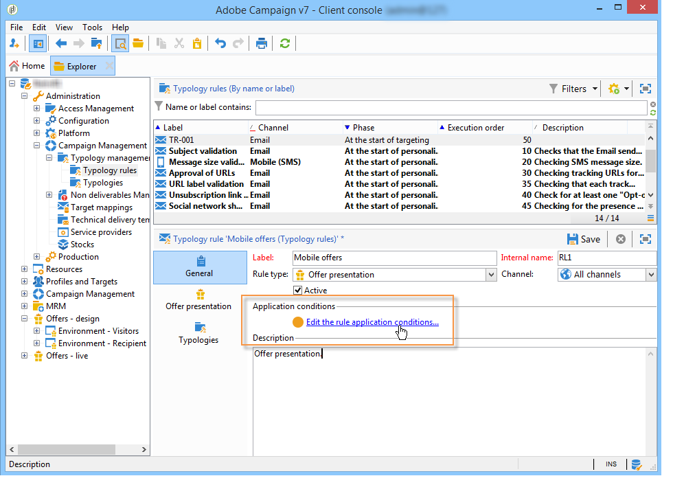

1. クエリウィンドウでは、タイポロジルールを適用するオファーに対してフィルターを適用できます。

   例えば、オファーカテゴリを選択できます。

   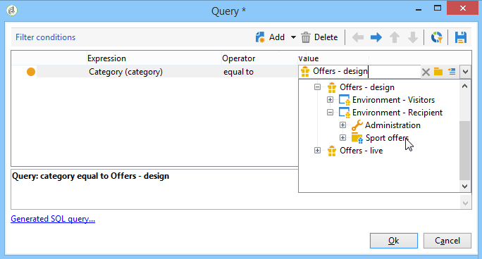

### オファーディメンション {#offer-dimensions}

「**[!UICONTROL オファーのプレゼンテーション]**」タブで、環境内に設定されているのと同じディメンションをプレゼンテーションルールにも指定する必要があります。

「**[!UICONTROL ターゲティングディメンション]**」は、オファーの提案を受け取る受信者のテーブル（デフォルトは `nms:recipients`）に一致します。 「**[!UICONTROL ストレージディメンション]**」は、ターゲティングディメンションにリンクした提案履歴のテーブル（デフォルトでは `nms:propositionRcp`）に一致します。

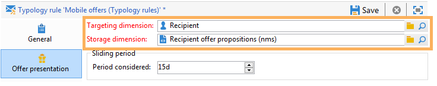

>[!NOTE]
>
>標準以外のテーブルを使用することもできます。 特定のターゲティングディメンションを使用する場合、ターゲットマッピングを使用したテーブルおよび専用の環境を作成する必要があります。 詳しくは、[オファー環境の作成](https://experienceleague.adobe.com/ja/docs/campaign/campaign-v8/offers/interaction-settings/interaction-env#create-an-offer-environment){target="_blank"}（Campaign v8 ドキュメント）を参照してください。

### 期間 {#period}

これは、オファーのプレゼンテーション日から始まるスライドする期間です。 これによって、オファーの提案が有効な期限が設定されます。 この期間を過ぎると、ルールはオファーの提案に適用されなくなります。

期間は、提案日の **n** 日前に始まって **n** 日後に終わります（**n** には、「**[!UICONTROL 考慮する期間]**」フィールドに入力された数値が入ります）。

* インバウンドスペースの場合、提案日は、オファーのプレゼンテーション日です。
* アウトバウンドスペースの場合、提案日は、配信の連絡日（例えば、ターゲティングワークフローに入力された配信日）です。

矢印ボタンを使用して日数を変更するか、期間を直接入力します（例：&quot;2d 6h&quot; で 2 日と 6 時間）。

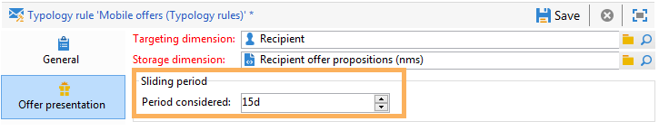

### 提案数 {#number-of-propositions}

オファーが除外されるまでに実行できる提案回数の上限を設定できます。

オファーの提案回数を変更するには、矢印ボタンを使用します。

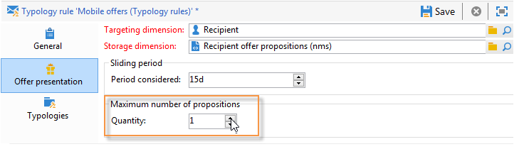

## 提案と受信者の定義 {#defining-propositions-and-recipients}

「**[!UICONTROL カウントする提案]**」セクションで受信者と提案の両方を指定すると、提案履歴にそれらが所定の回数出現した場合に、「**[!UICONTROL 一般]**」タブで定義されたオファーの除外が適用されます。

### 提案のフィルタリング {#filtering-propositions}

チャネル、該当するオファーの数、またはそれまでに割り当てられた提案のステータスに基づいて、提案を除外するためのフィルタリング条件を選択できます。

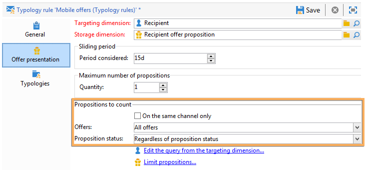

これらの条件には、プレゼンテーションルールのうち特に適用頻度が高いものが示されます。 その他の条件を使用するには、「**[!UICONTROL 提案を制限]**」リンクを使用してクエリを作成できます。 詳しくは、[提案に関するクエリの作成](#creating-a-query-on-propositions)の節を参照してください。

* **チャネルに対するフィルター**

  **[!UICONTROL 同じチャネル上のみ]**：「**[!UICONTROL 一般]**」タブで指定されたチャネルのオファー提案を除外します。

  例えば、「**[!UICONTROL 一般]**」タブで、このルール用のチャネルとしてメールが指定されているとします。 ルールを適用するオファーが、それまでに Web チャネルでしか提供されていない場合、インタラクションエンジンは、メール配信でオファーを提示できます。 ただし、一度メールで提示されると、インタラクションエンジンは別のチャネルを選択してそのオファーを提示します。

  >[!NOTE]
  >
  >この説明は、スペースではなく、チャネルに関することである点に注意してください。 ルールによって Web チャネルのオファーを除外すると、Web サイト内の 2 つのスペース（例：ページのバナーと本文）で提示されることになっているオファーは、一度これらの場所に提示された後は表示されなくなります。
  >
  >オファープレゼンテーションに関するワークフローでは、ルールは、**[!UICONTROL すべてのチャネル]**&#x200B;に対して設定されている場合にのみ正しく考慮されます。

* **オファーに対するフィルター**

  このフィルターを使用すると、カウントされるオファーの提案を、特定のセットのオファーのみに制限できます。

  **[!UICONTROL すべてのオファー]**：デフォルト値。 オファーにフィルターは適用されません。

  **[!UICONTROL 提供されているオファー]**：「**[!UICONTROL 一般]**」タブで指定されたオファーは、既に提示されたことがあれば除外されます。

  **[!UICONTROL 同じカテゴリーのオファー]**：同じカテゴリに属するオファーが既に提示されているオファーは除外されます。

  **[!UICONTROL ルールが適用されるオファー]**：いくつかのオファーが「**[!UICONTROL 一般]**」タブで定義されている場合に、それらに基づく各オファーの提案が考慮され、提案しきい値に達するとすべてのオファーが除外されます。

  例えば、オファー 2、3、5 が「**[!UICONTROL 一般]**」タブで定義されており、 提案の最大回数が 2 に設定されているとします。 オファー 2 とオファー 5 がそれぞれ 1 回ずつ提示されると、提案回数のカウントは 2 に達します。 したがって、以後オファー 3 が提示されることはありません。

* **提案ステータスに対するフィルター**

  このフィルターを使用すると、提案履歴で考慮に入れる、オファーの提案で最も頻繁に使用されるステータスを選択できます。

  **[!UICONTROL 提案のステータスとは無関係]**：デフォルト値。 提案のステータスにフィルターは適用されません。

  **[!UICONTROL 承認または却下された提案]**：以前に提案されたことがある承認済みまたは却下済みのオファーが除外されます。

  **[!UICONTROL 承認された提案]**：以前に提案されたことがある承認済みのオファーが除外されます。

  **[!UICONTROL 却下された提案]**：以前に提案されたことがある却下済みのオファーが除外されます。

### 受信者の定義 {#defining-recipients}

受信者を指定するには、「**[!UICONTROL ターゲティングディメンションからクエリを編集...]**」リンクをクリックし、そのルールに関係する受信者を選択します。

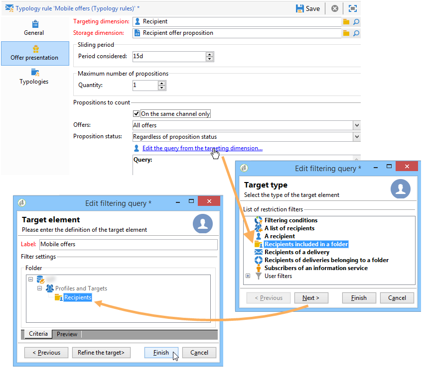

### 提案に関するクエリの作成 {#creating-a-query-on-propositions}

カウントする提案をクエリで指定するには、「**[!UICONTROL 提案を制限]**」リンクをクリックし、考慮に入れるための条件を指定します。

次の例では、**Special offers** カテゴリと **Call center** スペースに属し、重み付けが **20** 未満である提案が、2 回のプレゼンテーションの後にカウント対象となります。

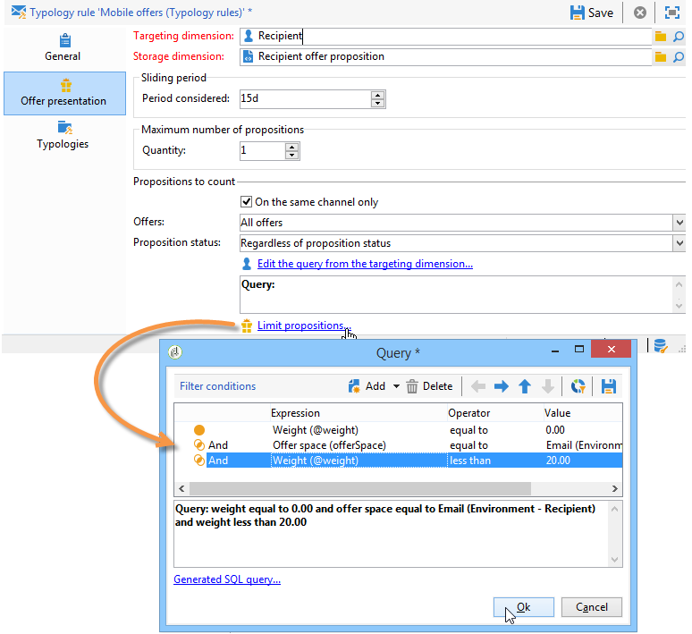
