# インバウンドチャネルのオファー{#offers-on-an-inbound-channel}


## 匿名訪問者に対するオファーの提案 {#presenting-an-offer-to-an-anonymous-visitor}

Neobank という会社のサイトで、ページを閲覧した匿名訪問者に対するオファーを Web サイト上に表示するものとします。

このインタラクションを実現するには、次の手順を実行します。

1. [匿名環境の作成](#creating-an-anonymous-environment)
1. [匿名オファースペースの作成](#creating-anonymous-offer-spaces)
1. [オファーカテゴリとテーマの作成](#creating-an-offer-category-and-a-theme)
1. [匿名オファーの作成](#creating-anonymous-offers)
1. [Web サイト上の web オファースペースの設定](#configure-the-web-offer-space-on-the-website)

### 匿名環境の作成 {#creating-an-anonymous-environment}

[オファー環境の作成](https://experienceleague.adobe.com/ja/docs/campaign/campaign-v8/offers/interaction-settings/interaction-env#create-an-offer-environment){target="_blank"}（Campaign v8 ドキュメント）で説明されている手順に従って、**訪問者**&#x200B;のディメンションに基づく匿名環境を作成します。

新しい環境を格納したツリー構造ができます。

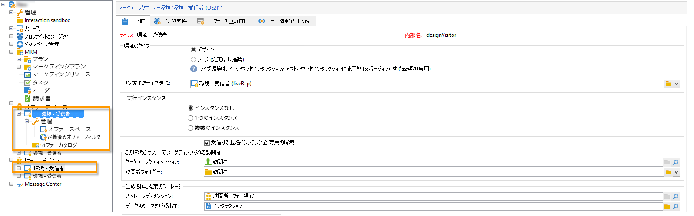

### 匿名オファースペースの作成 {#creating-anonymous-offer-spaces}

1. 匿名環境（**訪問者**）内で、**[!UICONTROL 管理]**／**[!UICONTROL スペース]**&#x200B;ノードに移動します。
1. 「**[!UICONTROL 新規]**」をクリックして呼び出しチャネルを作成します。

   

   >[!NOTE]
   >
   >スペースは、この匿名環境に自動的にリンクされます。

1. ラベルを変更し、「**[!UICONTROL インバウンド Web]**」チャネルを選択します。 また、「**[!UICONTROL 単一モードを有効にする]**」ボックスをオンにします。

   ラベル「匿名Web プレミアムオファー」とインバウンド Web チャネルが選択された

1. このスペースで使用するオファーコンテンツフィールドを選択し、必要に応じて関連するボックスをオンにして指定します。

   これにより、次の要素に不足があるオファーは、このスペースの実施要件を満たさないことになります。

   * タイトル
   * HTML コンテンツ
   * 画像 URL
   * 宛先 URL

   

1. 次の例のように、HTML レンダリング関数を編集します。

   ```javascript
   function (imageUrl, targetUrl, shortContent, htmlSource){
         var html = "<p><b>" + shortContent + "</b></p>";
         html += "<p>" + htmlSource + "</p>";
         html += "<a _urlType='11' href='" + targetUrl + "'></a>";
         return html;
       }   
   ```

   >[!IMPORTANT]
   >
   >オファーを正しく表示するために、レンダリング関数では、事前に選択された順序のとおりにスペース用のフィールドを列挙する必要があります。

   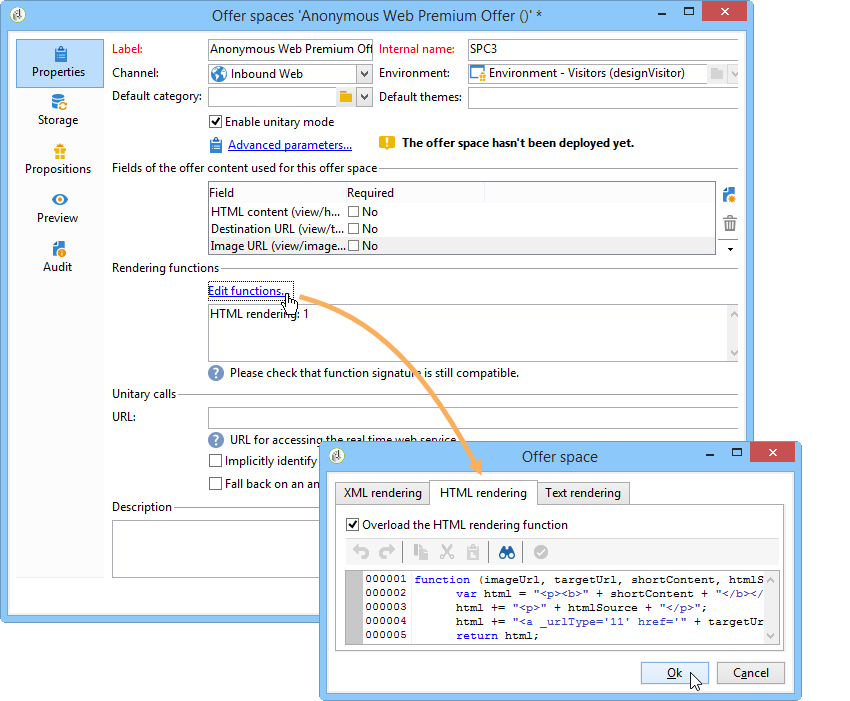

1. オファースペースを保存します。

### オファーカテゴリとテーマの作成 {#creating-an-offer-category-and-a-theme}

1. 先ほど作成した環境の「**[!UICONTROL オファーカタログ]**」ノードに移動します。
1. 「**[!UICONTROL オファーカタログ]**」ノードを右クリックし、「**[!UICONTROL 新しい「オファーカテゴリ」フォルダーを作成]**」を選択します。

   新規カテゴリに、例えば「**Financial products**」（金融商品）という名前を付けます。

1. このカテゴリの「**[!UICONTROL 実施要件]**」タブに移動して、テーマに「**financing**」と入力し、変更を保存します。

   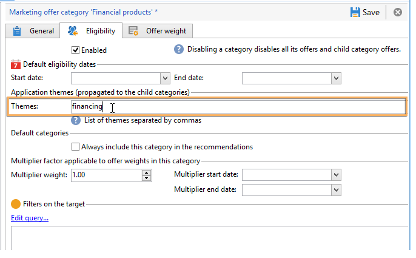に設定された「Offer category Eligibility」タブ

### 匿名オファーの作成 {#creating-anonymous-offers}

1. 作成したカテゴリに移動します。
1. 「**[!UICONTROL 新規]**」をクリックします。

   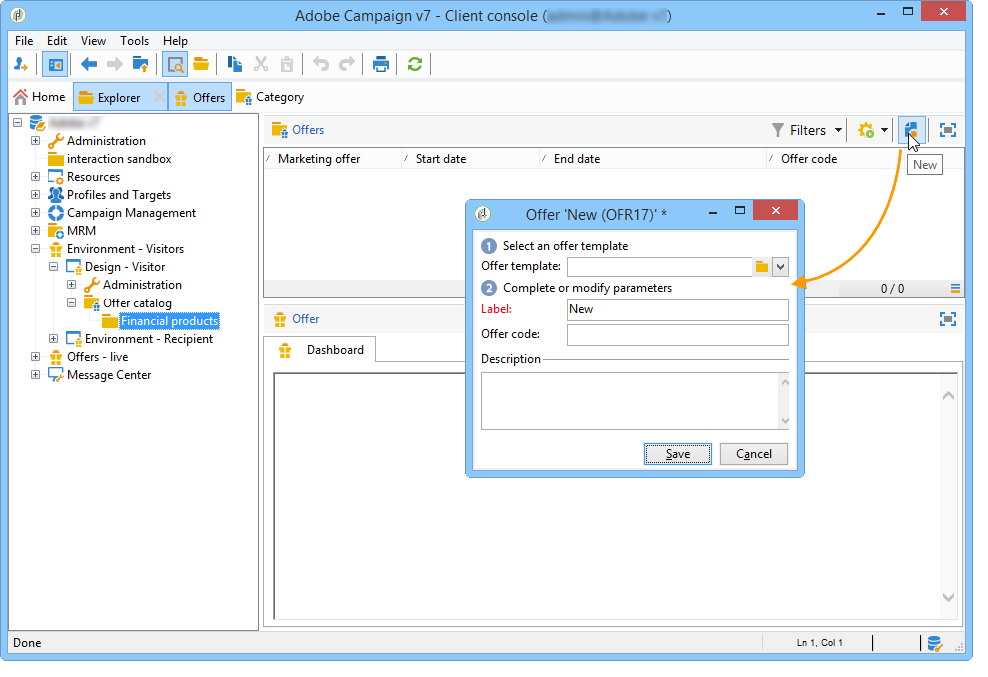

1. 標準で用意されている匿名オファーテンプレートか、別の作成済みテンプレートを選択します。

   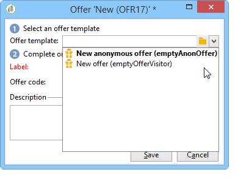

1. ラベルを変更し、オファーを保存します。

   

1. 「**[!UICONTROL 実施要件]**」タブに移動し、アプリケーションのコンテキストに応じてオファーの重み付けを指定します。

   この例では、オファーは、年末まで優先項目としてサイトのホームページに表示されるように設定されています。

   

1. 「**[!UICONTROL コンテンツ]**」タブに移動し、オファーのコンテンツを定義します。

   >[!NOTE]
   >
   >「**[!UICONTROL コンテンツ定義]**」を選択すると、この Web スペースに必要な要素のリストが表示されます。

   

1. 2 つ目のオファーを作成します。

   

1. 「**[!UICONTROL 実施要件]**」タブに移動し、最初のオファーと同じ重み付けを指定します。
1. 各オファーに対して承認サイクルを実行し、オファーおよび承認されたオファースペースを、オンライン環境で利用可能な状態にします。

### Web サイト上の Web オファースペースの設定 {#configure-the-web-offer-space-on-the-website}

設定したばかりのオファーをweb サイトに表示するには、サイトのHTML ページにJavaScript コードを挿入してインタラクションエンジンを呼び出します（詳しくは、[ インバウンドチャネルについて](https://experienceleague.adobe.com/ja/docs/campaign/campaign-v8/offers/inbound/interaction-present-offers){target="_blank"} （Campaign v8 ドキュメント）を参照）。

1. HTML ページに移動して、@id 属性を挿入し、先ほど作成した匿名オファースペース（[匿名オファースペースの作成](#creating-anonymous-offer-spaces)を参照）の内部名にプレフィックス **i_** を付加した値を指定します。

   が付きます

1. 呼び出し URL を挿入します。

   env=liveVisitorおよびth=financing パラメーターがハイライト表示されたinteractionProposal.jsへの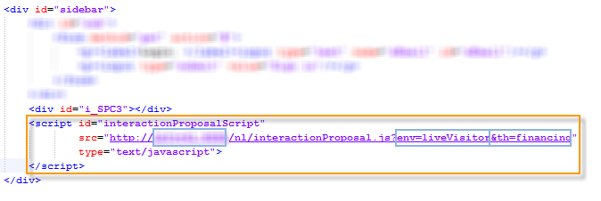

   上のコード中の URL について、青色の囲みで示した部分は、インスタンス名、環境の内部名（[匿名環境の作成](#creating-an-anonymous-environment)を参照）、カテゴリにリンクされたテーマ（[オファーカテゴリとテーマの作成](#creating-an-offer-category-and-a-theme)）を表しています。 テーマの指定はオプションです。

この Web サイトの訪問者がホームページにアクセスすると、HTML ページに設定されたとおりに、「**financing**」のテーマに属するオファーが表示されます。


同じユーザーが何回もページにアクセスすると、カテゴリの各オファーに適用されている重み付けは等しいので、いずれかのオファーが表示されます。

## 連絡先が識別されていない場合の匿名環境への切り替え {#switching-to-an-anonymous-environment-in-case-of-unidentified-contacts}

Neobank が、異なる 2 つのターゲットに向けたマーケティングオファーを作成するものとします。 匿名の Web サイトブラウザーに対しては、汎用的なオファーを表示します。 ユーザーが Neobank 発行の ID を持った顧客であると判明した場合は、ログイン後すぐに、パーソナライズされたオファーを表示するようにします。

このケーススタディで使用するシナリオは次のとおりです。

1. 訪問者が、ログインすることなく Neobank の Web サイトを閲覧します。

   

   3 つの匿名オファーがページに表示されます。そのうち 2 つは Neobank の商品に関するオファー「**Best Offer**」（ベストオファー）で、もう 1 つは Neobank のパートナー企業によるオファーです。

   

1. このユーザーが、Neobank の顧客として、自分の資格情報でログインします。

   ユーザーがログオンする前に資格情報を入力した

   3 つのパーソナライズされたオファーが表示されます。

   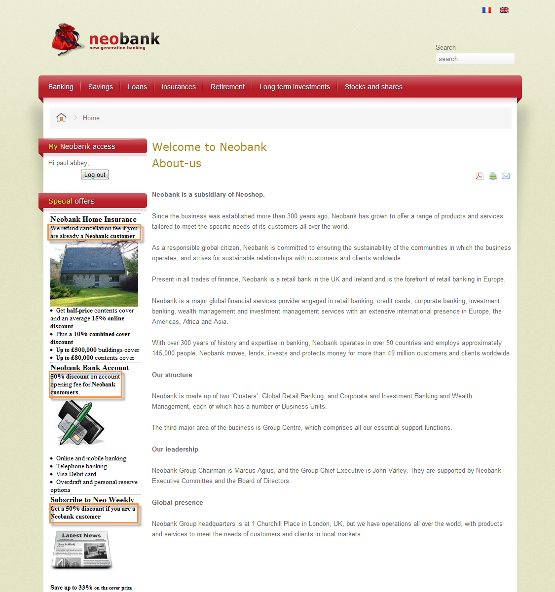

このケーススタディを実装するには、2 つのオファー環境が必要です。1 つは匿名インタラクション用の環境、もう 1 つは識別されたコンタクト向けに設定された特別なオファーを提示する環境です。 識別されたオファー環境については、連絡先がログインせず識別されない場合、自動的に匿名オファー環境へと切り替わるように設定します。

次の手順に従います。

* 匿名のインバウンドインタラクションに特化したオファーカタログの作成手順：

  1. [匿名連絡先向け環境の作成](#creating-an-environment-for-anonymous-contacts)
  1. [匿名環境向けオファースペースの設定](#configuring-offer-spaces-for-the-anonymous-environment)
  1. [匿名環境でのオファーカテゴリの作成](#creating-offer-categories-in-an-anonymous-environment)
  1. [匿名訪問者向けオファーの作成](#creating-offers-for-anonymous-visitors)

* 識別したインバウンドインタラクションに特化したオファーカタログの作成手順：

  1. [識別した環境でのオファースペース設定](#configure-the-offer-spaces-in-the-identified-environment)
  1. [識別した環境でのオファーカテゴリ作成](#creating-offer-categories-in-an-identified-environment)
  1. [パーソナライズされたオファーの作成](#creating-personalized-offers)

* オファーエンジン呼び出しの設定：

  1. [Web ページのオファースペース設定](#configuring-offer-spaces-on-the-web-page)
  1. [識別したオファースペースの詳細設定](#specifying-the-advanced-settings-of-the-identified-offer-spaces)

### 匿名連絡先向け環境の作成 {#creating-an-environment-for-anonymous-contacts}

1. 配信マッピングアシスタントで、匿名インバウンドインタラクション向けのオファー環境を作成します（**訪問者**&#x200B;マッピング）。 詳しくは、[オファー環境の作成](https://experienceleague.adobe.com/ja/docs/campaign/campaign-v8/offers/interaction-settings/interaction-env#create-an-offer-environment){target="_blank"}（Campaign v8 ドキュメント）を参照してください。

   

### 匿名環境向けオファースペースの設定 {#configuring-offer-spaces-for-the-anonymous-environment}

この Web サイトに提示する必要があるオファーは、「**Best Offer**」（ベストオファー）と「**Partner**」（パートナー）の 2 つの異なるカテゴリに属します。 この例では、各カテゴリに特定のオファースペースを 1 つずつ作成します。

「**Best Offer**」カテゴリに対応するオファースペースを作成するには、次の手順に従います。

1. Adobe Campaign ツリーで、先ほど作成した匿名環境に移動し、オファースペースを 1 つ追加します。

   

1. 「**[!UICONTROL インバウンド Web]**」タイプのスペースを新規作成します。

   

1. ラベルとして、例えば、&quot;**Web Best Anonymous Offer**&quot;（Web ベスト匿名オファー）と入力します。
1. このオファースペースに使用されるオファーコンテンツのフィールドを追加し、レンダリング関数を設定します。

   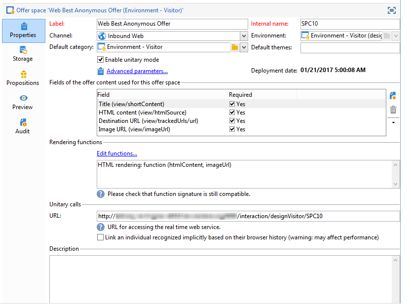

   >[!IMPORTANT]
   >
   >オファーを正しく表示するために、レンダリング関数では、事前に選択された順序のとおりにスペース用のフィールドを列挙する必要があります。

1. 同じ手順で、「**Partner**」カテゴリに対応するインバウンド Web チャネルのオファースペースを作成します。

   

### 匿名環境でのオファーカテゴリの作成 {#creating-offer-categories-in-an-anonymous-environment}

まず、「**Best Offer**」（ベストオファー）および「**Partner**」（パートナー）という 2 つのオファーカテゴリを作成します。 各カテゴリには、匿名コンタクト向けのオファーを 2 件ずつ用意します。

1. 先ほど作成した匿名環境の「**[!UICONTROL オファーカタログ]**」に移動します。
1. **[!UICONTROL オファーカテゴリ]**&#x200B;フォルダーを追加し、&quot;**Best Offer**&quot; というラベルを付けます。

   

1. 2 つ目のカテゴリを作成し、&quot;**Partner**&quot; というラベルを付けます。

   

### 匿名訪問者向けオファーの作成 {#creating-offers-for-anonymous-visitors}

次は、上で作成した各カテゴリ内に 2 つずつオファーを作成します。

1. 「**Best Offer**」カテゴリに移動し、匿名オファーを作成します。

   

1. 「**[!UICONTROL 実施要件]**」タブに移動し、アプリケーションのコンテキストに応じてオファーの重み付けを指定します。

   ホーム ページと保存ページの重み付けを持つ最高のオファー#1匿名オファーの

1. 「**[!UICONTROL コンテンツ]**」タブに移動し、オファーのコンテンツを定義します。

   タイトルがNeobank Bank AccountとHTML content](assets/offer_inbound_fallback_example_032.png)の匿名のベストオファーの

1. 「**Partner**」カテゴリに移動し、匿名オファーを作成します。
1. 「**[!UICONTROL コンテンツ]**」タブに移動し、オファーのコンテンツを定義します。

   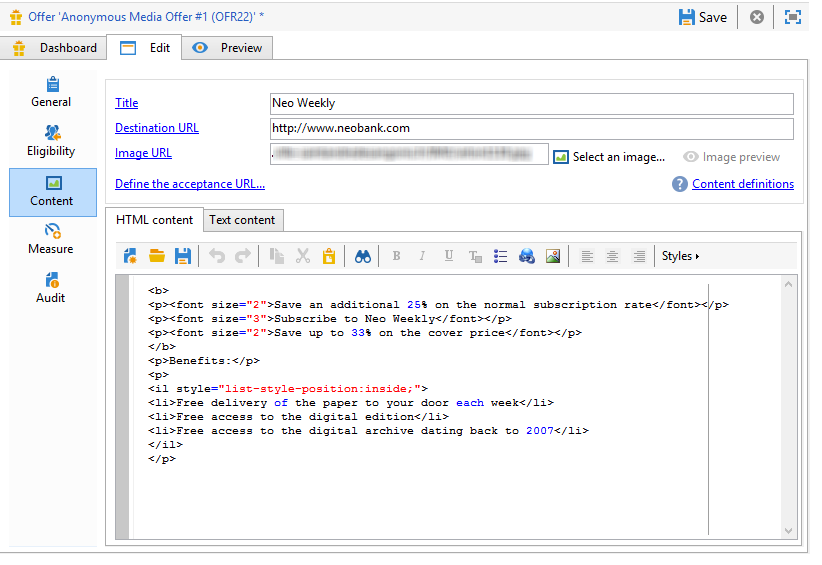

1. 「**[!UICONTROL 実施要件]**」タブに移動し、アプリケーションのコンテキストに応じてオファーの重み付けを指定します。

   

1. 「**Partner**」カテゴリに 2 つ目のオファーを作成します。

   

1. 「**[!UICONTROL 実施要件]**」タブに移動し、このカテゴリの最初のオファーと同じ値の重み付けを適用して、交互に Web サイトに表示されるようにします。

   最初の](assets/offer_inbound_fallback_example_036.png)と同じ、ホームページの重みが3の2番目のパートナーオファーの「実施要件」タブを参照してください。

1. Adobe Campaign ツリー内で、先ほど作成した環境に移動し、「**Best Offer**」および「**Partner**」オファースペースを追加します。
1. [匿名環境向けオファースペースの設定](#configuring-offer-spaces-for-the-anonymous-environment)で説明されているプロセスを実行します。

   

1. 「**[!UICONTROL 個人が識別されなかった場合、匿名環境にフォールバックします]**」オプションを選択します。

   

1. ドロップダウンリストを使用して、先ほど作成した匿名 Web オファースペースを選択します（[匿名環境向けオファースペースの設定](#configuring-offer-spaces-for-the-anonymous-environment)を参照）。

   

### 識別したオファースペースの詳細設定の指定 {#specifying-the-advanced-settings-of-the-identified-offer-spaces}

この例では、Adobe Campaign データベースのメールアドレス情報を利用してコンタクト先を識別します。 受信者のメールをスペースに追加するには、次の手順に従います。

1. 識別された環境で、オファースペースフォルダーに移動します。
1. 「**Best Offer**」オファースペースを選択し、「**[!UICONTROL 詳細設定パラメーター]**」をクリックします。

   

1. 「**[!UICONTROL ターゲット識別情報]**」タブで、「**[!UICONTROL 追加]**」をクリックします。

   

1. 「**[!UICONTROL 式を編集]**」をクリックし、受信者テーブルに移動して、「**[!UICONTROL メール]**」フィールドを選択します。

   

1. 「**[!UICONTROL OK]**」をクリックして&#x200B;**[!UICONTROL 詳細設定パラメーター]**&#x200B;ウィンドウを閉じ、「**Best Offer**」オファースペースの設定を完了します。
1. 「**Partner**」オファースペースについても同じ手順を実行します。

   

### 識別した環境でのオファーカテゴリの作成 {#creating-offer-categories-in-an-identified-environment}

「**Best Offer**」および「**Partner**」という 2 つのカテゴリを作成し、パーソナライズされたオファーを各カテゴリに 2 つずつ用意します。

1. 識別された環境で、「**[!UICONTROL オファーカタログ]**」ノードに移動します。
1. 匿名環境と同様に、**最高オファー**&#x200B;と&#x200B;**パートナー**&#x200B;の2つの&#x200B;**[!UICONTROL オファーカテゴリ]** フォルダーをラベルとして追加します。

   

### パーソナライズされたオファーの作成 {#creating-personalized-offers}

各カテゴリにパーソナライズされたオファーを 2 つずつ、合計 4 つのオファーを作成します。

1. 「**Best Offer**」カテゴリに移動し、1 つ目のパーソナライズされたオファーを作成します。

   」というラベルを付けます

1. 「**[!UICONTROL 実施要件]**」タブに移動し、アプリケーションのコンテキストに応じてオファーの重み付けを指定します。

   

1. 「**[!UICONTROL コンテンツ]**」タブに移動し、オファーのコンテンツを定義します。

   

1. 「**Best Offer**」カテゴリに 2 つ目のオファーを作成します。

   

1. 「**Partner**」カテゴリに移動し、パーソナライズされたオファーを作成します。

   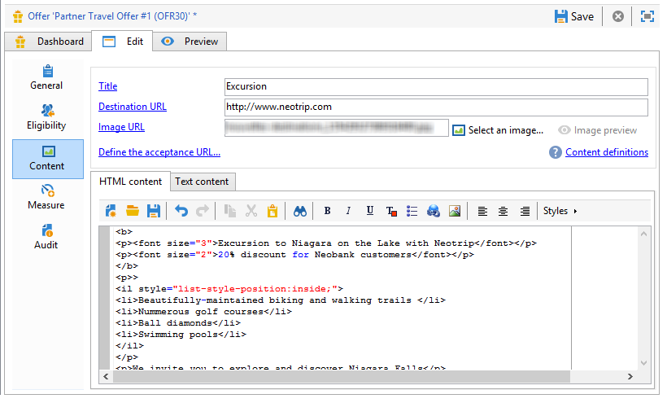

1. 「**[!UICONTROL 実施要件]**」タブに移動し、アプリケーションのコンテキストに応じてオファーの重み付けを指定します。

   

1. 「**Partner**」カテゴリに 2 つ目のオファーを作成します。

   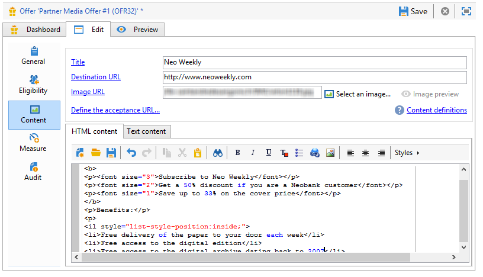

1. 「**[!UICONTROL 実施要件]**」タブに移動し、このカテゴリの最初のオファーと同じ値の重み付けを適用して、交互に Web サイトに表示されるようにします。
1. 各オファーに対して承認サイクルを実行し、更新を開始します。 コンテンツの承認処理では、「**Partner**」または「**Best Offer**」オファースペースを有効化します。

### Web ページのオファースペースの設定 {#configuring-offer-spaces-on-the-web-page}

Neobank の Web サイトにはオファー用のスペースが 3 つあります。そのうち 2 つは、自社の商品やサービスに関する「**Best Offer**」カテゴリのオファー、もう 1 つは、パートナー企業による「**Partner**」カテゴリのオファーです。


これらのオファースペースを Web サイトの HTML ページに設定するには、次の手順に従います。

1. HTML ページのコンテンツに、@id 属性を持つ

   要素を 3 つ挿入します。この @id 属性の値によって、Web サイトの様々なオファースペースに含まれるオファーの呼び出しが実行されます。

   

1. 各種の属性値を定義するスクリプトを挿入します。

   

   この例では、**ContBO1** および **ContBO2** に **OsWebBestOfferIdentified** という値が設定されています。この値は、識別された環境に先ほど作成した「**Best Offer**」オファースペースの内部名です。 **CatBestOffer** および **CatBestOfferAnonym** という値は、匿名環境および識別された環境にある「**Best Offer**」カテゴリの内部名に一致します。

   

   同様に、「**ContPtn**」に設定されている値 **OSWebPartnerIdentified** は、識別された環境に作成した「**Partner**」オファースペースの内部名に一致します。 **CatPartner** および **CatPartnerAnonym** という値は、匿名環境および識別された環境にある「**Partner**」カテゴリの内部名に一致します。

   

1. 変数 **interactionTarget** には、Neobank サイトにログオンするユーザーを識別するための情報を割り当てます。

   でログインするユーザーの電子メールに設定されています

   ユーザーの識別手段としては、ブラウザーの Cookie、URL 内の読み取りパラメーター、メール、ユーザー自身の本人確認情報などが使用できます。 受信者テーブルに含まれる情報のうち、プライマリキー以外のフィールドを使用する場合は、スペースの詳細設定パラメーターに定義する必要があります（[識別されたオファースペースの詳細設定](#specifying-the-advanced-settings-of-the-identified-offer-spaces)を参照）。

1. 呼び出し URL を挿入します。

   env=EnvNeobankIdnRecipを含むinteractionProposal.jsへの

   URLには、識別された環境の内部名である&#x200B;**EnvNeobankIdnRecip**&#x200B;が含まれています。

Web ページを開くと、スクリプトを使用してインタラクションエンジンを呼び出し、Web ページの関連するスペースにオファーのコンテンツを表示できます。 Adobe Campaign サーバーに対する 1 回の呼び出しのみで、エンジンは、選択する環境、オファースペース、カテゴリを認識します。

この例では、識別された環境（**EnvNeobankIdnRecip**）をエンジンが認識します。 また、Web ページに含まれる第 1、第 2 のオファースペースについては「**OSWebBestOfferIdentified**」オファースペースおよび「**Best Offer**」カテゴリ（**CatBestOffer**）を認識し、第 3 のオファースペースについては「**OSWebPartnerIdentified**」オファースペースおよび「**Partner**」カテゴリ（**CatPartner**）を認識します。

エンジンが受信者を識別できない場合は、識別されたオファースペースから参照されている匿名オファースペースへの切り替えがおこなわれ、スクリプトの指定どおり、匿名カテゴリ（「**CatPartner**」および「**CatPartnerAnonym**」）が使用されます。
