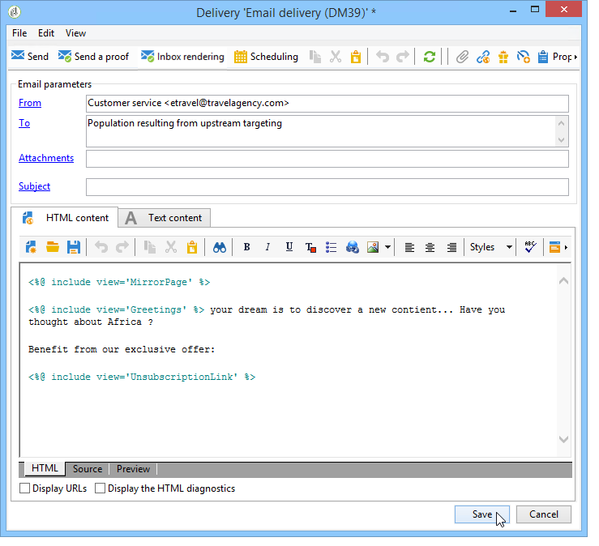

# アウトバウンドチャネルのオファー{#offers-on-an-outbound-channel}

## メールによるオファー配信 {#email-offer-delivery}

データベースにアフリカ旅行のカテゴリがあり、 各オファーの実施要件、コンテキスト、表示域は既に設定されているとします。 これから、メール経由でオファーを提示するためのキャンペーンを作成します。

1. マーケティングキャンペーンとターゲティングワークフローを作成します。

   

1. メール配信を編集し、**[!UICONTROL オファー]**&#x200B;アイコンをクリックします。

   

1. 休暇シーズンに合ったオファー環境用のメールスペースを選択します。

   購読者ジャーニーを含む、利用可能な電子メールスペースが表示されたオファースペースリストを含む

1. アフリカ旅行のオファーを含んだカテゴリを選択します。

   

1. 配信するオファーの数を 2 に設定します。

   に設定されたオファー管理ウィンドウ

1. オファー管理ウィンドウを閉じ、配信のコンテンツを作成します。

   

1. メニューを使用して、最初のオファー提案を挿入し、HTML レンダリング関数を選択します。

   

1. 2 番目のオファー提案を挿入します。

   

1. 配信に含まれるオファーを確認するために、「**[!UICONTROL プレビュー]**」をクリックします。受信者を選択して、そのユーザーが受け取るオファーのプレビューを表示します。

   

1. 配信を保存し、ターゲティングワークフローを開始します。
1. 配信を開き、配信の「**[!UICONTROL 監査]**」タブをクリックします。カタログに格納されている様々なオファーの中からオファーエンジンによって選択された提案を確認できます。

   

## オファーシミュレーションの実行 {#perform-an-offer-simulation}

1. 「**[!UICONTROL プロファイルとターゲット]**」タブで、「**[!UICONTROL シミュレーション]**」リンクをクリックしたあと、「**[!UICONTROL 作成]**」ボタンをクリックします。

   

1. ラベルを選択し、必要に応じて実行設定を指定します。

   

1. シミュレーションを保存します。 新しいタブが表示されます。

   「編集」タブと「シミュレーションを開始」ボタンを持つ1年間の購読者の

1. 「**[!UICONTROL 編集]**」タブをクリックし、「**[!UICONTROL スコープ]**」をクリックします。

   

1. オファーをシミュレートするカテゴリを選択します。

   

1. シミュレーションに使用するオファースペースを選択します。

   

1. 有効制限日を入力します。 ここでは、少なくとも開始日を指定する必要があります。 この情報は、特定の日において有効なオファーを絞り込むためにオファーエンジンで使用されます。
1. 必要な場合は、1 つまたは複数のテーマを選択し、このキーワードが設定に含まれているオファーのみを提案の対象としてオファー数を限定します。

   この例では、「**Travel**」（旅行）カテゴリの下に、2 つのテーマを持つ 2 つのサブカテゴリがあります。 「**Customers>1 year**」（1 年を超える顧客）のテーマに属するオファーに関するシミュレーションを実行することにします。

   

1. ターゲットにする受信者を選択します。

   

1. 各受信者に送信されるオファーの数を設定します。

   この例では、オファーエンジンにより、各受信者に対して重み付けが最も大きい 3 つのオファーが選択されます。

   

1. 設定を保存し、「**[!UICONTROL ダッシュボード]**」タブの「**[!UICONTROL 開始]**」をクリックしてシミュレーションを実行します。

   

1. シミュレーションが完了したら、「**[!UICONTROL 結果]**」タブで、提案の詳しい分類をオファーごとに確認します。

   この例では、オファーエンジンによって 3 件の提案を基にした分類が表示されています。

   オファー別の提案の内訳が表示された

1. 「**[!UICONTROL オファーの分類（ランキング別）]**」を表示し、オファーエンジンによって選択されたオファーのリストを確認します。

   

1. 必要な場合は、スコープ設定を変更し、「**[!UICONTROL シミュレーションを開始]**」をクリックしてシミュレーションを再実行できます。

   

1. シミュレーションデータの保存が必要な場合は、レポートの履歴機能またはエクスポート機能を使用して保存できます。

   
