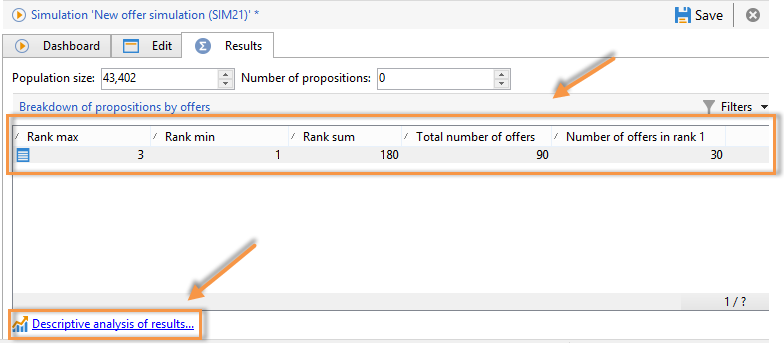
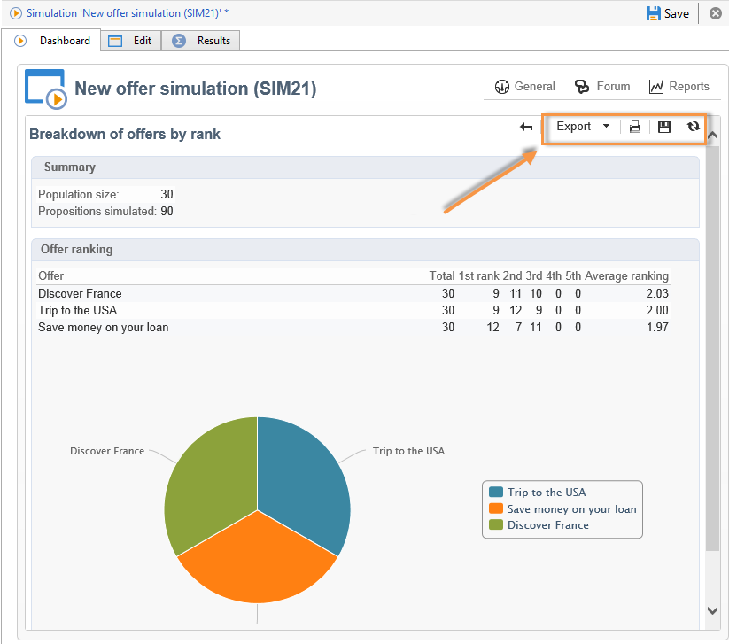

# シミュレーションのトラッキング{#simulation-tracking}

シミュレーションが完了したら、シミュレーション ウィンドウに追加された「**[!UICONTROL 結果]**」タブと、シミュレーション ダッシュボードで利用できる「**[!UICONTROL ランク別オファーの内訳]**」レポートを使用して、その結果を分析できます。

シミュレーションの結果には、提案のランキング別および受信者別の分類が含まれています。 また、レポートの軸も考慮されて、このタブに表示されます。

必要に応じて、結果の記述的分析を作成することで、シミュレーションの結果を保存してエクスポートできます。 それには、結果ウィンドウで適切なリンクをクリックします。

記述的分析アシスタントについて詳しくは、[この節](https://experienceleague.adobe.com/ja/docs/campaign-classic/using/reporting/analyzing-populations/about-descriptive-analysis){target="_blank"}を参照してください。

ピボットテーブルを使用すると、オファーのランキングごとの分類をすばやく確認できます。 Adobe Campaign のすべてのレポートと同じように、エクスポート、印刷、アーカイブまたは web ブラウザーでの表示が可能です。

詳しくは、[この節](https://experienceleague.adobe.com/ja/docs/campaign-classic/using/reporting/creating-new-reports/actions-on-reports){target="_blank"}を参照してください。

